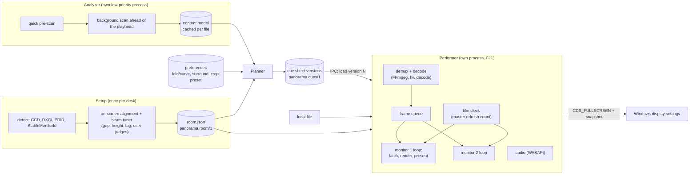

# M1 architecture design

What panorama is made of, how the parts talk, and which hard-to-change choices are settled, on today's evidence. Plain-English terms: a *refresh* is one chance for a screen to show a picture; a *shot* is one unbroken piece of footage and a *cut* is where it ends; the *seam* is the bezel between two screens.

## 1. Answer

1. **Decide ahead, perform live** stays ([0014](../../docs/adr/0014-architecture-plan-ahead-into-a-cue-sheet-perform-live.md)): setup, analysis and planning run before or beside playback; only the performer runs against the clock.
2. **The performer is our own program** on libplacebo + FFmpeg + libass + WASAPI, in C ([0022](../../docs/adr/0022-own-performer-on-libplacebo-and-ffmpeg.md)). Stock mpv can't present to each monitor on its own; it stays as fallback and as the plain-stretched comparison.
3. **One window per monitor, one film clock** ([0021](../../docs/adr/0021-one-window-per-monitor-one-film-clock.md)): the film clock counts the master monitor's refreshes; other monitors switch on their nearest refresh, corrected for panel lag and aimed at the row where things cross the seam. Each refresh is drawn for the moment its own light appears. Measured on Setup A: both screens in hardware overlay, even pace, frame changes within half a laptop refresh (±2.1 ms guaranteed). Setup A has no variable refresh (no G-SYNC), but starting the film on the best-aligned master refresh brought the offset to 0.39 ms at 240 + 96 Hz and 0.16 ms at 240 + 72 Hz.
4. **Zero delay across a bezel, as seen** ([0020](../../docs/adr/0020-motion-crosses-a-bezel-with-no-delay.md), the user's call): the room model holds each seam's gap and height and each monitor's lag and scan time; an on-screen seam tuner sets them while the user only judges.
5. **Picture path per monitor:** one resample from source to the monitor's pixels, then surround, then one colour correction and dither over everything, then subtitles at native pixels.
6. **Cue sheet in process:** an immutable version behind one atomic pointer; each shot keeps the version it started with; presentation changes only at breaks (cut, seek, pause, file start).
7. **Display changes are held by the player** ([0023](../../docs/adr/0023-display-changes-held-by-the-player.md)): Windows undoes them if it dies; a snapshot covers the rest.
8. **Film analysis is a separate worker** ([0024](../../docs/adr/0024-film-analysis-worker-and-content-model-shape.md)): Python, FFmpeg hardware decode, ONNX Runtime; raw per-frame signals plus derived per-shot tables, keyed by timestamps and source pixels. About 1 minute per episode and 5 per film on Setup A, with no dropped frames in playback.

## 2. From requirements to architecture

| Requirement (PRD / ADR) | What it forces |
|---|---|
| No stutter; even pace on every picture monitor | each picture monitor at a whole multiple of the playback rate: built-in, custom mode or variable refresh; per-monitor presentation |
| Both sides of a bezel in step, zero delay as seen (0020) | one film clock; per-monitor switch timing corrected for lag and scan; calibrated gap |
| Camera slides smooth (0016) | renderer knows each refresh's light time; per-refresh sub-pixel shift; fill for the uncovered strip |
| Exact cues, no shot changes on screen (0014) | cue lookup by the drawn frame's timestamp; per-shot latch; refinements only for shots not yet started |
| One resample, never distorted, picture continues behind bezels (0001, 0009) | per-monitor render straight from source to native pixels; geometry in physical mm |
| Colour match across monitors | one linear-light correction stage per monitor, last, over picture and surround, dithered |
| Dialogue inside one screen (0013) | subtitles rendered per monitor, placed by the cue |
| Analysis never slows playback (0010, 0014) | analyzer in its own low-priority process; results cached per file |
| Settings always come back (0005) | player-held temporary changes + snapshot |
| License open until after the demo | process boundaries; dynamically linked LGPL libraries; no mpv code in our files |

## 3. System view

Processes: setup, analyzer, planner and performer are separate programs talking through files and a named pipe. The planner can run inside the setup/UI process; the analyzer never shares a process with the performer.

## 4. The performer

| Part | Job | Notes |
|---|---|---|
| demux + decode | FFmpeg reads and decodes once; hardware decode on the GPU that drives the monitors | D3D11VA import is ours to write (libplacebo's helpers lack it); Vulkan Video works through libplacebo's helpers |
| audio | WASAPI shared, event-driven; audible position from `IAudioClock` + QPC | audio follows the master display by resampling (display-resample idea from mpv), never the other way |
| film clock | counts the master monitor's refreshes; playback speed nudged so the master's rate is a whole multiple of the film rate; film time is a time and frames are picked by their own timestamps (variable-frame-rate files work) | master = slowest monitor carrying the picture; every break restarts the clock on one master refresh chosen ahead of every monitor's render lead, and all queues reset on it |
| per-monitor loop | waits for its refresh, computes the film time for the moment its light appears, latches the shot's cues, renders, presents itself | followers pick the refresh nearest the master's switch (lag-corrected, aimed at the crossing row), with hysteresis, moving only at cuts; with three screens they chain to their neighbour; exact timing only with variable refresh; render lead configurable per monitor |
| devices | one rendering device per graphics adapter that drives a monitor | hybrid laptops and Setup B can put screens on the integrated GPU; D3D11 `pl_gpu` is not thread-safe, Vulkan's is; P1 decides between them |
| cue latch | one atomic pointer to an immutable cue-sheet version; each shot keeps the version it started with | the break rule: presentation changes only at a cut, seek, pause or file start |
| control | named pipe, JSON: load version N, seek, pause, status, diagnostics | the planner never needs the playhead for correctness |
| diagnostics | frame numbers, per-monitor flip times, overlay state | same measurements as today's spikes |

## 5. Picture path (per monitor, per refresh)

From the [engine research](researcher-261011-1247-performer-engine-and-picture-path.md) section 4:

1. **Picture:** libplacebo renders the frame (mixed for this refresh's time) into a linear-light canvas the size of the monitor. The source crop is the cue's crop plus, in a camera slide, this refresh's sub-pixel offset; the target crop is where the picture lands on this monitor. One high-quality resample. Fold geometry is exactly this; smooth-curve geometry needs one custom per-pixel pass at this stage.
2. **Surround:** edge colours of the picture, smoothed over time in the shader's own state, fill the leftover area (no resample).
3. **Finish:** the monitor's colour correction in linear light, over picture and surround together, then encode and dither to the panel's bit depth.
4. **Subtitles:** libass bitmaps drawn last at the monitor's own pixels; dialogue on the monitor the cue names.

Only pass 1 resamples. A slide uncovers a strip at the picture's edge; the neighbouring frame fills it before pass 1 draws. Rows light up one after another as the screen scans, so in a slide each row gets the offset for its own moment (a slight shear per refresh, as the seam tuner already draws); one offset per refresh would leave about 3 mm of skew at 300 mm/s on a 10 ms scan.

## 6. Data contracts, v0 sketches

All plain JSON, versioned by a `schema` field, readable and writable by hand. Conventions all contracts share, to be fixed in phase 05/06:

- **Timeline:** seconds from the first video frame of the file (mpv's rebased timeline); to define for edit lists, negative timestamps and MKV ordered chapters (per segment).
- **Surface coordinates:** u = distance along the picture surface (arc length), v = height, in mm, so cues survive a switch between fold and smooth curve.
- **One vertical convention:** the room's seat frame has +y up, screen pixels have y down; one conversion function with a round-trip test.
- **Refinements** never move a shot boundary before the commit horizon; slide paths are stored in source pixels and converted per monitor.

- **Room** (`panorama.room/1`, from the [room research](researcher-261011-1247-room-model-and-display-settings.md) section 2.3): seat frame in mm (origin at the eye); per monitor: identity (`StableMonitorId`, EDID hash), panel (native pixels, active area in mm with sanity flags), pose (centre, yaw, pitch, roll, bezels; from alignment), timing (modes as pixel clock + totals + rational rate; verified custom modes; variable-refresh range per link; scan fraction; **lag in ms**), colour (EDID, Windows ACM/HDR state, correction). Derived seams: gap, height offset, hinge. New today: lag and scan time come from the seam tuner (stored with the backlight levels they were tuned at); each monitor also records its graphics adapter and scan direction.
- **Content model** ([0024](../../docs/adr/0024-film-analysis-worker-and-content-model-shape.md); fields in the [film analysis research](researcher-261011-1247-film-analysis-content-model.md) section 5): file facts (identity, streams, frame rate and whether it varies, crop vocabulary, black level, text-in-bars per side, Dolby Vision active area); raw per-frame signals (shot scores, crop, bar-strip peaks, brightness, slide shift and purity); per-shot tables (boundary kind and span, crop with confidence, subjects and a keep-clear map, slide run, motion and brightness); slide paths as per-frame positions with confidence; subtitle events per track with a dialogue/sign class and rendered box. Times are frame timestamps; positions are source pixels.
- **Preferences:** surface (fold, or curve with its curvature), surround style, crop preset, subtitle size.
- **Cue sheet** (`panorama.cues/1`): header (file hash, room signature, preferences hash, version); per shot: start (halfway between frames on the rebased timeline), crop (source pixels), picture placement on the surface (centre and height in mm), subtitle monitor, surround settings, time treatment (as filmed, or the slide path); per film: display modes per monitor and the master. Geometry and colour per monitor come from the room model, not copied.

## 7. Decisions so far

| M1 question | Decision | Evidence | Record | State |
|---|---|---|---|---|
| Pace | one window per monitor, film clock from the master's refreshes, nearest-refresh followers with lag and row aim | [per-monitor spike](spike-261011-1247-one-window-per-monitor.md), [presentation research](researcher-261011-1247-per-monitor-presentation-and-sync.md) | [0021](../../docs/adr/0021-one-window-per-monitor-one-film-clock.md) | accepted |
| Motion target | zero delay across a bezel, as seen | the user, after watching the spike | [0020](../../docs/adr/0020-motion-crosses-a-bezel-with-no-delay.md) | accepted |
| Engine | own C11 performer on libplacebo + FFmpeg + libass + WASAPI; mpv core + own video output as fallback | [engine research](researcher-261011-1247-performer-engine-and-picture-path.md) | [0022](../../docs/adr/0022-own-performer-on-libplacebo-and-ffmpeg.md) | accepted, gated by P0-P3 |
| Display settings | player-held `CDS_FULLSCREEN` changes + snapshot; guardian only for persistent changes | kill test in the [room research](researcher-261011-1247-room-model-and-display-settings.md) | [0023](../../docs/adr/0023-display-changes-held-by-the-player.md) | accepted, more triggers to test |
| Picture path | four passes above, one resample | engine research section 4 | phase 03 ADR | proposed (P4) |
| Plan and cue sheet | in-process latch, immutable versions | engine research, refinement spike | phase 05 ADR | proposed (P3) |
| Room | `panorama.room/1`, identity by `StableMonitorId` | room research | phase 06 ADR | proposed; Setup B facts open |
| Film analysis | separate Python worker on FFmpeg hardware decode + ONNX Runtime; raw signals + derived tables; crops by per-shot union snapped to the file's vocabulary | [film analysis research](researcher-261011-1247-film-analysis-content-model.md) | [0024](../../docs/adr/0024-film-analysis-worker-and-content-model-shape.md) | accepted; detectors settled by its spikes S1-S10 |

## 8. What M1 still has to prove

| Check | Settles | State |
|---|---|---|
| Seam tuner, by eye | gap, height, lag on Setup A; whether the felt delay goes | ready, waiting for the user |
| Custom 96/72 Hz | even 24 fps pace on the external | tool ready (`spikes/custom-refresh/`), approved, needs the user at the dialog |
| P0 toolchain and playback | the engine builds and plays here | done: D3D11 with our own `Present`, 0 late or skipped frames; Vulkan jittery ([report](spike-261011-1247-performer-toolchain-p0.md)) |
| P1 two-window presenter on libplacebo | the measured scheme survives the real renderer | running |
| P2 pan mode, P3 cues and seek latch, P4 picture path, P5 audio, P6 subtitles | the rest of the performer | after P1 |
| G-SYNC for borderless windows | the exact-time follower | not available on Setup A (no G-SYNC page); aimed start used instead (0.16-0.39 ms) |
| Seam threshold test | how close is close enough below zero | clip ready, lower priority |
| Setup B probe | nothing assumes two side-by-side screens | needs Setup B connected |
| Fast-scan custom timings | custom modes keep the native scan speed | tool updated; plans verified (96 Hz: 2000 x 1160 at 222.72 MHz, 9.70 ms scan) |
| Phone slow-motion of the tuner at the tuned values, and a grey field | panel lag vs perception; scan direction; PWM flicker | needs the user's phone (≥ 240 fps) |
| Brightness change during tuning | how much perception moves the tuned lag | by eye, 10 min |
| Clock simulation with jitter, drift, hysteresis, 25 fps and a real variable-frame-rate trace | the clock rules before P1 | offline |
| File matrix smoke test in P0 | ordered chapters, interlaced, PGS, 10-bit HEVC, variable frame rate | with P0 |
| Seek while a swap is in flight (P3) | all screens switch on the same master refresh | with P3 |

## 9. Risks

- **Engine effort.** A/V sync, hardware-decode import and seeking are real work. Response: P0 and P1 first; fallback to mpv's core with our presenter as its video output.
- **Overlay lost under the real renderer** (subtitles, colour stage, a control window). Signal: frame statistics report "composed". Response: check in P1/P4; keep controls off the picture windows.
- **Setup B's 60 Hz screen** scans in 16 ms against 3.7 ms on a fast panel and has no variable refresh: up to ±6–8 ms remains above and below the aimed row. Response: setup reports it; the planner can keep fast motion off that seam; hardware advice.
- **FFmpeg 9 vs libplacebo's helpers** (tested to FFmpeg 8). Response: pin FFmpeg 8.x if P0 fails.
- **150% display scaling** on the laptop. Response: per-monitor DPI awareness in every window.
- **Lag is not one number.** Rise and fall times differ, overdrive and brightness shift perceived timing (roughly 15 ms per tenfold luminance). Response: match brightness before tuning lag; store backlight levels with the lag; retune when they change; camera check.
- **Backlight flicker (PWM)** on a dimmed laptop panel can look like a seam artifact on one side. Response: prefer brightening the dimmer screen; check with a grey field on camera.
- **The long tail of files.** Response: supported-file matrix from P0; stock mpv as a per-file fallback.

The [red-team review](red-team-261011-1247-m1-architecture.md) (verdict: go with changes) led to the clock rules in section 4, the row shear in section 5, the shared conventions in section 6, the experiments added to section 8 and the last three risks.

## 10. Unresolved questions

1. Does the seam tuner remove the delay the user felt, and what are the real gap and lag values?
2. Does the external accept 96 or 72 Hz?
3. Answered: no variable refresh on Setup A. Remaining seam terms: scan speed (laptop 3.7 ms vs external 9.7 ms per screen, ±3 ms above and below the aimed row) and panel lag. Could a laptop custom mode that slows its scan to match the external's close the first? (experiment)
4. Which detectors ship (shot bake-off, real scope/IMAX films, faces at planner level, subtitle corpus, slide purity)? Needs labelled test material from the user's library.
4b. Dialogue lines are wide (median 41% of the frame), so nearly every centred line would cross a middle seam: re-wrap into narrower lines, shrink, or move to one screen as-is? A what-you-see choice.
5. Setup B: which three screens, sizes, orientation, gaps, ports, which graphics adapter each?
6. When no picture monitor's rate is a multiple of the film rate, which rung first: custom mode, variable refresh, a speed nudge up to 1%, blending frames on that monitor, or keeping the picture off it? A what-you-see choice for the user.
7. Does a Vulkan swapchain reach hardware overlay here with default driver settings, and on the AMD 610M at all?
