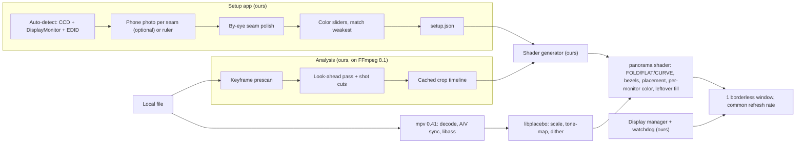

# Research Synthesis: panorama concept demo (SOTA pass)

Conducted 2026-10-10, 18:46–19:22 (Asia/Bangkok). 5 parallel researchers, max 5 web calls each, plus read-only local probes on this PC (assumed Setup A). Detail, sources and tags live in the topic reports (links at end); this file only merges them.

## Contents

1. Key takeaways
2. Setup A facts (measured on this PC)
3. Proposed concept-demo architecture
4. Build on (verified, dated)
5. Build ourselves
6. Spikes before building
7. Decisions needed from the user
8. Evidence quality
9. Topic reports
10. Unresolved questions
11. Next steps

## 1. Key takeaways

1. **Core tension: "crop none" vs side-by-side landscape screens.** Picture is height-fitted, so extra landscape screens add 0% size for 16:9 (most anime) and at most +34% height for 2.39:1 (same for 2 or 3 screens). Mixed sizes can shrink a spanning picture (14" laptop + 24" example: 22–42% smaller than the 24" alone; depends on sizes and seating). Leftover canvas = 33–75% of the area for common content. Unless the arrangement or the crop policy changes, the extra screens mostly serve as periphery. Needs a user decision (D1).
2. **Bezels.** No study of film/video viewing across bezels exists; only HCI task studies (object split across bezel hurts; time/error otherwise unchanged). Hide-strip is physically correct (motion keeps its true path); skip makes things jump. Neither removes the black stripe → the real lever is placement: keep faces and picture centre off seams, change placement only at shot cuts. Hide-strip costs ~1–3% of picture width (30 px per seam on 27" 1440p at 7 mm gap). Lens strips (ASUS ROG Bezel-Free Kit, 2018) = legacy, optional.
3. **Geometry.** Coplanar screens → FOLD, FLAT and CURVE are the identical picture. Differences only with toe-in (FOLD kinks lines at seams) or depth offsets (laptop nearer than monitor: FOLD can't fix, seat-referenced models can). One ray-cast renderer with a FOLD/FLAT/CURVE switch (sim-racing per-monitor projection, Pannini curvature knob). Nothing existing does bezel-aware panoramic video mapping → this is the project's novelty.
4. **Setup.** Windows knows pixels, refresh, positions, rotation exactly; EDID physical size only roughly (external monitor here: 3–4% off, primaries are fake defaults). Bezels, gaps, physical alignment, angles, eye position are undetectable. Simplest flow: auto-detect → optional phone photo per seam (or ruler numbers) → by-eye seam polish → color sliders → saved per monitor. ~2–3 min Setup A, ~4–6 min Setup B. Phone-photo method: no prior art found; simulation says angles ≤ ~1° and eye ±1–3 cm, gap accuracy limited by EDID scale → finish by eye.
5. **Color (#2).** Per-monitor correction inside the player, last stage, linear light, dithered; match everything to the weakest panel via on-screen patterns + sliders; optional colorimeter import. Windows ACM is on for the laptop and off for the external here → treated differently by the OS. DDC/CI failed on both panels. Don't depend on MHC2 (experimental, 24H2 bugs). Phone-camera color: starting guess at most.
6. **Smooth playback (#3).** mpv 0.41.0 + libplacebo 7.360.1 is the only maintained open stack with shader hooks and D3D11/Vulkan. libmpv embedding rejected (render API = OpenGL/software only). Demo: stock mpv + generated shader, one borderless window across all screens, all screens on one common refresh rate. Product: one flip-model window per monitor on libplacebo (likely an mpv fork), decided after spikes. Refresh switching: non-persistent + out-of-process watchdog.
7. **Black bars (#4).** No system uses whole-file look-ahead → gap we can own. Keyframe prescan (<1 s) gives a crop vocabulary; background pass ahead of the playhead (~24× realtime on NVDEC here, ~5 min per 2 h film); decide per shot, cache per file, apply exactly at cuts. FFmpeg 8.1 `cropdetect` with safe settings (defaults cut real picture). Text-in-bars guard. Literal "when in doubt, don't crop" = bars back on every dark scene = breaker #4 → replace (D3).
8. **Leftover area.** Generative outpainting out for now: SOTA (HL-OutPaint, SIGGRAPH 2026) ~12.6 s/frame on an A100 ≈ 25 GPU-days per 2 h film, no code released, no anime tests. Demo: one parametric edge-extension shader (glow/blur/mirror = settings) A/B vs black; real picture untouched. Risk: smooth fills may expose monitor color mismatch.
9. **Subtitles (#5).** Anchor dialogue inside one monitor (safe zone); typeset signs are part of the picture and can't be controlled.

## 2. Setup A facts (measured on this PC)

| Item | Value | Note |
|---|---|---|
| Laptop panel | AUO 2560×1600, 240 Hz, EDID 344×215 mm | size exact; ACM on |
| External | EGM22F100H 1920×1080, 100 Hz, EDID 480×260 mm | size 3–4% off; fake sRGB primaries; ACM off |
| GPU | RTX 5070 Ti Laptop | both outputs report one adapter LUID |
| DDC/CI | failed on both (0xC0262582) | laptop brightness via WMI works |
| Cadence | 100 Hz has no whole-number 24p cadence | check 48/72/96/120 Hz support |

## 3. Proposed concept-demo architecture

## 4. Build on (verified, dated)

| Component | Version / date | Status | Use |
|---|---|---|---|
| mpv | 0.41.0 (2025-12-21); rolling Windows build 2026-10-09 | maintained [V] | decode, A/V sync, libass, shader host |
| libplacebo | 7.360.1 (2026-03-13) | maintained [V] | scaling, tone mapping, dithering |
| FFmpeg | 8.1 (on this PC) | maintained [V] | cropdetect, scdet, signalstats |
| PySceneDetect | 0.7.1 (2026-07-21) | maintained [S] | fallback shot detection only |
| OpenCV ChArUco + solvePnP | 4.8.0 tested locally; current release not verified | assumed maintained | phone-photo geometry — re-verify version |
| Windows CCD API + DisplayMonitor | Learn page 2025-11-21 | current [V/L] | detection, refresh switching |
| ArgyllCMS | 3.5.0 (Feb 2026) | [S] — verify | optional colorimeter import |
| ASUS ROG Bezel-Free Kit | 2018 | legacy | optional hardware, Setup B only |

Not building on: libmpv render API (OpenGL/software only), madVR (can't bundle), Windows MHC2 (experimental), DDC/CI (failed here), generative outpainting (cost, no code), 2026 ML shot detectors (research code only).

## 5. Build ourselves

- Physical model + shader generator: FOLD/FLAT/CURVE, hide/skip bezels, placement, per-monitor color, leftover fill. The novelty.
- Layout planner: per-shot placement keeping faces/centre off seams, re-planned at the same cut as any crop change.
- Look-ahead crop timeline: prescan + vocabulary, per-shot union + snap + hold, text-in-bars guard, cache, cut-synchronous application.
- Setup app: EDID sanity layer, optional photo solver (board sizing, chaining, confidence), by-eye seam tuner, color sliders, persistence by EDID identity.
- Display manager: rate chooser, non-persistent switch, snapshot, watchdog.
- Subtitle safe zone.
- A/B harness: hotkeys, blind randomised swaps, test patterns T1–T9, clip list, PresentMon/mpv stats logging.

## 6. Spikes before building

Cheap checks on Setup A (then B). Each closes an unverified claim.

| # | Question |
|---|---|
| S1 | Can a stock mpv user shader draw the whole canvas, including the leftover area outside the video rectangle? (both reports flag this) |
| S2 | Present mode per output for one spanning window (PresentMon); any independent flip? |
| S3 | Mixed vs unified refresh on the same clip: visible stutter? |
| S4 | Exact refresh modes per monitor (does the external offer 48/72/96/120 Hz?) |
| S5 | Does a non-persistent mode change revert after a hard kill on Win11 26200? |
| S6 | Hybrid-GPU wiring of Setup A and cross-adapter jitter |
| S7 | Shader hook order vs dither and subtitle overlay in gpu-next |
| S8 | Phone-photo field test: 3 photos vs ruler/protractor (targets: angle ≤ 1°, eye ±3 cm) |
| S9 | Size the later per-monitor renderer (read mpv VO code, d3d11 composition mode) |

## 7. Decisions needed from the user

| ID | Decision | Research input |
|---|---|---|
| D1 | Direction for the core tension: periphery as main immersion for 16:9 / arrange screens closer to content shape / opt-in crop preset / mix. Also: Setup B orientation. | §1.1 |
| D2 | Bezel strategy: placement planner (faces/centre off seams, change at cuts) as the main lever; allow hide-strip (~1–3% width) as an exception to crop-none? | §1.2 |
| D3 | Replace "when in doubt, don't crop" with "hold the last confident crop; no crop only when nothing is confident yet". | §1.7 |
| D4 | Phone allowed as an optional setup helper? | §1.4 |
| D5 | Accept the demo package: stack (§3–4), leftover A/B black vs edge shader, color sliders matched to weakest, look-ahead crop timeline. | §3–5 |

## 8. Evidence quality

- Web budget was 5 calls per researcher (research skill rule); multi-topic searches only searched their first topic. Several claims are prior knowledge [K]/[B], local measurement [L], or simulation — flagged in each report.
- Strong: mpv/libplacebo versions, FFmpeg behaviour (tested locally), Windows detection on this PC, outpainting cost (one paper, authors' numbers).
- Weak: DWM/DXGI multi-monitor behaviour, hybrid-GPU behaviour, madVR/Envy internals, immersion evidence for periphery fills (old, abstract-level), anime-specific behaviour of every component.
- Researchers also ran read-only local probes (FFmpeg tests on 6 short local clips, display API queries, EDID from the registry, an OpenCV simulation). Two wrote notes to their own agent-memory folder. No project file besides the reports was touched (checked).

## 9. Topic reports

- [Bezels, perception and geometry model](researcher-261010-1846-bezels-perception-and-geometry-model.md) — test plan with arms C0–C6, patterns T1–T9, clips, 7 predictions
- [Setup calibration and color matching](researcher-261010-1846-setup-calibration-and-color-matching.md)
- [Black-bar detection: fast start + steady crops](researcher-261010-1846-black-bar-detection-fast-start-steady-crops.md) — FFmpeg commands, metrics
- [Unused canvas area: periphery and outpainting](researcher-261010-1846-unused-canvas-area-periphery-and-outpainting.md)
- [Windows rendering and smooth multi-monitor playback](researcher-261010-1846-windows-rendering-and-smooth-multi-monitor-playback.md) — demo and product diagrams, refresh algorithm

## 10. Unresolved questions

1. Setup B physical layout: orientation, sizes, angles, which monitor is the odd brand.
2. Does any fill beat black on a desk multi-monitor setup, and does it make the odd monitor more visible? (demo decides)
3. Does any arm make a seam through a face acceptable, or is avoidance the only answer? (demo decides; prediction H7: avoidance only)
4. DWM behaviour with mixed refresh rates on current Windows 11; independent per-display refresh shipped or not.
5. Anime-specific behaviour: crop detection, upscalers, shot detection.
6. Current OpenCV release; ArgyllCMS/DisplayCAL-py3 status; VACE license.
7. License choice (deferred to after the demo; keep geometry/calibration code GPL-free).

## 11. Next steps

1. User answers D1–D5 → record as ADRs.
2. Run spikes S1–S8 on Setup A.
3. Write the concept-demo plan (phases: setup app, analysis, shader generator, display manager, A/B harness).
