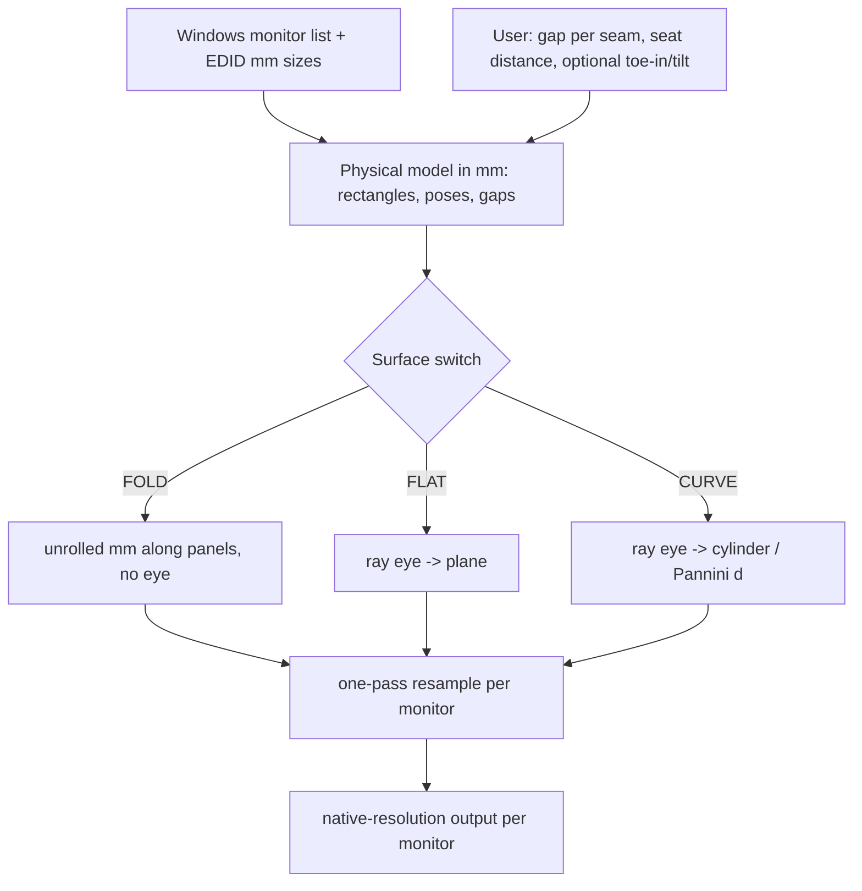

# Research Report: Bezels, perception, and the multi-screen geometry model

Timestamp: 2026-10-10 18:46 (Asia/Bangkok, UTC+7). Topic 1 of 5 in the panorama SOTA pass.

Evidence tags used everywhere:
- **[V]** seen in a web result this pass. Snippet/summary level, page NOT read in full.
- **[B]** background knowledge, NOT re-verified here.
- **[C]** my own calculation (assumptions stated next to it).

## Contents

1. Executive Summary
2. Research Methodology (incl. coverage gaps)
3. Key Findings: 3.1 Technology Overview, 3.2 Current State & Trends, 3.3 Best Practices, 3.4 Security, 3.5 Performance
4. Comparative Analysis
5. Implementation Recommendations
6. Recommendation for the concept demo (incl. test scenes and A/B matrix)
7. Resources & References
8. Appendix: Glossary
9. Unresolved questions

Question map: Q1 perception = 3.1.1, 3.2.1 | Q2 beyond hide/skip = 3.2.2-3.2.4, 4.2 | Q3 geometry = 3.1.2-3.1.4, 4.1 | Q4 combination + loss = 3.1.5, 4.3 | Q5 test scenes = 6.3.

---

## 1. Executive Summary

**Bezels / perception (Q1, Q2).** No study of film or video viewed across bezels was found (one dedicated query plus four incidental ones; the literature is task-centric HCI). What exists [V]: bezels do not change visual-search time or error rate, but splitting an object across a bezel hurts search accuracy and bezels hurt straight-line steering (CHI 2010); bezel presence affects magnitude judgments from a distance (2014); bezel size and compensation had minimal effect on gaming performance (2015); bezel effect on gaze decays after a short exposure. So the user's belief "hide/skip will not solve bezels" is plausible but unproven either way for video. My assessment [B/C]: hide-the-strip is the physically correct default (lines and motion stay on their true path; "skip" makes everything jump by the gap) and costs about 0.9-1.7% of picture width at a 7 mm gap (up to ~5% at 20 mm), but it does nothing about the opaque black stripe itself. A 7 mm gap is 8 arcmin wide even at 3 m, always resolved, so the goal is "tolerable", never "invisible". Only three things attack salience: avoidance (shift the picture so faces miss the seam, at cuts; no literature, pure hypothesis), optics (ASUS-type lens strips: real, but 130 degree toe-in, <13 mm bezels, dimming), or habituation.

**Geometry (Q3).** Sim-racing practice [V, undated community tools] = one view per monitor from the seat (toe-in = per-panel angle; bezel compensation = border + gap + border). For a flat video the same ray-cast onto a virtual surface gives FLAT (plane) or CURVE (cylinder / Pannini); FOLD is the zero-input special case. With coplanar monitors all three are the same picture. With toed-in monitors FOLD bends horizontal lines at the seams ([C] 1.3 to 16 degrees for 15-53 degree toe-in, lines 5-18 degrees off eye level), jumps the angular scale by about 10% at 15-30 degree toe-in, and cannot fix monitors at different distances (laptop nearer than the monitor). CURVE removes all three but needs the seat. No automatic wide-FOV projection exists (2024 paper [V]), so expose one curvature parameter. Prediction (to be settled by eye): FOLD wins on coplanar setups, CURVE wins on toed-in or mixed-depth setups.

**Scope consequences found while quantifying (Q4), for the lead.** Under ADR 0001 (height-fit, nothing cropped) on landscape monitors [C]: a 16:9 picture on 3x27" never touches a seam (598 mm vs 597.7 mm centre monitor); a 2.39:1 picture crosses both seams 12% in from its edges; two monitors put the seam through the picture centre. Hidden-strip loss is 30 px per crossed seam (7 mm, 27" 1440p). Mixed sizes dominate bezels: laptop 14" + 24" caps a seam-crossing picture at the laptop's 174 mm height (vs 299 mm on the 24" alone), a 22-42% shrink against a 2-3% bezel loss. Second screens add picture size only for wide content: 16:9 gains 0%, 2.39:1 gains up to +34% height, same for 2 or 3 monitors. Evidence limits: 5 web calls; each extended search ran only its first topic, so amodal-completion papers, video-wall bezel docs, MPCDI/nDisplay, Nvidia Surround and 2025-26 hardware trends are [B] or unverified.

**Ranked bottom line**
1. Geometry: one ray-cast renderer with a surface switch (FOLD / FLAT / CURVE with Pannini-style parameter d). Default by measured toe-in and depth offset (hypothesis: FOLD if toe-in <= ~10 degrees and equal depth, else CURVE).
2. Bezel: hide-strip via geometry (gap lives in the physical model) = default. Face/seam-aware placement at cuts = experiment. ASUS-type lens kit = optional Setup B experiment only. Skip = control arm only.
3. Test: 7 arms, two stages, forced hard placements, blind hotkey swaps, winner gate >= 9/10 or >= 15/20 consistent choices.

---

## 2. Research Methodology

- **Web calls: 5 of 5**, all mode "extended": (1) bezel-perception papers; (2) optical bezel concealment, narrow-bezel trend, video-wall compensation; (3) sim-racing triple-screen projection; (4) multi-projector/MPCDI, Pannini, Vishwanath, Carroll; (5) video/film perception on bezeled displays.
- **Tool lesson:** calls 1-4 were multi-topic (4 sub-topics each); each ran ONE search covering the first topic only. Uncovered as a result: Mackinlay & Heer 2004, amodal-completion literature, video-wall bezel-compensation docs, 2025-26 narrow-bezel/microLED trend, Nvidia Surround bezel correction, off-axis frustum math, MPCDI/nDisplay, Vishwanath et al. 2005, Carroll et al. 2009. All items on that list are tagged [B] or "not found/not searched" below.
- **Local compute:** one inline Python script (no files): pixel pitch, hidden px, angular size, FOLD kink, seam arithmetic, binomial tails.
- **Project docs read:** README.md, ADR 0001, 0006, 0007.
- **Date range:** 2005-2026. Newest verified source: 2024. Foundational perception/geometry items are older and flagged with year; nothing newer that supersedes them was found (but the search could not look).
- **Key search terms:** bezel tiled display perception; interior bezels visual search tunnel steering; wideband displays seams; bezel concealment lens Fresnel; ROG Bezel-Free Kit; video wall bezel compensation; sim racing triple screen FOV bezel compensation; Pannini projection; MPCDI warp blend; film video bezel perceptual study.
- **Credibility weighting:** peer-reviewed (ACM CHI/GI, Eurographics) > official engine docs > vendor pages > community calculators (undated) > retail/forum/social (used only to show availability).

---

## 3. Key Findings

### 3.1 Technology Overview

#### 3.1.1 What makes a bezel-split picture read as one? (Q1)

| Factor | Mechanism | Evidence | So what |
|---|---|---|---|
| Occlusion / window frame (amodal completion) | Bezel = opaque object in front of the picture; brain continues contours behind thin occluders; strength falls as the gap grows relative to the visible contour length | [B] Kellman & Shipley 1991 (not re-verified). HCI [V]: splitting objects across bezels still hurts accuracy (CHI 2010), so completion is partial | Long contours (horizon, edges) survive a 7 mm stripe; small features at the seam (eyes, letters) do not |
| Why the window analogy is weaker than it sounds | A real window frame sits in front of a far scene. A bezel is millimetres from the image plane, so it also reads as a black line drawn on the picture. Counter: depicted depth is "behind the screen", so "scene behind a mullion" is also plausible | None found (reasoning) | Do not expect completion to hide the stripe; supports the user's belief |
| Motion continuity | Hide-strip: object vanishes for g/v then reappears on its true path (tunnel effect [B], Burke 1952 / Michotte). Skip: object jumps by g | [C] 7 mm at 0.6 m = 0.67 degrees: vanish time 0.33 s at 2 deg/s, 84 ms at 8 deg/s, 34 ms at 20 deg/s. Cross-panel timing mismatch acuity depends on object speed and bezel width (QoE study 2011 [V]; thresholds not read) | Hide-strip is correct for motion; frame sync across monitors is mandatory |
| Faces | No study found | [C] 7 mm hides ~21% of an eye width in a close-up (face 60% of frame height, ~150 mm wide) and ~63% of an eye width in a medium shot (face 20% of frame height, ~50 mm wide). Assumes face width = 0.75 x height, eye width = 0.22 x face width [B anthropometry] | Even perfect compensation removes a feature-sized slice; the stripe itself will draw gaze |
| Text | No study found | [C] subtitle at 5% frame height = 17 mm tall, ~8 mm per character; a 7 mm strip erases about one character | Subtitles must sit inside one monitor, off the seams (illusion breaker 5) |
| Bezel width vs distance | See angular table below | [V] from a distance bezel presence affects magnitude judgments, at arm's length less except lengths (GI 2014); bezel size/compensation minimal effect on gaming performance (2015); unnamed newer studies: spanning targets found more accurately, bezel width effect on search time <0.5% (snippet only) | Bezel never invisible; effect on tasks is small; effect on "oneness" untested |
| Habituation | Gaze effect of bezels decreases after a short period [V, eye-tracking study, year not shown] | | Favourable for 2-hour films, unquantified |

**Bezel angular width [C]** (arcmin; 1 arcmin ~ normal acuity; a 1-arcmin gap would need 0.175 mm at 0.6 m, 0.58 mm at 2 m, 0.87 mm at 3 m):

| Gap | 0.6 m | 1 m | 2 m | 3 m |
|---|---|---|---|---|
| 7 mm (best case, user's example) | 40 (0.67 deg) | 24 | 12 | 8 |
| 12 mm | 69 | 41 | 21 | 14 |
| 20 mm | 115 (1.9 deg) | 69 | 34 | 23 |
| 25 mm (laptop + monitor) | 143 (2.4 deg) | 86 | 43 | 29 |

**Film/video on tiled or multi-monitor displays (Q1 last part): not found.** One dedicated query returned only task studies (Bi 2010, Ball & North 2005), a video-quality sync-mismatch study (2011), and bezel-free tile patents. The closest [V] statements: bezels cause discontinuities in images, animations and videos (framing in several papers), and a projector-onto-bezels approach is reported to reduce the problem (paper not identified; maybe IEEE TVCG 2009 DOI 10.1109/TVCG.2009.57, unverified). Historical film leads (Cinerama seam lines, Barco Escape, ScreenX) were NOT searched: leads only. Reason it could not be answered: a 5-call budget and a task-centric literature.

#### 3.1.2 The three geometry models in plain terms (Q3)

All three are one question: *for each physical monitor pixel, which spot of the picture should it show?*

```
Top view, viewer E, panels L C R (toed-in). u = horizontal picture coordinate.

 FOLD   no eye.   Print the picture ON the panels, unrolled: [L] gap [C] gap [R]
                  u = millimetres travelled along the panels (gaps included).
 FLAT   eye E.    Extend the centre panel's plane sideways into a big flat poster P.
                  Side panels are windows onto P.  Pixel -> ray from E -> hit on P.
 CURVE  eye E.    Bend that poster into a cylinder around E (radius R ~ seat distance).
                  u = R x azimuth of the ray.  Pannini d blends FLAT <-> CURVE.
```

Plain-English cheat sheet:
- **FOLD** = a printed sheet folded to match the monitors. Sharpest (1:1 pixels), no seat needed, but a straight line printed across two panels that face different directions looks bent where they meet, like creased paper.
- **FLAT** = a giant flat poster seen through three windows. Every straight line stays straight, but the poster's far edges are seen at a slant, so the periphery is squeezed.
- **CURVE** = the poster wrapped around you. Even horizontal scale, vertical lines vertical, horizontal lines bow slightly, no kinks.
- A CURVE fitted to coplanar monitors is a flat plane lying in the panel plane = FOLD exactly (seat irrelevant). A FLAT plane equal to the panel plane likewise. The models differ only when panels are toed-in, tilted, or at different depths.

**Math, minimal** (physical units, mm; panel pixel centre P in seat coordinates, eye E, ray d = normalize(P - E)):
- FOLD: u = cumulative millimetres along the panels, v = height. No d.
- FLAT at distance Dp: hit = E + d * (Dp / d.z); u = hit.x, v = hit.y.
- CURVE (cylinder R): azimuth a = atan2(d.x, d.z), elevation e = atan2(d.y, hypot(d.x, d.z)); u = R*a, v = R*tan(e).
- Pannini (general form from the PanoTools wiki, formula from memory [B], verify when implementing): S = (d+1)/(d+cos a); u = S*sin a; v = S*tan e. d = 0 is FLAT, d ~ 1 the standard Pannini, large d approaches a cylinder-like mapping.
- The bezel needs no special step in FLAT/CURVE: pixel positions already include the physical gap, so rays aimed at the bezel are simply never drawn.

**Artifacts [C]** (assumptions: 27" 16:9 panels, eye on the centre panel's normal at D = 600 mm, centre panel perpendicular to gaze, side panel rotated inward by alpha about the seam; kink = change in the retinal direction of a picture-horizontal line across the seam):

| alpha (toe-in) | Kink, line 5 deg above eye line (h=50 mm) | 10 deg (h=100) | 18 deg (h=200) | Angular-scale jump at seam |
|---|---|---|---|---|
| 0 (coplanar) | 0 | 0 | 0 | 0% |
| 15 | 1.3 deg | 2.5 | 4.8 | +9.5% |
| 30 | 2.4 | 4.7 | 9.1 | +11.5% |
| 53 (tangent polygon, = panel angular width) | 4.2 | 8.4 | 16.2 | 0% (but within-panel speed ripple: edge = 0.80 x centre) |

- Orientation-discrimination thresholds for long high-contrast lines are on the order of 1 degree or less [B, not verified here], so FOLD kinks at alpha >= ~15 degrees on horizontals away from eye level should be visible; below ~10 degrees expect < 1 degree. Settled by test T2, not by this table.
- FLAT periphery: texel angular size scales with cos^2(angle off axis): 0.88 at 20, 0.75 at 30, 0.50 at 45, 0.25 at 60 degrees [C]. Under ADR 0001 the picture is small (2.39:1 at D = 600 mm spans +/-34 degrees, edge factor 0.69; 16:9 on one monitor +/-26.5, factor 0.80), so FLAT's squeeze is moderate here and only dominant if someone later asks for crop-to-fill across 3 monitors (+/-80 degrees: unusable).
- Picture-edge face distortion [C], assumes a 50 degree horizontal camera FOV: FOLD and CURVE keep the camera's own radial stretch (+10% wide at the picture edge); FLAT over-corrects (-8% narrow). Both are small; neither can be fixed without per-shot FOV knowledge. Residual: unknown if visible; probe with face at picture edge (T5 far positions).
- Resampling "softness" is not inherent to warping: the warp merges into the one scaling pass already needed to fit 1080p/4K video to the panel. FOLD is a pure uniform scale (cheapest, sharpest); FLAT/CURVE vary the scale per pixel (about 0.8-1.0x near the seams in the tangent case) and need a proper filter (Lanczos/EWA), not bilinear.

**Eye-position needs.** FOLD: none. FLAT/CURVE: distance to the main panel, lateral offset, eye height (3 numbers) plus panel toe-in/tilt. With the viewer off the design point the picture still reads as an image on monitors, but seams drift; tolerance unknown (test H-offset in 6.3). FOLD + hide-strip is the only combination that is exact from any seat when panels are coplanar.

**Mixed sizes, densities, offsets, curved and angled panels.** Work in millimetres, treat each monitor as a 3D rectangle with its own pixel pitch (EDID physical size [B], verify with a ruler) and pose:
- Different pixel density: same physical picture scale on both, so the denser panel shows the same detail sharper. Hidden-strip px differ per panel (7 mm = 25 px on a 24" 1080p, 43 px on a 14" 1080p laptop).
- Vertical offsets / different heights: the usable canvas is the union of the physical rectangles; a seam-crossing picture is capped by the shorter screen's height (see 4.3).
- Different distances to the seat (laptop nearer): the same mm shows at different angular sizes. At laptop 15 cm nearer than a 60 cm monitor the size jump is about 33% [C: 600/450 - 1]; only seat-aware FLAT/CURVE can equalise angular size.
- Laptop lid tilt (pitch): FOLD ignores it; ray-cast takes it as an input (or the user tilts the lid near-vertical).
- Curved monitors (1000R-1800R): model the panel as a cylinder patch; curvature is a spec-sheet value, not in EDID [B]. At a viewer at the centre of curvature the panel is already a CURVE segment.

#### 3.1.3 How sim racing and multi-projector systems solve it (Q3)

**Sim racing triple-screen [V; 9 community tools/guides, undated; no 2025-specific rFactor 2 / Le Mans Ultimate settings found]:**
- Native triple = one camera per monitor. Toe-in angle of each side monitor = horizontal visual angle of one panel; total geometric FOV = 3 x per-panel angle. A sim that stretches one image across all three wants the combined FOV instead; a sim that renders triples natively wants the per-screen value.
- Bezel compensation = add (border of screen A + gap + border of screen B) to the angle budget.
- Known mess: sources disagree on the FOV axis (iRacing horizontal, ACC vertical per one source; some sims read vertical, a few double it). Always check each game's own setting.
- Equivalent in our terms: each monitor is a head-on view of a scene from the seat = the FLAT window when the scene is a flat poster. The single stretched image across three panels = FOLD/plain stretch, whose edge-and-seam distortion is the reason native triple modes exist [B inference].
- Not found: Nvidia Surround bezel correction, off-axis frustum math, cylindrical modes for triples (not searched effectively). The off-axis formulation is textbook (Kooima, "Generalized Perspective Projection", 2008/09 [B]).

**Multi-projector curved screens [B, NOT verified this pass]:** camera-based calibration measures each projector's pixel-to-screen-point mapping; rendering is done for one design eye; per-projector warp mesh + overlap blend masks + colour/black-level matching; VESA MPCDI is the interchange format and Unreal nDisplay consumes it. Lessons we borrow (architecture, no dependency): keep (1) the screen description, (2) the design eye, (3) the warp separate. Differences: monitors do not overlap, so blend masks are moot; the gap is physical, so "hiding" is geometry, not photometry.

#### 3.1.4 Wide-FOV projection state of the art [V]

- Pannini (Sharpless, Postle, German, Computational Aesthetics 2010): sphere -> cylinder -> plane; keeps verticals vertical and radial lines through the centre straight; compresses horizontal angles; "150 degrees or more with a natural appearance". Shipped as Unity URP and Unreal Engine 4 post-process effects, RenderMan PxrPanini, PanoTools projection.
- A 2024 paper (Signal Processing: Image Communication) states there is still no automatic projection solution for very wide FOV without visible geometric distortion. So: expose one parameter, do not build a solver.
- Older content-adaptive projections (Zorin & Barr 1995; Carroll, Agrawala, Agarwala 2009; Kopf et al. 2009) and the perception result that pictures look right from a wrong place within limits (Vishwanath, Girshick & Banks 2005) are [B], NOT verified; they back the claim that no single mapping is distortion-free, and that moderate viewer-offset errors are tolerated for a single flat picture. Tolerance for multi-panel angled surfaces is unknown.

#### 3.1.5 How bezel handling combines with each model (Q4)

| | FOLD | FLAT | CURVE |
|---|---|---|---|
| Skip (gap = 0 in model) | picture continuous in pixels, jumps by g in space | same | same |
| Hide-strip (gap in model) | add g to u at each seam; seat-independent for coplanar panels | automatic: rays aimed at the bezel are not drawn | automatic |
| Bezel lip depth | n/a | strip seen from the seat is slightly wider than g on toed-in panels (recessed panel behind the bezel lip); ignore in demo | same |
| Lens kit (Section 3.2.2) | needs panels at the lens's design angle; use with skip (no double hiding) | same | same |
| Face-aware shift | needs slack in the canvas, see 4.3 | same | same |

### 3.2 Current State & Trends

#### 3.2.1 Perception literature, in one paragraph

Task-based HCI dominates [V]: Ball & North (CHI EA 2005, tiled displays), Bi, Bae & Balakrishnan (CHI 2010: no effect on search time/error, harm when objects split, harm for straight steering, none for target selection; the authors note bezels are small relative to the screen so users may compensate), Graphics Interface 2014 (magnitude judgments), GEM 2015 (gaming: minimal effect of bezel size and compensation), an eye-tracking/saliency paper (initial gaze attraction decays), and a 2011 QoE study (sync-mismatch thresholds vs speed and bezel width). Nothing on perceived oneness, faces, or film. Not superseded by anything newer I could find, but the search was shallow.

#### 3.2.2 Techniques beyond hide-the-strip / skip-the-strip (Q2)

| Technique | How | Evidence | Maintained / legacy | Verdict |
|---|---|---|---|---|
| Skip | adjacent pixel columns, ignore gap | Sims ship bezel compensation because skip distorts [V inference] | n/a | Control arm only |
| Hide-strip (bezel compensation) | gap inside the geometry | Standard in sim guides [V]; GEM 2015 minimal effect on game performance [V] | Current practice | Default |
| Lens strips (optical) | prismatic micro-structure film at each seam refracts edge light over the bezel | ASUS ROG Bezel-Free Kit: announced 2018; PMMA/PET lenses; monitors at ~130 degrees; bezel < 13 mm; flat < 27" four-side slim; 90% light transmission; reviewer: lens strip brightness clearly differs from screen [V]. RaceBear: vendor claims 21-55", 90-170 degrees [V, unverified claim]. Still listed by Amazon (ABF01), Simline, Treq-sim, an Etsy seller; a Pinterest pin tagged 2025 [V, availability only] | ASUS: 2018 product, successor/status not verified -> treat as legacy/stalled. RaceBear: vendor listing, date unknown | Optional Setup B experiment; not a default (hardware, angle limits, brightness mismatch hits illusion breaker 2, useless for laptop) |
| Projection onto bezels | projector fills bezel area | Snippet-level claim, paper unidentified [V] | Academic prototype | Reject for "almost anyone" |
| Bezel-less hardware | edge-wrapped conductors, tiles | Two US patents on "bezel-free display tile" [V titles only]; consumer monitors still keep a few mm of border + housing (user's 7 mm example) | Hardware trend, not actionable | Design for 5-25 mm gaps |
| Face/saliency-aware placement or timing | detect faces per shot; choose picture offset inside canvas slack; apply at cuts only | NO literature found. Local files allow offline analysis | n/a | Hypothesis; experiment arm |
| Edge luminance blending / feathering | dim picture near seam | Not applicable physically (opaque bezel, no overlap); would worsen brightness mismatch | n/a | Reject |
| Temporal tricks | cut-synchronised repositioning (viewer attention resets at cuts [B]); tunnel-effect-correct timing (inherent to hide-strip) | none verified | n/a | Only the cut-synchronised shift is worth testing |
| Partial hide (e.g. 50% of g) | trade jump vs lost content | none | n/a | Optional extra arm, low priority |

#### 3.2.3 Verdict on the user's belief

Half right. Hide/skip fix geometry and timing (hide) or break it (skip); neither touches salience of the stripe. The literature gives no evidence that the stripe breaks "oneness" for film, and little that it is harmless. Treat as an open empirical question: the demo is the experiment. The only techniques with a mechanism to reduce salience are avoidance and optics.

#### 3.2.4 Trends

- Sim-racing tools still centre on FOV calculators and manual measurement (Section 3.1.3); setup burden of ~3-5 measured numbers is accepted by that community.
- Engines still ship Pannini as the practical wide-FOV compromise; research states the problem is not solved (2024).
- Bezel-free hardware: patents only; no consumer 2025-26 product found (search did not cover this; the claim "none exists" is NOT made).

### 3.3 Best Practices

1. Work in millimetres in a seat-centred frame. Every monitor = rectangle + pose + pixel pitch. Derive FOLD/FLAT/CURVE from it.
2. One shader, one switch. FOLD is the zero-input fallback and the identity case.
3. Bezel gap = measured active-edge to active-edge distance (border A + air + border B), per seam. Measure with a ruler or card; do not trust spec sheets [V sim guides].
4. Gap goes into the model, not a post-hoc crop.
5. Single-pass resample from source to native panel resolution; no OS scaling in between.
6. Keep subtitles/OSD inside one monitor, off the seams.
7. Never move or scale the picture inside a shot. Reposition only at cuts, if at all (hypothesis).
8. Seat inputs by measurement (distance, offsets) and optional by-eye line-straightening calibration (slider until T1/T2 lines look straight): hypothesis, cheap to test.
9. Hotkey A/B with instant swap; blind mode.

### 3.4 Security Considerations

N/A for this topic (no new attack surface). Display-mode restore on crash belongs to ADR 0005 work.

### 3.5 Performance Insights

- Ray-cast mapping is one texture fetch per pixel plus a few multiplies, negligible next to decoding for 3x1440p (11 Mpx/frame) [B estimate, not benchmarked].
- Warp + scaling in one pass avoids double-resampling softness.
- Cross-monitor frame timing matters: sync-mismatch acuity thresholds depend on object velocity and bezel width (2011 study [V]; numeric thresholds not read). Test T9 measures it empirically for Setups A/B. Hidden-strip frames: g/v table above.
- Mixed refresh rates between monitors would produce temporal shear at the seam; owned by the timing researcher.

---

## 4. Comparative Analysis

### 4.1 Geometry models (ranked)

| Dimension | FOLD | CURVE (cylinder / Pannini d) | FLAT window | Baseline: plain stretch (control) |
|---|---|---|---|---|
| Picture lives on | panels, unrolled (mm + gaps) | cylinder around seat | virtual plane (centre panel's plane extended) | desktop bounding box (px) |
| Seat position | no | yes | yes | no |
| Extra inputs | gap, mm size | + toe-in/tilt, seat, R or d | + toe-in/tilt, seat, Dp | none |
| Coplanar panels | perfect | = FOLD | = FOLD | only if equal size/pitch |
| Toed-in 15-53 degrees | kink 1.3-16 deg, scale jump ~10% [C] | none | none | worse |
| Panels at different depths | size jump = depth ratio | corrected | corrected | uncorrected |
| Picture edge (+/-34 deg case) | camera stretch kept (+10% wide) [C] | same | -8% squeeze [C] | n/a |
| Sharpness | 1:1, best | varying scale, single pass | varying scale, single pass | 1:1 |
| Off-seat head | unchanged | seams drift, tolerance unknown | same | n/a |
| Effort | lowest | medium | medium | trivial |
| **Predicted rank** | **1** if toe-in <~10 deg and equal depth; else 3 | **1** if toe-in or depth mismatch | 2 | control |

### 4.2 Bezel strategies (ranked)

| Rank | Strategy | Continuity | Picture lost | Stripe salience | Cost | Evidence |
|---|---|---|---|---|---|---|
| 1 | Hide-strip (geometry) | preserved | ~0.9-1.7% at g = 7 mm, up to ~5% at 20 mm (4.3) | unchanged | 1 number per seam | [V] sims, GEM 2015 |
| 2 | Hide + face/seam-aware shift at cuts | preserved | same | avoided when slack exists | offline analysis, jump risk | none (hypothesis) |
| 3 | Lens kit + skip (Setup B only) | physical | ~0, edge duplicated | strongly reduced | hardware; angle, size, dimming | [V] vendor + reviewer remark |
| 4 | Projector onto bezels | physical | ~0 | reduced | projector | snippet only |
| 5 | Skip | broken (jump g) | 0 | unchanged | none | control |
| - | Edge feathering | n/a | n/a | worse | n/a | reject |

### 4.3 Hidden-strip loss, seam exposure, mixed-size cap (Q4) [C]

Pixel pitch: 27" 16:9 1440p 0.2335 mm; 27" 4K 0.1557; 24" 1080p 0.2767; 14" 1080p laptop 0.1614; 15.6" 1080p laptop 0.1799. Panel sizes: 27" 597.7 x 336.2 mm; 24" 531.3 x 298.9; 14" 309.9 x 174.3; 15.6" 345.4 x 194.3.

Hidden px per seam = g / pitch: g = 7 mm -> 30 px (27" 1440p), 45 (27" 4K), 25 (24" 1080p), 43 (14" laptop). g = 12 -> 51 / 77 / 43 / 74. g = 20 -> 86 / 128 / 72 / 124.

| Setup (picture height-fit, ADR 0001) | Seams crossed | Lost, % of picture width |
|---|---|---|
| 3x27" 1440p, 16:9, g = 7 | 0 (picture = centre monitor, 598 vs 597.7 mm) | 0% |
| 3x27", 2.39:1 (804 mm wide), g = 7 / 12 / 20 | 2, each 12.4% in from picture edge | 1.74% / 2.99% / 4.98% (14 mm of 804; ~67 px of a 3840 source at g = 7) |
| 3x27", plain stretch across all 3 (baseline), g = 7 / 12 / 20 | 2 | 0.77% / 1.32% / 2.18% of canvas width (60 / 103 / 171 px of 7680) |
| 2x27", 16:9 centred on seam, g = 7 / 12 / 20 | 1, at picture centre | 1.17% / 2.01% / 3.35% |
| 2x27", 2.39:1 centred on seam, g = 7 / 12 / 20 | 1, at picture centre | 0.87% / 1.49% / 2.49% |
| 14" laptop + 24" 1080p, g = 15 / 25 | 1 | 1.75% / 2.89% of canvas width (54 / 90 px on 24" pitch, 93 / 155 px on laptop pitch) |

Face scale of the same strip: see 3.1.1 (21% of an eye width in a close-up, 63% in a medium shot at 7 mm).

**Gain from extra landscape screens under crop-none:** 16:9 content: 0% (picture is height-limited by one monitor). 2.39:1: picture height 336 vs 250 mm on one 27" (+34% linear, +80% area), identical for 2 or 3 monitors. Slack for shifting the picture to dodge a seam: 2x27", 2.39:1: +/-199 mm; 16:9: +/-302 mm (can sit entirely on one monitor); 3x27", 2.39:1: large, but seams already sit near the edges.

**Mixed-size cap:** picture crossing the seam is limited by the shorter screen.
- 14" laptop (174 mm tall) + 24": 16:9 crossing = 310x174 mm vs 531x299 on the 24" alone (-42% height); 2.39:1 crossing = 417x174 vs 531x222 alone (-22%).
- 15.6" laptop (194 mm): -35% (16:9), -13% (2.39:1).
- Crossing never beats the large screen alone unless the screens' heights are close. This dwarfs the 2-3% bezel loss and decides Setup A more than any bezel strategy. (Not re-litigating ADR 0001: this is a consequence to report.)

### 4.4 Adoption risk and fit

| Item | Maturity | Community | Breaking changes | Abandonment risk | Fit (Windows, local, single viewer, mixed monitors) |
|---|---|---|---|---|---|
| Per-monitor ray-cast + bezel compensation (own code) | decades-old math; 9 live sim tools [V] | large | none | low | Excellent: all inputs are mm; one viewer assumption matches ADR 0007 |
| Pannini / cylinder parameter | 2010 paper, engine-supported [V] | medium | low (UE4 docs are legacy-version) | low | Good: implement ourselves, no dependency |
| ASUS ROG Bezel-Free Kit | 2018 product [V] | niche | n/a | high, status unverified | Poor: angle, size, dimming; helps Setup B at most |
| RaceBear kit | vendor listing [V] | niche | n/a | high | Same |
| Projector-on-bezel | prototype | none | n/a | n/a | Poor |
| MPCDI / nDisplay | [B] | large in broadcast/XR | unknown | low | Overkill; borrow ideas only |
| Face/seam-aware shift | none | none | n/a | n/a | Cheap to try because files are local |

---

## 5. Implementation Recommendations

### Quick Start

1. Measure both setups: per monitor active width/height (ruler; compare EDID), top-left active corner in mm relative to the main monitor, toe-in and tilt, seat distance/offset/eye height, gap per seam. Save as plain JSON.
2. Minimal user inputs for the product: gap per seam (default 12 mm with a slider), seat distance to the main monitor, optional toe-in per side (default 0), optional depth offset.
3. Build the unified shader (below) plus the baseline arm. Add patterns T1-T9 rendered by the same engine (exact pixels).
4. Hotkeys: switch arm, blind mode (random labels), head-offset marker prompts.
5. Run Stage 1 (geometry), then Stage 2 (bezel), log choices (6.3).

### Code Example (sketch, not tested)

```
// per monitor m: pose (R_m, t_m) in seat coords [mm]; pitch (px,py) mm; eye E; surface S
for pixel (i,j) of monitor m:
  P = t_m + R_m * ((i+.5)*px - w_m/2, h_m/2 - (j+.5)*py, 0)
  if S == FOLD:  (u,v) = unrolled_mm(m,i,j)          // mm along panels, gaps included, no eye
  else:
    d = normalize(P - E)
    FLAT: hit = E + d*(Dp/d.z);  (u,v) = (hit.x, hit.y)
    CURVE: a = atan2(d.x,d.z); e = atan2(d.y, hypot(d.x,d.z))
           (u,v) = (R*a, R*tan(e))                   // or Pannini with parameter d
  texel = ((u,v) - PR.origin) / PR.size * video_size // PR = picture rect on the surface
  out = resample(video, texel)                        // ONE pass, Lanczos/EWA; outside PR = leftover area
// skip arm = set gap 0 in the poses; plain stretch arm = desktop px / bounding box
```



### Common Pitfalls

1. Treating Windows virtual-desktop coordinates as physical: they hold no gaps, sizes, angles or depth.
2. EDID sizes can be coarse (centimetres in the base block [B]) or wrong; measure with a ruler.
3. Using spec-sheet bezel instead of measured active-edge to active-edge distance [V guides].
4. FOV-axis confusion between sims (horizontal vs vertical) [V]; irrelevant for us, but a reminder that calculators disagree.
5. Double resampling (video scaler then compositor).
6. Expecting 16:9 to cross seams under crop-none on 3x16:9: it will not; "hard scenes" need forced placements.
7. Laptop pitch/tilt and nearer depth: FOLD cannot fix; set lid near-vertical or enter tilt.
8. Moving the picture within a shot (induced-motion risk; hypothesis) or at every cut without hysteresis (visible jumping).
9. Lens kit: brightness mismatch at the strips and a fixed design angle; do not combine with hide-strip.
10. Subtitles across a seam: snap to one monitor.
11. FLAT at extreme FOV (cos^2 squeeze): cap or blend towards CURVE.

---

## 6. Recommendation for the concept demo

### 6.1 Build on (named, dated, verified)

| Item | Source / date | Flag |
|---|---|---|
| Per-monitor view from the seat (toe-in = per-panel angle; compensation = border + gap + border) | 9 sim-racing calculators/guides [V], undated | Current practice; build ourselves (shader), no dependency |
| Hide-strip bezel compensation | same [V]; GEM 2015 [V] | Current practice |
| Pannini / cylinder as the curvature knob | Sharpless, Postle, German 2010 [V]; Unity URP 7.1 docs, UE 4.27 docs, RenderMan 25 [V]; 2024 paper says no auto solution [V] | Stable maths; engine docs are old-version; implement ourselves |
| ASUS ROG Bezel-Free Kit ABF01 / RaceBear | ASUS 2018 [V]; vendor listing [V] | Legacy/stalled? Optional, Setup B only |

Do not depend on: MPCDI/nDisplay (unverified, overkill), Nvidia Surround bezel correction (unverified, vendor-locked), projector-on-bezel (needs hardware).

### 6.2 Build ourselves

- The physical model + unified ray-cast renderer with FOLD / FLAT / CURVE switch and Pannini-style d.
- Setup capture: EDID mm sizes, 3-5 measured numbers, optional by-eye straightening calibration.
- One-pass native-resolution resampler per monitor.
- Cut-synchronised face/seam-aware placement experiment (offline shot-boundary + face boxes cached per file; only when slack exists; hysteresis).
- Subtitle snap-to-monitor.
- A/B harness with hotkeys, blind mode, pattern generator.

### 6.3 What to A/B by eye (Q5)

**Arms (conditions)**

| ID | Geometry | Bezel | Notes |
|---|---|---|---|
| C0 | plain stretch (window spanning desktop bounding box, aspect kept, no physical correction) | none | required baseline |
| C1 | FOLD | skip | physical size equalised, gap ignored |
| C2 | FOLD | hide | |
| C3 | CURVE (cylinder; also d = 0.5 and 1 variants) | hide | |
| C4 | FLAT | hide | |
| C5 | winner of C2-C4 | hide + face/seam-aware shift at cuts | only where slack exists |
| C6 | winner | lens kit + skip | Setup B only, optional, needs hardware and compatible angle |
| C2b (optional) | FOLD | partial hide 50% | low priority |

Stage 1 (geometry): C0 vs C2 vs C3 vs C4 on patterns T1, T2, T3, T4, T7 and real clips F4, F5, F6. Stage 2 (bezel): C1 vs C2 vs C5 (vs C6) on T3, T5, T6 and clips F1, F2, F3, A2 with forced placements.

**Synthetic patterns** (rendered by the engine; source 3840x1608 for 2.39:1, 3840x2160 for 16:9):

| ID | Content | Isolates | Pass |
|---|---|---|---|
| T1 | 100 px grid, 2 px lines, 3 circles (r = 200 px) centred ON each seam position, diagonals at 30/45/60 degrees | geometry, scale jump, hide vs skip | circles stay round, diagonals continuous, grid pitch constant across seam |
| T2 | long horizontal lines at +/-5, +/-10, +/-20 degrees from the eye line | FOLD kink | no visible direction change at seams |
| T3 | bright disc crossing each seam at ~2, 8, 20 deg/s on black and on texture | tunnel effect, jump vs vanish, speed ripple | smooth, same-object percept; no jump |
| T4 | high-contrast textured wall panning at 1 and 4 px/frame at 24 fps | pan continuity, judder | continuous flow across seam |
| T5 | still portrait + 10 s talking-head loop at face heights 60%, 30%, 15% of frame; seam at nose bridge / eye / cheek; also face at far picture edge | bezel through faces, picture-edge distortion | face still reads as one face; no obvious wrong-proportion edge faces |
| T6 | static 3-line subtitle (5% height) and credits crawl across the seam | text chop | every character whole, or text snapped to one monitor |
| T7 | slanted edge, zone plate, 1 px line pairs straddling the seam | resampling softness, density mismatch | no visible sharpness step at seam |
| T8 | 10% gray steps, near-black patches, skin-tone patch spanning seam | keeps brightness mismatch constant across arms (colour researcher's domain) | do not score geometry on this one |
| T9 | vertical bar sweeping at 3 speeds | cross-monitor frame-timing shear | no offset/shear at seam |

**Real content** (pick 20-40 s clips, fixed in/out, >=1080p, from your own library; nothing here is verified as a specific title):

| ID | Type | Stresses |
|---|---|---|
| F1 | two-person dialogue, faces near +/-1/6 picture width | seam through faces after forced offset |
| F2 | close-up talking head, face >=50% of frame | worst case for bezel on a face |
| F3 | medium two-shot / over-the-shoulder | mid-size faces, motion of heads |
| F4 | wide establishing shot with strong horizon and sky gradient | horizontal lines (FOLD kink), gradients |
| F5 | interior/architecture with verticals and receding lines | straightness |
| F6 | slow lateral track or pan across landscape | motion continuity |
| F7 | fast whip pan / action | sync shear, blur hides bezel |
| F8 | dark scene | control: bezel nearly invisible |
| F9 | title card / credits | text across seams |
| A1 | anime slow multi-plane pan, flat colours | pan, judder |
| A2 | anime close-up, large eyes, line art, seam through face | the stress case |
| A3 | anime dialogue with soft subtitles | subtitle snap |
| A4 | anime background pan with thin line art crossing the seam | thin-line continuity |
| A5 | anime bright flash / white scene | bezel salience on bright content |

**Placements:** default (centred) plus forced hard placement (shift picture so the seam hits the face/nose bridge). On 3x16:9 with centred placement the seams miss the picture (16:9) or sit at 12% from the edges (2.39:1), so forced placements are required to test faces at all. On Setup A the seam is at the picture centre by default.

**Protocol**
- Fixed seat marker; measure and enter distance, offsets, eye height; same room light for all runs (dark room, note any bias light).
- Instant hotkey swap between two arms on the same moment of the same clip. A helper or script randomises which arm is A/B; two repeats per pair, order randomised.
- Questions: (1) which looks more like ONE picture? (2) where do you first see the seam? (3) comfortable for 10 min? Tick artifact: kink / jump / softness / brightness step / squeeze.
- Gate: winner needs >= 9/10 (one-sided exact binomial p = 0.0107 vs chance) or >= 15/20 (p = 0.0207); 8/10 gives p = 0.0547 (not enough). Otherwise call it a tie and take the simpler arm (FOLD, hide-strip). [C]
- Head-offset test: repeat T1, T2, F4 with the head shifted +/-10 and +/-20 cm; log when CURVE/FLAT artifacts appear versus FOLD.
- Author-only judging is biased; add at least 2-3 other viewers if any exist.

**Pre-registered predictions** (written down before testing)

| H | Prediction | Falsified if |
|---|---|---|
| H1 | Coplanar (toe-in <~10 deg), equal depth: FOLD, FLAT, CURVE indistinguishable; pick FOLD | judges prefer another arm >= 9/10 |
| H2 | Toe-in >= 15 deg: CURVE >= FLAT > FOLD on T2/F4/F5; FOLD kink visible on T2 | no preference |
| H3 | Depth offset >= ~5% between panels: seat-aware models win on T1/T3 | no preference |
| H4 | Hide beats skip on T1/T3/T4 | judges cannot tell |
| H5 | Face-aware shift beats centred hide on T5/F2 forced placements and is not noticed as a jump | judges flag jumps |
| H6 | Lens kit lowers stripe salience but loses on brightness step (Setup B) | kit wins outright |
| H7 | No arm makes a seam through a face disappear; the stripe is only avoidable | any arm does |

---

## 7. Resources & References

Dates are as shown in the result or inferred from the URL/DOI; "n/s" = not shown. Credibility: P = peer-reviewed, O = official docs, V = vendor, C = community/undated tool, L = low (retail/forum/social).

**Academic / perception [V, P unless noted]**
- Bi, Bae, Balakrishnan, "Effects of interior bezels of tiled-monitor large displays on visual search, tunnel steering, and target selection", CHI 2010: https://dl.acm.org/doi/10.1145/1753326.1753337 (PDF https://www.dgp.toronto.edu/~ravin/papers/chi2010_bezels.pdf; ResearchGate https://www.researchgate.net/publication/221518231_Effects_of_interior_bezels_of_tiled-monitor_large_displays_on_visual_search_tunnel_steering_and_target_selection)
- Ball & North, "Effects of tiled high-resolution display on basic visualization and navigation tasks", CHI EA 2005 (listed; findings not read): https://dl.acm.org/doi/pdf/10.1145/1056808.1056875
- "Effects of interior bezel size and configuration on gaming performance with large tiled displays", GEM 2015 (per filename): https://www.cas.mcmaster.ca/~carette/publications/GEM2015_bezels.pdf
- "The Effect of Interior Bezel Presence and Width on Magnitude Judgement", Graphics Interface 2014: https://www.researchgate.net/publication/265612653_The_Effect_of_Interior_Bezel_Presence_and_Width_on_Magnitude_Judgement
- "Effects of Interior Bezels of Tiled Large High-Resolution Displays on Saliency Prediction and Human Eye Movement Behavior", year n/s, host L: https://www.academia.edu/127977904/Effects_of_Interior_Bezels_of_Tiled_Large_High_Resolution_Displays_on_Saliency_Prediction_and_Human_Eye_Movement_Behavior
- "Quality of Experience for Large Ultra-High-Resolution Tiled Displays with Synchronization Mismatch", 2011 (DOI 10.1155/2011/647591): https://link.springer.com/article/10.1155/2011/647591
- IEEE TVCG DOI 10.1109/TVCG.2009.57 (2009; title not identified; possibly the projection-onto-bezels claim): https://doi.org/10.1109/tvcg.2009.57
- Sharpless, Postle, German, "Pannini: a new projection for rendering wide angle perspective images", Computational Aesthetics 2010: https://diglib.eg.org/bitstreams/8e4c4755-e33a-4ea6-8dbd-44c5780d7307/download
- "Globally and locally optimized Pannini projection for high FoV rendering of 360-degree images", Signal Processing: Image Communication 2024: https://www.sciencedirect.com/science/article/pii/S0923596524000912

**Official / engine docs [V, O]**
- Unreal Engine 4.27 Panini Projection (legacy-version docs): https://docs.unrealengine.com/4.27/en-US/RenderingAndGraphics/PostProcessEffects/PaniniProjection
- Unity URP 7.1 Panini Projection (old-version docs): https://docs.unity3d.com/Packages/com.unity.render-pipelines.universal@7.1/manual/Post-Processing-Panini-Projection.html
- RenderMan 25 PxrPanini: https://renderman.atlassian.net/wiki/spaces/REN25/pages/20420578
- PanoTools wiki, The General Panini Projection (community wiki): https://wiki.panotools.org/The_General_Panini_Projection

**Optics / vendors [V, V or L]**
- ASUS ROG Bezel-Free Kit article (announced 2018 per search summary): https://rog.asus.com/articles/gaming-monitors/rogs-bezel-free-kit-makes-multi-monitor-setups-seamless/
- PC Gamer: https://www.pcgamer.com/this-clever-contraption-makes-the-bezels-on-your-multi-monitor-setup-disappear/ | Neowin: https://www.neowin.net/news/use-multiple-monitors-asus-bezel-free-kit-will-make-those-edges-disappear/ | HardForum (L): https://hardforum.com/threads/asus-created-a-bezel-hiding-adapter-for-multi-monitor-setups.1952066/
- Amazon ABF01 listing (date n/s): https://www.amazon.com/ASUS-Bezel-Free-ABF01-Multi-Monitor-Micro-structures/dp/B082XZG3HM
- RaceBear Bezel Free Kit (Simline, vendor claims): https://simline.eu/en/simrigs-accesories/racebear-bezel-free-kit | Treq-sim: https://www.treq-sim.com/shop/bezel-free-kit-100
- Availability signals only (L): https://www.etsy.com/listing/1894329171/bezel-free-kit-seamless-multi-monitor?lang_mismatch=1 | https://www.pinterest.com/pin/bezelfree-kit-seamless-multimonitor-gaming-strip-in-2025--4609856518004681216/
- US patents "Bezel-free display tile with edge-wrapped conductors", titles only: https://image-ppubs.uspto.gov/dirsearch-public/print/downloadPdf/11282994 | https://image-ppubs.uspto.gov/dirsearch-public/print/downloadPdf/11777067

**Sim-racing triple-screen tools [V, C, all undated]**
- https://simracingcockpit.gg/fov-calculator/ | https://victorydash.io/tools/triple-screen-calculator | https://www.goodfellassimracing.nl/en/fov-calculator.html | https://simcoaches.com/pages/fov-calculator | https://ocracing.com/fov-calculator/ | https://www.simracemarket.com/sim-racing-tools/fov-calculator | https://mysimrig.nl/en/blog/simracing/ultimate-guide-triple-monitors-sim-racing/ | https://simracingfovcalculator.com/ | https://fovcalc.app/

**Background, NOT verified this pass [B], no links**
- Kellman & Shipley 1991, "A theory of visual interpolation in object perception", Cognitive Psychology.
- Burke 1952 / Michotte, tunnel effect.
- Vishwanath, Girshick, Banks 2005, "Why pictures look right when viewed from the wrong place", Nature Neuroscience.
- Zorin & Barr 1995, SIGGRAPH; Carroll, Agrawala, Agarwala 2009, ACM TOG; Kopf et al. 2009, CGF/EGSR.
- Kooima, "Generalized Perspective Projection", 2008/09.
- Mackinlay & Heer 2004, "Wideband displays: mitigating multiple monitor seams", CHI EA.
- VESA MPCDI; Unreal Engine nDisplay documentation.
- Project docs: README.md, docs/adr/0001, 0006, 0007.

---

## 8. Appendix: Glossary

- **Bezel / gap (g):** non-image strip between two active areas = border A + air + border B.
- **Hide-strip / bezel compensation:** treat the gap as picture that exists but is hidden behind the bezel.
- **Skip:** ignore the gap; adjacent pixel columns meet.
- **Toe-in (alpha):** inward rotation of a side monitor about a vertical axis.
- **Seat / eye point:** assumed viewer eye position used for ray-casting.
- **Ray-cast mapping:** for each pixel, shoot a ray from the eye through it and read the picture where it hits a surface.
- **FOLD / FLAT / CURVE:** see 3.1.2.
- **Pannini (d):** wide-FOV projection family; d = 0 rectilinear, larger d more cylinder-like.
- **Amodal completion:** perceiving a shape as continuing behind an occluder.
- **Tunnel effect:** an object passing behind an occluder is perceived as the same object if timing and speed fit.
- **Arcmin:** 1/60 degree.
- **Slack:** canvas width minus picture width; room to shift the picture.
- **Forced placement:** deliberately shifting the picture so a seam hits a face.

---

## 9. Unresolved questions

1. Any study of film/video "oneness" across bezels? Not found in 1 dedicated + 4 incidental queries. Not searched: SID/JSID seam-visibility thresholds for tiled LCDs, presence/immersion literature, Cinerama / Barco Escape / ScreenX precedents.
2. Numeric sync-mismatch thresholds from the 2011 QoE study (speed x bezel width): not read; needed for the stutter budget.
3. Tolerance of CURVE/FLAT to head offset on angled panels: unknown; test H-offset.
4. Is the FOLD kink visible in real film content, not just T2? By eye.
5. Is the ASUS ABF01 still manufactured/sold in 2026? RaceBear's listing date? Only retail listings seen.
6. Do video-wall vendors document bezel-compensation limits (viewing angle, lost content)? Not searched effectively.
7. Does a cut-synchronised picture shift look jarring (black margins moving)? No data.
8. Actual EDID size accuracy of the user's different-brand monitor; real toe-in and depth offsets of Setups A and B (the whole FOLD-vs-CURVE prediction hinges on them).
9. Camera-FOV-aware correction of picture-edge stretch: possible in principle, no per-shot FOV source; ignore unless T5 shows a problem.
10. For the lead (not mine to decide): under crop-none, landscape multi-monitor adds picture size only for wide content (0% for 16:9) and a small second screen can shrink the picture; how this interacts with the "leftover area" and later presets.
11. Unidentified paper behind the "projection onto bezels" claim (maybe TVCG 2009); 2025-26 bezel-less hardware trend; MPCDI/nDisplay; Nvidia Surround bezel correction: all unverified.
12. Memory file not updated per this task's read-only constraint; one reusable lesson is stated in 2 (multi-topic extended queries run only their first topic).
