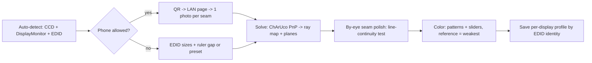

# Research Report: One-step setup calibration and color/brightness matching

Timestamp: written 2026-10-10 evening (Asia/Bangkok, UTC+7); research started 18:46. One of 5 parallel SOTA researchers for panorama.

Evidence tags used everywhere:
- **[V]** primary page read in full this pass (WebFetch).
- **[S]** web search result/summary; page NOT read; a sentence is not pinned to one link.
- **[L]** local probe or simulation run on this PC on 2026-10-10 (Windows 11 10.0.26200, Python 3.11, numpy 1.24.4, OpenCV 4.8.0). Read-only, no files written. Assumed to be Setup A (laptop + 1 external).
- **[B]** background knowledge, NOT re-verified this pass.
- **[D]** derived / design judgement.

## Contents

1. Executive Summary
2. Research Methodology
3. Key Findings: 3.1 Technology Overview (Q1-Q4) | 3.2 Current State & Trends | 3.3 Best Practices | 3.4 Security | 3.5 Performance
4. Comparative Analysis
5. Implementation Recommendations (Quick Start, Code Examples, Common Pitfalls)
6. Recommendation for the concept demo (incl. Q5 flow)
7. Resources & References
8. Appendix: Glossary
9. Unresolved questions

Question map: Q1 = 3.1.1 | Q2 = 3.1.2, 4.1 | Q3 = 3.1.3 | Q4 = 3.1.4, 4.2 | Q5 = 6.1.

---

## 1. Executive Summary

**Detect (Q1).** Windows hands over everything except physical placement. Pixels, fractional refresh, rotation, desktop position, connector, adapter LUID and HDR/ACM state are exact from CCD (`QueryDisplayConfig` + `DisplayConfigGetDeviceInfo`) [L]; EDID/DisplayID primaries, luminance and *diagonal* size come from `Windows.Devices.Display.DisplayMonitor` (Win10 1803+, docs updated 2025-11-21) [V]. EDID physical size is NOT trustworthy: on this PC the external 1080p panel reports 480x260 mm = non-square pixels (vertical 3-4% short) while the laptop panel's DTD size is exact [L]. Bezel, gap, stagger, depth, angles, eye position: not detectable; Windows' arrangement is logical, not physical.

**Geometry (Q2, Q3).** No published SOTA or tool for "phone photo -> multi-monitor layout" found (one thin search; absence is weak evidence). The sound method is mainstream CV: a full-screen ChArUco board per screen (unique IDs), one landscape photo from the seat, planar PnP per screen (OpenCV). Local Monte Carlo [L]: hinge angles median 0.07-0.42 deg, P95 <= ~1 deg; eye distance median 6-19 mm, P95 12-36 mm; seam gap median 1-1.5 mm but **P95 7-12 mm because per-screen EDID scale (assumed 0.8% sd) is the floor, not the camera** (P95 <= 0.4 mm if scale were exact). Key insight [D]: the photo yields an *eye-referenced ray map that needs no physical scale*, which is exactly what SMOOTH CURVE consumes; FOLD needs mm gaps, so seed from photo or ruler and finish with a by-eye line-continuity polish (1 px = 0.6-1.1 arcmin at 0.8 m). One photo only covers spans <= ~65 deg (main lens) or ~100 deg (ultra-wide): fine for Setup A (54-63 deg at 0.7-0.8 m), but wrapped triples at <= 0.8 m need one photo per seam.

**Color (Q4).** No shortcut found. Best accuracy is still colorimeter + ArgyllCMS (3.5.0, Feb 2026 [S]) -> ICC/3D LUT, but the OS route (ACM + MHC2) is experimental (MHC2Gen "experimental", only DisplayCAL profiles tested, 24H2 bugs [V]) and colorimeter access on 24H2 has user-reported problems [S]. On this PC Windows already runs ACM on the wide-gamut laptop panel via an EDID-derived "Emulated Color Profile"; the external is sRGB-class with ACM off; no MHC2/ICC calibration installed; DDC/CI is unavailable on both panels [L]. So gamut is nominally handled and the player must fix luminance, white point, EOTF and black level (illusion breaker 2). Phone-photo color matching: no maintained tool or study found; reasoned limits say luminance/white gain only [D].

**Ranked bottom line**
1. Geometry: phone photo per seam (ChArUco, OpenCV, QR -> LAN page, file-input capture) -> poses + eye-referenced ray map -> by-eye seam polish. No-phone fallback: EDID sizes + ruler gap + same polish. One output feeds both FOLD and CURVE.
2. Color: player-side relative correction (linear light, dithered), ACM-aware gamut ownership, match-to-weakest, by-eye patterns + sliders. Optional import of ICC/3D LUT from ArgyllCMS/DisplayCAL-py3.
3. Do not depend on MHC2, DDC/CI, learned geometry models, or camera chromaticity.
4. Setup time: Setup A about 2-3 min, Setup B about 4-6 min [D]; accuracy numbers above are simulation floors and MUST be field-checked with a ruler/laser meter on A and B.

---

## 2. Research Methodology

- **Web budget: 5 of 5 used.** (1) extended search: ACM/MHC2/Advanced Color + EDID size accuracy; (2) extended search: phone-photo multi-monitor calibration, ArUco/ChArUco/AprilTag, learned geometry (VGGT, MoGe-2, Depth Pro), OpenCV release; (3) extended search: ArgyllCMS/DisplayCAL/dwm_lut/novideo_srgb status, phone relative color matching, `capture` vs `getUserMedia`; (4) WebFetch Microsoft Learn `DisplayMonitor`; (5) WebFetch `github.com/dantmnf/MHC2`.
- **Tool lesson:** the three multi-topic extended queries each ran ONE search, mostly on the first topic (sibling topic-1 report saw the same). Not covered by the web as a result: prior art for phone-photo monitor calibration, learned-geometry comparison, OpenCV/AprilTag release status, smartphone display colorimetry accuracy, `capture`/secure-context rules, EDID size accuracy, dwm_lut/novideo_srgb. Those are answered by [L], [B] or [D] and labelled so.
- **Local probes [L] (inline, read-only, no files):** P1 EDID parse of both active monitors from the registry; P2 CCD via ctypes (modes, refresh, rotation, connector, adapter LUID, advanced color, SDR white); P3 Monitor Configuration API (DDC/CI) + WMI brightness; P4 `spool\drivers\color` ICC scan + decode of the Windows-generated profile; P5 Monte Carlo of single-photo pose recovery (numpy + OpenCV 4.8.0 `solvePnP` IPPE; 4 scenarios x 5 variants x 150 trials); P6 synthetic ChArUco detection test (tilt, glare, blur); P7 FOV/angle/arcmin arithmetic.
- **Project docs read:** README.md, ADR 0005, 0006, 0007. Sibling reports read for consistency: bezels/geometry (full), windows-rendering (greps).
- **Date range:** Learn page updated 2025-11-21; search items 2026; foundational plane-based calibration (Zhang 2000) [B], not re-verified, nothing newer checked.
- **Key search terms:** Windows Auto Color Management MHC2 ICC; `DISPLAYCONFIG_GET_ADVANCED_COLOR_INFO` wideColorEnforced; EDID physical size inaccurate; multi-monitor bezel gap smartphone photo ArUco ChArUco AprilTag; VGGT MoGe-2 Depth Pro vs fiducials; ArgyllCMS 2026 MHC2; DisplayCAL py3; dwm_lut novideo_srgb; smartphone relative display color matching; HTML capture getUserMedia secure context.
- **Credibility weighting:** Microsoft docs and a read README [V] > search summaries [S] > forum threads [S, lowest] ; local measurements [L] are real but n=2 panels / one machine / simulation assumptions stated.
- **Cross-check status (brutal):** no key claim has 3 independent web sources. ACM semantics = one README + forum threads; ArgyllCMS/DisplayCAL status = one site family + one retail listing + forum posts; geometry accuracy = my own simulation; EDID error = n=2 panels. Treat every number as a lead to field-check, not a spec.
- **Not covered:** HDR path, curved/portrait monitors, macOS, Windows 10, uniformity compensation, colorimeter hardware, psychophysical thresholds, AprilTag/OpenCV release status.

---

## 3. Key Findings

### 3.1 Technology Overview

#### 3.1.1 Q1 What Windows can and cannot tell us

| Item | Current API | What we saw / reliability | Tag |
|---|---|---|---|
| Active displays, pixel size, desktop position, rotation, scaling | `GetDisplayConfigBufferSizes` + `QueryDisplayConfig(QDC_ONLY_ACTIVE_PATHS)` -> `DISPLAYCONFIG_PATH_INFO` + `MODE_INFO` | Exact, physical px. Laptop 2560x1600 at (0,0); external 1920x1080 at (2560,0), top-aligned; rotation identity | [L]; API stable since Win7 [B] |
| Refresh rate | target mode `vSyncFreq` (Num/Den) | Exact incl. fractional: 240001/1000 (laptop), 100/1 (external) | [L] |
| Mode list | `EnumDisplaySettingsEx` / DXGI `GetDisplayModeList` | Not probed | [B] |
| Identity, connector | `GET_TARGET_NAME` (EDID mfr/product, friendly name, device path); `outputTechnology` | Laptop: DP_EMBEDDED, empty friendly name. External: HDMI, name "EGM22F100H" | [L] |
| Same via WinRT | `DisplayMonitor.ConnectionKind`, `PhysicalConnector`, `DisplayName`, `UsageKind` | Documented | [V] |
| GPU driving each output | path `adapterId` LUID; `DisplayMonitor.DisplayAdapterId`/`DisplayAdapterTargetId` (compatible with Direct3D and DisplayConfig) | Doc warns the connected adapter "may not be the most suitable one for rendering". Here both paths share ONE LUID although two GPUs exist (AMD Radeon 610M, NVIDIA RTX 5070 Ti Laptop) | [V], [L] |
| HDR / wide-color state | `DisplayConfigGetDeviceInfo(GET_ADVANCED_COLOR_INFO)`: supported / enabled / wideColorEnforced / forceDisabled, encoding, bpc | Laptop: supported=1 enabled=1 wideColorEnforced=1 (ACM on), 8 bpc. External: supported=1 enabled=0. "supported" is not "HDR" | [L]; HDR-vs-ACM reading is my inference [D] |
| SDR white level | `GET_SDR_WHITE_LEVEL` (1000 = 80 nits) | 1000 on both; only meaningful with HDR on | [L], [B] |
| EDID/DisplayID colorimetry, luminance, size | `Windows.Devices.Display.DisplayMonitor` (Win10 1803+): Red/Green/BluePrimary, WhitePoint ("calculated from EDID and any driver overrides"), Min/Max/MaxAverageFullFrame luminance, `PhysicalSizeInInches` (**diagonal only**), `RawDpiX/Y`, `NativeResolutionInRawPixels`, `GetDescriptor(DisplayMonitorDescriptorKind)` raw bytes (kinds Edid / DisplayId [B]) | Nominal values, not measurements | [V] (page updated 2025-11-21) |
| Hardware brightness/gain (DDC/CI) | Monitor Configuration API (`dxva2`) | **Failed on BOTH panels** with 0xC0262582 (my recollection: GRAPHICS_I2C_NOT_SUPPORTED [B]); laptop brightness works via WMI (`WmiMonitorBrightness`, 101 levels, current 48) | [L] |

**EDID physical size accuracy (the real-world part)** [L, n=2 panels, one machine]

| Panel | EDID | Base-block cm fields (bytes 21/22) | First DTD image size (mm) | Implied pixel pitch x, y (mm) | Verdict |
|---|---|---|---|---|---|
| Laptop AUO7DB2, 2560x1600 @240 Hz, eDP | 1.4 + DisplayID ext (0x70) + CTA ext (0x02) | 34 x 22 | 344 x 215 | 0.1344, 0.1344 | DTD size looks exact (16" 16:10, square pixels). cm fields are rounded: -1.2% width, +2.3% height vs DTD |
| External ZZY2150 "EGM22F100H", 1920x1080 @100 Hz, HDMI | 1.3 + CTA ext | 48 x 26 | 480 x 260 (= cm x 10, no mm precision) | 0.2500, 0.2407 | **Non-square implied (4%)**: vertical under-reported; square-pixel rule gives 270 mm. Width within ~+/-1% under any 16:9 reading |

- EDID primaries: laptop is wide-gamut (R .679/.316, G .258/.693, B .147/.052, W .313/.329); external reports **exactly** the sRGB nominal primaries (R .640/.330, G .300/.600, B .150/.060, W .312/.329) = a generic default, not a measurement [L + D].
- Rules [D]: assume square pixels; take scale from the longer axis (or the DTD when it has real mm); let the user override the diagonal; never use EDID aspect to size the canvas.
- The EDID spec details (cm integer fields; zero byte = aspect-ratio code in EDID 1.4) are [B], not re-verified. No web source quantifying real-world EDID size error was found.

**Not detectable by any Windows API** [D, B]: bezel width and air gap, vertical stagger/physical alignment, depth offsets (laptop in front of monitor), toe-in and lid angles (hinge sensors exist only on some 2-in-1s [B]), curved-screen radius (not in EDID [B]), panel uniformity, measured colorimetry, whether Windows' order matches the desk, viewer eye position.

**Recommended detection stack** [D]: CCD for topology/mode/refresh/rotation/advanced color; `DisplayMonitor` (or raw EDID) for colorimetry/size/connector; DXGI for adapter + `IDXGIOutput6::GetDesc1` cross-check [B]; per-monitor-v2 DPI awareness so nothing is DPI-virtualized.

#### 3.1.2 Q2 SOTA for SIMPLE geometry calibration

No dedicated SOTA exists for this exact task. The composite state of the art, assembled from mainstream CV [D]:

| Technique | Evidence this pass | Notes |
|---|---|---|
| Fiducial boards on screen, photo, planar PnP (ArUco/ChArUco/AprilTag) | OpenCV 4.8.0 has `ArucoDetector` + `CharucoDetector` [L]. [S]: a 2026 write-up reports ChArUco gives lower translation/rotation error than plain ArUco; another 2026 paper notes ArUco is limited to moderate viewing angles | ChArUco = ArUco robustness to partial views + chessboard-corner sub-pixel accuracy [B]. AprilTag (AprilRobotics) is the alternative; status not verified |
| Plane-based self-calibration of focal length (Zhang 2000 [B]) from the same photo | [L] MAP version halves-to-tenths the focal error when side screens are angled >= ~10 deg; useless when nearly flat (3.1.3) | Needs non-parallel planes |
| Learned geometry (VGGT, MoGe-2, Depth Pro, DUSt3R family) | **Nothing found**: the search returned no comparison against fiducials | No evidence of mm-level accuracy on planar screens. Skip; fiducials are deterministic, sub-pixel |
| Multi-projector camera calibration (structured light, per-pixel maps) | [S] arXiv 2604.24024 (Apr 2026, "Breaking the Scalability Limit of Multi-Projector Calibration with Embedded Cameras"); only title seen | Nearest literature; needs many captures/stable camera; overkill for flat monitors |
| On-screen interactive alignment (line continuity / vernier) | Pattern used by GPU-driver bezel correction [B, not verified]. [L] resolution limit = 1 px = 0.58 arcmin (laptop 16"), 1.07 (22" 1080p), 1.00 (27" 1440p) at 0.8 m | Needs the seat; cannot give angles/eye; human repeatability unmeasured |
| Measured input (ruler/card) | [D] | +/-1-2 mm if careful; 3-5 numbers; sim-racing community accepts it (sibling report) |
| Prior art: phone photo -> monitor layout | **Not found** (one query) | Treat as new build |

Local detection test [L] (OpenCV 4.8.0, 27" 1080p panel, ChArUco 24x13, ~25 mm squares, ultra-wide f=1514 px, blur 1.0 px, noise): frontal 276/276 corners; yaw 30 deg 156; 45 deg 114; 55 deg 82; 62 deg 70; 72 deg 36; 76 deg 8; corner RMS 0.31-0.52 px (max <= 1.0 px) up to 72 deg. Screen at 1.4 m (marker bit cell ~3.4 px): **0 corners**. Glare blob (+140 levels) frontal 266/276; blur 1.6 px + heavier noise still fine to ~62 deg. Lesson: size boards by photo scale (bit cell >= ~5 px at the worst tilt), not by screen pixels. Synthetic only: no real moire, JPEG artifacts, PWM banding.

#### 3.1.3 Q3 Can ONE phone photo from the seat recover layout, gaps, angles, eye?

**Geometry of the answer** [D]: the camera sits where the eye sits. Each screen's board gives a homography to the image; with intrinsics K that is a full 6-DoF pose of every screen in the eye frame. Two kinds of output:
- *Eye-referenced ray map*: direction from the eye to every pixel of every screen = K^-1 H p. **Scale-free** (no EDID, no distance needed). A common focal error scales all angles equally, so seam continuity is preserved. This is the input SMOOTH CURVE needs.
- *Metric planes*: positions in mm need pixel pitch per screen (EDID) -> gap and distance inherit EDID scale error.

**What one photo recovers** (Monte Carlo [L]; median / P95; 150 trials per cell; assumptions below)

| Scenario | Angle err deg, EXIF f | Angle err deg, MAP self-cal f | Gap err mm, EDID-grade scale | Gap err mm, exact scale | Eye err mm, EXIF f / MAP f |
|---|---|---|---|---|---|
| B-20: 3x27", 1.0 m, 20 deg hinge, 18 mm gap, ultra-wide | 0.42 / 0.83 | 0.09 / 0.22 | 1.4 / 11.7 | 0.14 / 0.39 | 16.9 / 33.3 ; 10.6 / 17.0 |
| B-10: same, 10 deg hinge | 0.20 / 0.38 | 0.08 / 0.22 | 1.0 / 11.9 | 0.13 / 0.32 | 19.2 / 35.7 ; 11.2 / 23.0 |
| B-5: 3x27", 0.8 m, 5 deg (near flat) | 0.07 / 0.19 | 0.07 / 0.17 | 1.1 / 9.3 | 0.08 / 0.21 | 13.2 / 28.3 ; 12.0 / 27.6 |
| A: laptop 16" + 22", 0.7 m, 15 deg, 30 mm gap, main lens | 0.42 / 0.83 | 0.16 / 0.39 | 1.5 / 7.3 | 0.05 / 0.14 | 9.6 / 22.8 ; 9.2 / 20.7 |

Gap columns = variant "EXIF f + EDID-grade scale" and variant "MAP f + exact scale"; gap with MAP f and EDID-grade scale is within ~0.2 mm median / ~1 mm P95 of the first. Gap metric = 3D distance between facing edge midpoints minus truth. Assumptions: pinhole + Gaussian corner noise 0.3 px; EXIF f error uniform +/-3% (integer-rounded 35 mm-equivalent, undistortion crop: my inference [D]); principal point +/-15 px; EDID scale error N(0, 0.8%) per screen, isotropic (square-pixel rule); 16x9 corner grid per screen; eye at screen mid-height; flat screens; MAP self-cal = minimise reprojection^2/0.5^2 + ((f/f0-1)/0.03)^2. Harder variant (noise 0.7 px + 0.5% corner distortion): angle P95 up to ~1.1 deg, gap P95 6-16 mm, eye P95 up to 49 mm (B-5 with self-cal: f error 2.3/5.6% = worse than EXIF; **gate self-cal to hinge >= ~10 deg**). Vertical stagger error was 0.05-0.3 mm in sim but grows with eye offset x scale error.

Reading it:
- **Angles**: good, <= ~1 deg P95. **Eye position**: +/-1-2 cm median; real life adds 2-4 cm lens-to-pupil placement error (not simulated) [D]. Eye distance error barely matters for coplanar screens; parallax at a seam matters only when depths differ (laptop in front): s x (1/d1 - 1/d2), e.g. 30 mm shift, 600 vs 800 mm = 0.7 deg [D].
- **Gap in mm**: the camera is not the limit; per-screen scale is. With EDID-grade scale the P95 is 7-12 mm (= 0.5-0.9 deg at 0.8 m) vs a 18-30 mm gap. 1 mm = 4.3 arcmin at 0.8 m. Therefore photo = seed, by-eye polish = final.
- **Layout/order**: Windows already gives it; the photo confirms and adds stagger/depth/lid angle.

**Coverage: one photo only if the span fits** [L arithmetic; typical lens figures B]

| Row of monitors, active areas, 18 mm gap | Span flat | 15 deg hinge | 30 deg hinge |
|---|---|---|---|
| 3 x 24" at 0.8 m | 91 | 101 | 109 |
| 3 x 24" at 1.0 m | 78 | 85 | 91 |
| 3 x 27" at 0.8 m | 98 | 108 | 118 |
| 3 x 27" at 1.0 m | 85 | 93 | 100 |
| 3 x 32" at 1.0 m | 94 | 105 | 114 |
| 3 x 27" at 0.6 m | 113 | 127 | 140 |
| Laptop 16" + 22" (30 mm gap), 0.7 m / 0.8 m | 60 / 54 | 63 / 57 | n/a |
| 2 x 27" flat, 0.7 m / 0.9 m | 82 / 68 | n/a | n/a |

Lens horizontal FOV (4:3 landscape) from 35 mm-equivalent: 26 mm = 67 deg, 24 mm = 72 deg, 13 mm = 106 deg [L arithmetic]. So: Setup A (2 screens): ONE photo with the main lens (tight at 0.7 m; ultra-wide safer). Triples: one photo only if span <= ~100 deg and ultra-wide; wrapped 27" triples at <= 0.8 m do not fit. Then **one photo per seam** (left+center, center+right) chaining through the shared center screen; hand-held shift between photos shows up as a camera-position difference (cm-level) that can be averaged [D, chaining error not simulated].

**Getting the photo to the PC** [B for web-platform rules, not re-fetched]
1. PC app starts a tiny HTTP server on the LAN IP, shows a QR for `http://<ip>:<port>/s/<token>`.
2. Phone page = `<input type="file" accept="image/*" capture="environment">` + upload. A file input launches the native camera app and works on plain HTTP; `getUserMedia` needs a secure context (HTTPS or localhost), so a live in-page camera would need a self-signed cert (warnings) [B].
3. Fallback: drag a photo file onto the window (USB, cloud, Quick Share). Messengers may strip EXIF.
4. Need EXIF `FocalLengthIn35mmFilm` (integer-rounded on many phones [B]); else rely on self-calibration (hinge >= 10 deg) or ask the user which lens.
5. Costs: Windows Firewall prompt on first listen; guest Wi-Fi / AP isolation can block; phone must be on the same LAN.

Failure modes [L/D/B]: glare (use dim room; partial ChArUco survives), moire (large squares), PWM banding at low brightness (set screens >= ~50% for the shot), steep angles (ArUco limited to moderate angles [S]; synthetic detection counts fall past ~60 deg), curved screens (planar model breaks; fit a cylinder; not simulated), ultra-wide software undistortion (EXIF f may be wrong), digital zoom/portrait mode, lid angle changes after setup.

#### 3.1.4 Q4 Color and brightness matching

**Windows color pipeline today**
- **Auto Color Management (ACM), Win11:** maps SDR content to the panel's native gamut; "assumes the display is calibrated to sRGB tone curve" [V, README]. Before 24H2, SDR ACM "requires a non-HDR-capable display at the moment" [V, README]. Color data source is EDID unless an MHC ICC profile supplies it [S: forums; V: README says only `lumi`, `MHC2` and primaries of a valid MHC ICC profile are used, tone curves and `vcgt` ignored].
- **ICC APIs under Advanced Color return sRGB** (Microsoft docs, quoted on DPReview) [S]: color-aware apps end up managing to sRGB; users report ACM making apps ignore applied ICC profiles, workaround = legacy color management per app [S].
- **MHC2:** an ICC profile with a private `MHC2` tag (3x3 matrix stage + 1D LUT stage per MHC2Gen examples) applied by Windows; "The Windows calibration loader must be enabled to load MHC2 transform" [V]. Microsoft docs exist (4 URLs in section 7) but were NOT read.
- **Tooling/maturity [V]:** dantmnf/MHC2: 289 stars, 10 forks, 60 commits, Unlicense, last commit date not shown; MHC2Gen "an experimental tool", "only profiles created with DisplayCAL are tested"; known issues on 24H2 with MHC calibration active: buggy cursor and MPO composition on NVIDIA and AMD, poor LUT quality on 8-bit output on Intel, conflicts with novideo_srgb. Multi-monitor and multi-GPU behaviour not documented there.
- **This PC [L]:** laptop panel ACM on; Windows holds a 564-byte ICC v2.1 profile "Emulated Color Profile" (creator MSFT, tags wtpt, r/g/bXYZ, r/g/bTRC, lumi, desc, cprt; wtpt xy = EDID white; `lumi` = 507.6 cd/m2, source EDID/DisplayID/driver not determined); no profile in `spool\drivers\color` has MHC2 or vcgt; no per-user display profile associations. External: ACM off.

```
player: linear light, relative correction (gain / white point / EOTF) [+ own gamut clamp ONLY if ACM off]
  -> swapchain tagged SDR sRGB/G22-P709
  -> DWM: ACM maps sRGB -> panel gamut (EDID or MHC-ICC primaries/lumi)      [if wideColorEnforced]
  -> optional MHC2: matrix + 1D LUT (needs Calibration Loader task enabled)
  -> GPU -> panel                                         (README does not say where DWM/GPU split sits)
```

**Consequence for Setup A [D]:** Windows (nominally) already reconciles the P3-like laptop panel with the sRGB-class external. What it does NOT reconcile: luminance level, white point of the real panel, EOTF (ACM = sRGB curve vs external's native ~2.2 [README: ACM assumes sRGB tone curve]), black level, uniformity, EDID error.

**How the video player should apply per-monitor correction** [D, consistent with sibling rendering report]
1. One render target per monitor (needed for geometry anyway); apply the correction as the **last stage, in linear light, then dither** to panel depth (gain < 1 on 8-bit loses codes).
2. Per-display transform T_i = (common target) -> (this display) built from: (a) EDID/DisplayMonitor primaries + white (free), (b) user sliders (gain, warmth R/B, gamma, black lift), (c) optional imported ICC/3D LUT.
3. **Gamut ownership per display:** if `advancedColorEnabled && wideColorEnforced` (ACM) or HDR on -> OS owns panel gamut; player outputs sRGB and applies only the *relative* tweak. Else player applies the EDID-primaries clamp itself. Re-check on display-change events; users toggle HDR/ACM/Night Light at runtime [B].
4. Never apply a panel ICC on top of ACM (double management) [S].
5. Persist keyed by EDID mfr/product + connector (+ serial if present), not by index.

**Match-to-weakest strategy** [D]: target = intersection. White level = the lowest level all panels can hit at the user's viewing level (dark-room video is ~80-120 nits, so peak is rarely binding; **minimum reachable luminance and black level are**). Gamut = common (usually sRGB/Rec.709, clamp wider panels). White point = D65 or the least-bad shared point. EOTF = one curve for all (explicit per-display tone mapping so ACM's sRGB curve does not differ from the neighbour). Black: LCD IPS (glow) next to OLED (true black) is the worst mismatch in dark scenes; raising the OLED floor hides the seam but costs contrast: expose as an A/B option. Panel uniformity is worst at edges = the seams [B, no source in this pass].

**Measurement options, ranked**
1. Colorimeter + ArgyllCMS/DisplayCAL -> ICC/3D LUT per display: best accuracy [B]; needs hardware and 15-30 min per display [B]. Status: ArgyllCMS 3.5.0 "Released Feb 2026" on displaycal.org [S, not confirmed on argyllcms.com]; user report that a Win11 24H2 update broke instrument access for Argyll 2.3.1 and 3.3.0 (HID drivers) [S]. DisplayCAL original 3.8.9.3 "not in active development" (FileHorse listing) [S]; Python 3 fork `eoyilmaz/displaycal-py3`, displaycal.org claims v3.9.17 current (self-reported, verify on GitHub) [S].
2. By-eye on large patterns (white, 50%, 20%, 5%), 2-3 sliders per non-reference screen: no hardware; accuracy unquantified (no source) [D].
3. Phone photo, relative: same frame, same camera pipeline, so global gain cancels. Limits [D, no source or maintained tool found]: native-camera JPEG has AE/AWB/tone mapping and local HDR fusion; camera RGB vs display spectra mean metamerism errors between technologies (wide-gamut/OLED vs sRGB IPS); RAW and manual exposure/WB need a native app or HTTPS `getUserMedia` constraints (browser-dependent [B]); it does measure what the seat sees (angle shifts included). Use only as luminance/white-gain pre-fill, never for chromaticity.
4. Windows "Calibrate display color" (dccw) [B, not verified]: GPU gamma ramp by eye; low value.
5. DDC/CI: hardware matching preserves bit depth, but failed on both panels here [L]; opportunistic only.
6. dwm_lut / novideo_srgb: not evaluated; README says novideo_srgb conflicts with MHC calibration [V]. System hooks, not shippable.

**Seam-aware luminance ramp (speculative A/B)** [B/D]: classic tiled-projector work suggests slow luminance gradients are far less visible than steps, so instead of a step gain on the brighter panel, ramp its gain toward the seam. Not verified here; cheap to test by eye.

### 3.2 Current State & Trends

| Item | State (date) | Flag |
|---|---|---|
| CCD API | Stable; works on Win11 10.0.26200 [L] | Maintained |
| `Windows.Devices.Display.DisplayMonitor` | Win10 1803+; docs updated 2025-11-21; one addition since (Dolby Vision flag, 2004) [V] | Maintained; WinRT interop needed |
| ACM / MHC2 | ACM live on this Win11 build [L]; MHC2 documented by Microsoft (URLs unread), community tool experimental, 24H2 issues [V] | New, immature; do not depend |
| OpenCV ArUco/ChArUco | `ArucoDetector`/`CharucoDetector` in 4.8.0 [L]; objdetect move and API rename around 4.7-4.8 [B]; current release not verified | Assumed maintained |
| AprilTag | Not verified | Unknown |
| ArgyllCMS | 3.5.0, Feb 2026 [S] | Maintained (single maintainer [B]) |
| DisplayCAL | original stalled [S]; py3 community fork v3.9.x [S] | Mixed; verify fork repo |
| Phone-photo monitor calibration | Not found | Build ourselves |
| Learned geometry for this task | Not found | No evidence |
| Multi-projector calibration | 2026 embedded-camera paper exists [S, title only] | Adjacent, not needed |

Trend: Microsoft is moving color correction into the OS (ACM now, MHC2 as the calibration hook), which shrinks the app-side ICC role but is not yet usable by "almost anyone". ChArUco keeps showing up in 2026 calibration work [S].

### 3.3 Best Practices

1. Detect everything Windows knows; ask the user only for what it cannot know. Show an "identify" overlay and let the user confirm order.
2. Square-pixel rule; scale from the longer axis; manual override of diagonal.
3. Put the camera where the eye is; hold the phone landscape at the dominant eye, lens 1x or 0.5x as the app instructs, no zoom/portrait, dim room.
4. Photo seeds, eye finishes: always end geometry with a by-eye line-continuity check per seam (diagonal + horizontal line across the seam), 1 px steps.
5. Self-calibrate focal length only when a side screen is angled >= ~10 deg; else trust EXIF and show a confidence flag.
6. One owner of gamut mapping per display (OS if ACM/HDR, else player).
7. Correct in linear light, last, dithered.
8. Reference display = weakest; sliders on the others.
9. Pre-flight (sibling report): 100% scaling, HDR off, Night Light off, adaptive/content brightness off on the laptop, then calibrate.
10. Persist per display identity; re-run only when identity or arrangement changes.

### 3.4 Security Considerations

- LAN server: private interface only, random single-use token in the URL, 10-min expiry, upload size cap (<= 25 MB), accept JPEG/HEIC only, no directory listing, stop after one upload [D].
- Privacy: the photo may show room, people, GPS EXIF. Process in memory, delete after solving, keep only derived numbers, say so in the UI.
- Plain HTTP: token sniffable on shared Wi-Fi; low risk for a one-off local setup; warn on guest/public networks.
- Image decoding of untrusted input: keep OpenCV/libjpeg current; decode in the player process only if acceptable, else in a helper.
- System side effects: avoid installing system-wide ICC/MHC2 in the demo (Calibration Loader task, 24H2 issues [V]); restore any WMI brightness / Night Light / refresh change on exit (ADR 0005 pattern).
- Third-party executables (ArgyllCMS, DisplayCAL fork, instrument HID drivers): optional, verify hashes/signatures.

### 3.5 Performance Insights

- ChArUco detect + warp on a 12 MP synthetic image: ~0.35 s per image on CPU (OpenCV 4.8.0) [L]. Simulated solves averaged ~40 ms per trial single thread (blend of EXIF-only and 61-step focal-search solves, 3 planes, 144 points each) [L]. Setup compute is negligible; upload time dominates.
- Playback-time correction: 3x3 + 1D curve per pixel on GPU is negligible next to scaling; a 33^3 3D LUT adds one trilinear fetch [B/D]. Dither pass is required at 8 bit.
- Cross-topic [L]: Setup A runs 240.001 Hz (laptop) vs 100.000 Hz (external). 100 Hz gives no integer cadence for 24/23.976 fps; external "100H" suggests 100 Hz max. Flag for the stutter researcher.

---

## 4. Comparative Analysis

### 4.1 Geometry calibration (ranked)

| Rank | Method | Steps / time | Accuracy | Failure modes | Maintenance / building blocks | Fit |
|---|---|---|---|---|---|---|
| 1 | Photo per seam: ChArUco per screen + PnP (+MAP focal) + by-eye polish | scan QR, shoot, confirm, polish: ~2-3 min (A), ~4-6 min (B) [D] | angle <= ~1 deg P95, eye +/-1-3 cm, gap seed +/-1 mm median (P95 7-12 mm EDID-limited), final = 1 px [L/D] | glare, moire, FOV, curved, EXIF | OpenCV objdetect (assumed maintained), LAN page | Feeds FOLD and CURVE; ADR 0007 ok (setup-time only, not tracking); phone must be allowed as optional helper |
| 2 | EDID sizes + ruler gap + by-eye polish (no phone) | 1-2 min + 20-30 s per seam | gap +/-1-2 mm if measured; no angles/eye | typed errors, stagger unknown | none | Mandatory fallback |
| 3 | By-eye only from defaults | 1-3 min per seam | 1 px per seam but no angles/eye | slow, fatigue | none | Polish step only |
| 4 | Screen-quad detection (no tags) | same as 1 | worse than 1 (bloom, bezel confusion) [D] | glare | OpenCV | Reject |
| 5 | Learned monocular geometry | 1 photo | no evidence | unknown | n/a | Reject until evidence |
| 6 | Structured-light per-pixel maps | many frames, tripod | highest | setup burden | multi-projector literature | Overkill |

### 4.2 Color matching (ranked)

| Rank | Method | Effort | Accuracy | Risk | Fit |
|---|---|---|---|---|---|
| 1 | Player-side relative correction + ACM-aware ownership + by-eye patterns/sliders + match-to-weakest | 1-2 min | unquantified; score vs colorimeter once on A/B | by-eye drift, EDID error | Default for "almost anyone" |
| 2 | Import ICC/3D LUT from ArgyllCMS/DisplayCAL-py3 per display | colorimeter + 15-30 min each [B] | best | tool status, 24H2 instrument issue [S] | Opt-in advanced |
| 3 | Phone-photo gain pre-fill | 1 photo | luminance/white gain only; chromaticity unreliable [D] | AE/AWB, metamerism | Experimental |
| 4 | OS MHC2 profiles | colorimeter + experimental tools | good in theory | 24H2 bugs, tooling [V] | Not now |
| 5 | DDC/CI hardware | none | preserves bit depth | failed on both panels here [L] | Opportunistic |

### 4.3 Adoption risk

| Building block | Maturity | Breaking-change history | Abandonment risk |
|---|---|---|---|
| CCD API | Win7+ | none seen | very low |
| DisplayMonitor (WinRT) | 2018+ [V] | one added property [V] | low |
| OpenCV objdetect ArUco | multi-year | API reshuffle 4.7-4.8 [B] | low |
| AprilTag | multi-year [B] | n/v | low [B] |
| MHC2 route | new | 24H2 issues [V] | high |
| ArgyllCMS | decades [B] | low | low-medium |
| DisplayCAL-py3 | community | n/v | medium |
| LAN page + file input | web standard | none | very low |

---

## 5. Implementation Recommendations

### Quick Start

1. Enumerate: CCD + `DisplayMonitor` + raw EDID; build the physical model with the square-pixel rule; show identify numbers.
2. Pre-flight: 100% scaling, HDR/Night Light/adaptive brightness off.
3. Geometry: start LAN server, QR; each screen full-screen ChArUco (dictionary ID range unique per screen, mid-gray background, squares sized by photo scale); phone takes one landscape photo per seam; PC solves; overlay predicted vs detected for confirmation.
4. Polish: per seam line-continuity test, 1 px steps.
5. Color: patterns, reference = weakest, sliders; ACM check per display.
6. Persist by EDID identity.

### Code Examples (sketches, not shipped code)

EDID size (first DTD at byte 54; sizes at bytes 66-68) and the square-pixel rule:

```
h_mm = b[66] | ((b[68] & 0xF0) << 4);  v_mm = b[67] | ((b[68] & 0x0F) << 8)
pitch = h_mm / native_w          # longer axis; ignore v_mm / native_h unless they agree within ~1%
```

Phone page (works over plain HTTP):

```html
<input type="file" accept="image/*" capture="environment" id="shot">
<script>shot.onchange = () => fetch('/up/' + TOKEN, {method:'POST', body: shot.files[0]})</script>
```

Pose per screen (OpenCV 4.8 API verified locally):

```python
f  = f35 / 43.27 * math.hypot(W, H)                   # px, from EXIF FocalLengthIn35mmFilm
K  = np.array([[f,0,W/2],[0,f,H/2],[0,0,1]])
c, ids, _, _ = cv2.aruco.CharucoDetector(board).detectBoard(gray)
obj = board_px[ids.ravel()] * pitch                   # Nx3 mm, z = 0
ok, rv, tv = cv2.solvePnP(obj, c, K, None, flags=cv2.SOLVEPNP_IPPE)
rv, tv = cv2.solvePnPRefineLM(obj, c, K, None, rv, tv)
R, _ = cv2.Rodrigues(rv); n = R[:, 2]; eye_in_screen = -R.T @ tv
hinge = degrees(arccos(clip(n_a @ n_b, -1, 1)))       # adjacent screens
# focal self-cal only if hinge >= ~10 deg: min over f in 0.85..1.15 f0 of
#   sum(reproj^2)/0.5^2 + ((f/f0 - 1)/0.03)^2
```

### Common Pitfalls

1. Trusting EDID size/aspect (observed 4% non-square on a 1080p panel).
2. Treating Windows arrangement as physical (top-aligned in Windows here; real panels differ in height and stagger).
3. DPI virtualization: use per-monitor-v2 and CCD physical pixels.
4. Reading `advancedColorSupported` as "HDR capable".
5. Double color management (ACM + own ICC); ignoring runtime toggles of HDR/ACM/Night Light.
6. EOTF mismatch: ACM = sRGB curve on one panel, native ~2.2 on another -> near-black step, visible on OLED.
7. Boards too small for the photo scale (0 corners at 3.4 px bit cell [L]).
8. Phone modes: zoom, portrait, ultra-wide undistortion changing the real FOV vs EXIF.
9. Photo from a different place than the seat; rotating between pair photos.
10. Laptop adaptive/content brightness and OLED ABL changing brightness mid-film.
11. AP isolation/firewall blocking the phone page; no fallback.
12. Believing the simulation: it is a floor. Validate with ruler/laser/protractor.

---

## 6. Recommendation for the concept demo

### 6.1 Q5 The simplest flow



| Stage | User effort | Output | Accuracy |
|---|---|---|---|
| 0 Auto-detect | none, ~10 s | px, Hz, positions, EDID size/primaries/luminance, ACM/HDR, adapter, connector | exact for px/Hz/positions [L]; EDID size +/-1-4% [L] |
| 1a Photo (per seam) | scan, shoot, confirm, ~1 min | angles, ray map, eye, seed gap, stagger | angle <= ~1 deg P95, eye +/-1-3 cm, gap EDID-limited [L sim] |
| 1b Manual alternative | type/choose gap per seam, ~30 s | seed gap | +/-1-2 mm careful [D] |
| 1c By-eye polish | nudge 1 px, ~20-30 s per seam | final gap/offset | resolution 1 px; repeatability unmeasured |
| 2 Color | sliders vs weakest, ~1 min | gain/white/gamma/black per display | unquantified; check vs colorimeter once |
| 3 Persist | none | profile by identity | n/a |

Total [D]: Setup A about 2-3 min; Setup B (3 screens, 2 photos) about 4-6 min.

### 6.2 Build on (named, dated, verified)

| Item | Source / date | Flag |
|---|---|---|
| CCD `QueryDisplayConfig`/`DisplayConfigGetDeviceInfo` | works on Win11 10.0.26200, 2026-10-10 [L] | Maintained |
| `Windows.Devices.Display.DisplayMonitor` | Microsoft Learn, updated 2025-11-21 [V] | Maintained |
| OpenCV objdetect `CharucoDetector` + `solvePnP` IPPE | verified on 4.8.0 locally 2026-10-10 [L]; latest release not verified | Maintained (assumed) |
| LAN HTTP page + file-input capture | web standard [B] | Stable |
| ACM as gamut owner on WCG panels | live on this PC [L], semantics from README [V] | Current Windows behaviour |
| ArgyllCMS 3.5.0 / DisplayCAL-py3 (optional import only) | displaycal.org, Feb 2026 / 2026 [S] | Verify before use |

### 6.3 Build ourselves

- Photo -> geometry solver: board generator sized by photo scale, per-screen unique IDs, multi-photo chaining, EXIF/intrinsics handling, MAP focal gate, confidence flags, ray-map + plane export for FOLD and CURVE.
- EDID sanity layer (square pixels, longer axis, override).
- By-eye seam tuner (line continuity, 1 px).
- Per-display correction stage (match-to-weakest policy, sliders, black-lift option, ACM-aware gamut ownership, dither).
- Fallback manual path and persistence by EDID identity.

### 6.4 A/B by eye in the demo

1. FOLD vs CURVE fed by the SAME calibration (sibling report owns the protocol).
2. Photo-seeded gap vs ruler-seeded gap: time to converge and final value after polish.
3. Laptop panel: ACM-only vs player clamp (check for double conversion, oversaturation).
4. Match-to-weakest with and without black lift on LCD+OLED mixes (Setup B if applicable).
5. Step gain vs seam luminance ramp (speculative).
6. Phone-photo gain pre-fill vs pure by-eye: does it reduce slider time without changing the final look?

Field checks (cheap, before trusting numbers): 3 photos of Setup A from the seat vs ruler/laser/protractor (targets: angle <= 1 deg, eye +/-3 cm); a colorimeter reading of white/50%/near-black on each panel if one can be borrowed.

---

## 7. Resources & References

Read in full [V]
- Microsoft Learn, DisplayMonitor Class (Windows.Devices.Display), page metadata updated 2025-11-21, fetched 2026-10-10: https://learn.microsoft.com/en-us/uwp/api/windows.devices.display.displaymonitor
- dantmnf/MHC2, "information about next generation color management in Windows", fetched 2026-10-10 (289 stars, 10 forks, 60 commits, Unlicense, last commit not shown; observations on Win11 24H2 26100.1882): https://github.com/dantmnf/MHC2

Search-result level [S] (page not read; dates as shown or n/s)
- DPReview thread "Windows 11 24H2 26100.2161 today; monitor profiling still broken" (n/s): https://www.dpreview.com/forums/threads/windows-11-24h2-26100-2161-today-monitor-profiling-still-broken.4781552/page-6
- DisplayCAL hub "Managing WCG Oversaturation in Windows: Seeking Advice" (n/s): https://hub.displaycal.net/forums/topic/managing-wcg-oversaturation-in-windows-seeking-advice/
- PC Monitors forum "Windows 11 and Automatically manage color for apps feature" (n/s): https://forum.pcmonitors.info/topic/windows-11-and-automatically-manage-color-for-apps-feature/
- ArgyllCMS v3.5.0 download page on displaycal.org ("Released Feb 2026"): https://displaycal.org/argyllcms/
- DisplayCAL download page on displaycal.org (2026; claims py3 branch v3.9.17): https://displaycal.org/download/
- DisplayCAL hub "ArgyllCMS issues with Windows 11 24H2 26100" (n/s): https://hub.displaycal.net/forums/topic/argyllcms-issues-with-windows-11-24h2-26100/
- FileHorse DisplayCAL 3.8.9.3 listing ("not in active development"; n/s): https://www.filehorse.com/download-displaycal/
- arXiv 2604.24024 (2026-04), Breaking the Scalability Limit of Multi-Projector Calibration with Embedded Cameras, title only: https://arxiv.org/pdf/2604.24024
- HeadTriXz/charucal, multi-camera ChArUco tool (n/s): https://github.com/HeadTriXz/charucal

Listed in the MHC2 README, NOT read
- Advancing the State of Color Management in Windows: https://devblogs.microsoft.com/directx/auto-color-management/
- Windows hardware display color calibration pipeline: https://learn.microsoft.com/en-us/windows/win32/wcs/display-calibration-mhc
- ICC profile behavior with Advanced Color: https://learn.microsoft.com/en-us/windows/win32/wcs/advanced-color-icc-profiles
- Use DirectX with Advanced Color on high/standard dynamic range displays: https://learn.microsoft.com/en-us/windows/win32/direct3darticles/high-dynamic-range

Local evidence [L], 2026-10-10: probes P1-P7 (section 2); scripts were inline and not saved (read-only constraint).

Project/sibling: README.md; docs/adr/0005, 0006, 0007; plans/reports/researcher-261010-1846-bezels-perception-and-geometry-model.md; plans/reports/researcher-261010-1846-windows-rendering-and-smooth-multi-monitor-playback.md.

Background [B], not re-verified: Zhang, "A flexible new technique for camera calibration", 2000; EDID/VESA structure; HTML capture / secure-context rules; classic tiled-projector photometric work.

---

## 8. Appendix: Glossary

- **ACM**: Auto Color Management; Windows 11 SDR gamut mapping to the panel.
- **Advanced Color**: Windows umbrella for HDR/WCG pipeline.
- **MHC2**: private ICC tag (matrix + 1D LUT) applied by Windows for calibration.
- **EDID / DTD / DisplayID**: display self-description; detailed timing descriptor (carries image size mm); newer superset.
- **CCD**: Connecting and Configuring Displays API.
- **LUID**: locally unique adapter id.
- **DDC/CI, VCP**: monitor control channel and its feature codes (brightness, gain).
- **ChArUco**: ArUco markers embedded in a chessboard; sub-pixel corners, partial-view tolerant.
- **PnP / IPPE**: pose from 2D-3D points; planar-specialised solver.
- **MAP self-cal**: focal estimate balancing reprojection error and an EXIF prior.
- **Eye-referenced ray map**: direction from the eye to each screen pixel; scale-free.
- **Hinge / toe-in**: angle between adjacent screens.
- **P95**: 95th percentile of absolute error.
- **Match-to-weakest**: lower all displays to the least capable one's white/gamut/black.
- **CABC**: content-adaptive backlight control.
- **Arcmin**: 1/60 degree.

---

## 9. Unresolved questions

1. Is a phone allowed as an optional setup helper? README says "helpers or optional hardware: not known yet". The flow works without it (fallback 2), and a one-time setup photo is not tracking (ADR 0007), but this is a user decision.
2. Real-phone accuracy is unmeasured: all numbers are simulation floors. Field test on Setup A and B with ruler/laser/protractor needed.
3. Does Setup B fit one photo per seam? Monitor sizes, distance and hinge angles unknown (coverage table says wrapped 27" triples at <= 0.8 m do not).
4. Do iOS/Android browsers keep EXIF `FocalLengthIn35mmFilm` through a file-input upload (HEIC -> JPEG, stripped metadata)? Untested. Is a per-model intrinsics prior needed for near-flat setups where self-cal fails?
5. Chaining error across a photo pair and effect of the 2-4 cm lens-to-pupil offset on depth-staggered screens: not simulated.
6. Current OpenCV release and AprilTag status not verified; OpenCV.js ArUco availability unknown (plan keeps detection on the PC).
7. By-eye color-match accuracy and repeatability: no source; need a colorimeter ground truth on A/B (does the author own or can borrow one?).
8. Microsoft's ACM/MHC2 docs (4 URLs) not read; per-display behaviour, EOTF handling and whether `GET_ADVANCED_COLOR_INFO_2` (active color mode) exists on 26200 not verified.
9. Smartphone display-colorimetry accuracy literature not found (search ran one topic); metamerism claim rests on reasoning.
10. Real-world EDID size error distribution: only n=2 panels here; no web source.
11. Not covered: HDR content across mismatched peaks, curved/portrait monitors, macOS, Windows 10, uniformity compensation.
12. Cross-topic for the stutter researcher: Setup A is 240.001 Hz vs 100.000 Hz; does the external offer 120/144 or 48/72/96 Hz for 24p?
13. Memory file not updated (task is read-only except this report). Reusable lessons for the lead: (a) multi-topic extended queries run only their first topic (seen by two researchers); (b) local read-only probes (ctypes CCD, registry EDID parse, OpenCV Monte Carlo) are cheap, unbudgeted evidence and beat the web for Windows-specific facts.
