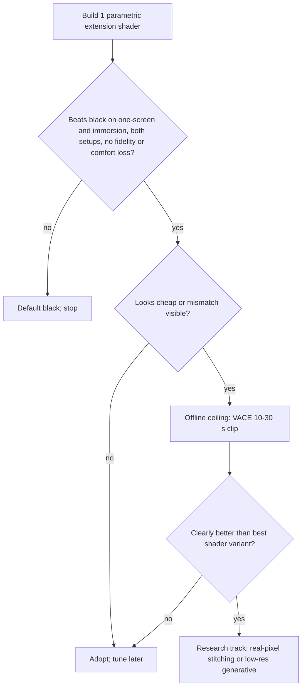

# Research Report: Unused canvas area — periphery, ambient extension, outpainting

Generated 2026-10-10 (session start 18:46, Asia/Bangkok). Project: panorama concept demo. Author: researcher agent.

Evidence tags used everywhere: **[V]** verified this pass (page or feed fetched) · **[S]** search snippet / secondhand · **[R]** recalled background knowledge, NOT verified this pass · **[E]** my arithmetic or inference.

## Table of contents
1. Executive Summary
2. Research Methodology (+ limitations)
3. Key Findings (Overview · State & Trends · Best Practices · Security · Performance)
4. Comparative Analysis
5. Implementation Recommendations (Quick Start · Code · Pitfalls)
6. Recommendation for the concept demo
7. Resources & References
8. Appendix: Glossary
9. Unresolved questions

---

## 1. Executive Summary

**Do not put generative outpainting in the concept demo.** Build ONE parametric GPU shader (edge-continuous progressive blur + luminance falloff + temporal smoothing) that spans "ambient glow" to "blurred extension", and A/B it against plain black. Why: the leftover area is the majority of the canvas for common content (33-75% on 32:9-48:9 canvases [E]), and the 2026 generative SOTA is not usable. HL-OutPaint (SIGGRAPH '26) needs 12.6 s/frame on an A100-80GB at 720p [V] (~300x slower than real time; a 2-hour film = ~25 GPU-days [E]), states no code/weights release [V], mentions no anime/cartoon test [V], and its longest test is ~500 frames (~20 s) [V]. On its own table the open baseline VACE ties on PSNR/SSIM and wins on FVD [V], so the SOTA gap vs open models is small on metrics.

**Evidence that periphery content raises immersion is thin and old.** IllumiRoom (CHI 2013) = qualitative feedback from 10 gamers + 15 designers [S, abstract]; the Ambilight "higher immersion" claim and "low-res peripheral motion/colour cues raise presence" are secondhand [S]. No controlled study of extending content into unused monitor area, and no distraction / motion-discomfort data, were found; the one primary full-text attempt (ACM) returned HTTP 403. The by-eye A/B in the demo is therefore the decider, and the real risks are engineering ones: flicker/pumping, smooth fills exposing inter-monitor mismatch, "cheap glow" look.

**Ranked:** (1) parametric edge-continuous blur extension — BUILD; (2) black — control + safe fallback; (3) real-pixel temporal stitching ("keep the seen", direction backed by Seen-to-Scene, CVPR 2026 Findings) — post-demo; (4) offline generative ceiling on 10-30 s clips using open VACE — calibration only, license/maintenance unverified; (5) cloud outpainting tools — excluded (local-only, ADR 0004).

---

## 2. Research Methodology

- **Budget:** 5 tool calls (hard cap). Ledger: (1) WebFetch arXiv API, title-OR query for video-outpainting papers, newest first — OK, 30 of 77 hits shown (2024-03 → 2026-09). (2) WebSearch extended, one multi-topic query (IllumiRoom, Ambilight, extrafoveal extension, wide-FOV sickness, ambient blurred background) — returned ONE result block (9 links; usable content only on IllumiRoom + AmbiPlant). (3) WebFetch `arxiv.org/html/2605.17543v3` chars 0-100k — OK. (4) WebFetch `dl.acm.org/doi/fullHtml/10.1145/2754391` — **HTTP 403, call wasted**. (5) WebFetch same HTML chars 100k-146k (appendices: runtime, user study) — OK.
- **Date range:** 2013 (foundational IllumiRoom) → 2026-09 (newest arXiv). Anything newer than 2023 is flagged in-line.
- **Key terms:** video outpainting, outpaint, HL-OutPaint, GlobalPaint, OutDreamer, Unboxed; IllumiRoom, Ambilight, extrafoveal video extension, peripheral presence, visually induced motion sickness, blurred ambient background.
- **Credibility weighting:** arXiv HTML of a SIGGRAPH '26 paper (primary, authors' own numbers) > arXiv abstracts via API feed (primary, abstract-level only) > search-engine summaries (secondary) > recalled knowledge (unverified).

**Limitations (what this did not cover, and why it matters):**
- IllumiRoom full text unread (403) → its blending / brightness / boundary choices and any distraction findings are unverified; my "keep boundary soft but visible" advice is inference [E].
- No commercial-tool search, no GitHub repo checks → VACE license/maintenance, consumer-GPU timings, Unboxed code status are unverified.
- Runtime numbers are single-source (authors' own, one 500-frame video, A100-80GB). Ratios between methods are more trustworthy than absolute seconds.
- WebFetch returns a small-model digest of the page, not raw text: quoted numbers were not re-checked against the PDF / tables. Re-verify before they drive a decision.
- No search for learned real-time extension models, no VIMS literature fetched. "Not found" here is NOT "does not exist".

---

## 3. Key Findings

### 3.1 Technology Overview

**Leftover share of the canvas** when the picture fills canvas height [E; = 1 − A_picture / A_canvas]:

| Picture \ Canvas | 32:9 (two 16:9 side by side) | 48:9 (three 16:9) |
|---|---|---|
| 16:9 | 50.0% | 66.7% |
| 2.39:1 | 32.8% | 55.2% |
| 4:3 (old anime) | 62.5% | 75.0% |

Consequence: the fill is a main surface, not a thin border. Anything that must *generate* it (outpainting) generates 1/3 to 3/4 of every frame.

**Five fill families** (details in Section 4):
- **F0 black** — control.
- **F1 edge-colour glow** (Ambilight-style): border colours spread outward; Ambilight does it with LEDs behind the TV [S: AmbiPlant 2020].
- **F2 blurred / mirrored edge extension**: software; sample the picture's edge, blur, dim.
- **F3 real-pixel temporal stitching**: other frames of the same shot fill the periphery. The file is local, so a pre-pass is possible. Research direction: Seen-to-Scene, "Keep the Seen, Generate the Unseen", flow-based propagation, CVPR 2026 Findings [V abstract].
- **F4 generative video outpainting** (diffusion).

**Perception basis [R, textbook, not fetched]:** acuity falls steeply with eccentricity but motion/flicker sensitivity persists → periphery needs low spatial detail and damped temporal change. A search-returned review-level statement says low-resolution peripheral cues, "particularly motion and color", can significantly raise presence/immersion despite low acuity [S, review unnamed]. That licenses low-res fills — and is also why fast peripheral motion is the main risk.

### 3.2 Current State & Trends

**A. Does periphery content raise immersion? (evidence map)**

| Source | Year | Type | Finding | Strength |
|---|---|---|---|---|
| IllumiRoom, Jones et al., CHI | 2013 | System + design space + qualitative feedback, 10 gamers + 15 designers [S, abstract] | Peripheral projected illusions can change room look, induce apparent motion, extend FOV | Qualitative, small N, living-room projection; abstract mentions no controlled immersion metric |
| Ambilight claim, via AmbiPlant (CHI EA) | 2020 | Secondhand [S] | "Ambilight is able to induce higher levels of immersion" vs classic TV (cited source not opened) | Weak |
| Unnamed review via search summary | n/d | Secondhand [S] | Low-res peripheral motion/colour raises presence despite low acuity | Weak |
| arXiv 2411.14213 (outpainting to bigger screen, memorability) | 2024 | Adjacent, results unread | Measures memorability, not immersion | N/A |
| arXiv 2602.08838 (AI ambient lightscapes for music videos) | 2026-02 | Adjacent, unread | Newest ambient-light-with-video item found | N/A |
| **Not found** | | | Controlled study of extending into unused monitor area; distraction / VIMS data for wide peripheral video; any 2024-2026 blurred-ambient user study | |

Verdict: directionally positive, weakly evidenced, nothing verified newer than 2013 that supersedes IllumiRoom. Recalled pointers to verify before citing [R]: Hatada et al. 1980 (SMPTE J.; FOV vs "sensation of reality"), Lin et al. 2002 (IEEE VR; FOV, presence, sickness), Fernandes & Feiner 2016 (3DUI; shrinking FOV reduces VR sickness), Aides et al. 2011 (ICCP; multiscale foveated video extrapolation), Turban et al. 2017 (IEEE TVCG; extrafoveal video extension), Novy 2013 (MIT; Infinity-by-nine). The last three are the closest prior art to F2/F3 — worth one search next round.

Risks to measure in the demo (hypotheses [E], none verified): distraction / attention capture by peripheral motion; comfort (peripheral flow); lower perceived fidelity if the fill looks artificial or washes picture contrast; pumping on cuts.

**B. Video outpainting SOTA 2025-2026**

- Trend [V]: SD-era models (M3DDM 2023, MOTIA, Follow-Your-Canvas 2024) → DiT + LoRA on big video models (HL-OutPaint on Wan2.2-14B-I2V) → keyframe "global guidance" for long clips (HL-OutPaint, GlobalPaint) → flow propagation of known pixels (Seen-to-Scene). Full table in Section 4.
- **HL-OutPaint** (arXiv 2605.17543v3, 2026-05-17; "SIGGRAPH Conference Papers '26, July 19-23, 2026", TOG; POSTECH + Samsung Electronics Visual Display Business) [V]: Wan2.2-14B-I2V + LoRA rank 128 (two LoRAs), trained on OpenVid-1M + REDS at 768×768×49 frames. Tests DAVIS 512²→1280×720 and →1920×1080 (~3.75x width, ~87% of output area generated [E]), Long-Video avg 481 frames, Short-Form avg ~500 frames. Failure case shown at 512²→5760². Authors say: not suitable for real time; may blur outpainted regions at extreme expansion; keyframes + local windows may not cover very long sequences.
- **Evidence conflict inside the same paper [V]:** DAVIS-720p PSNR 16.87 / SSIM 0.619 / FVD 202.4 (HL) vs 16.63 / 0.618 / 177.0 (VACE, better FVD). Long-Video FVD 133.2 (HL) vs 131.7 (VACE, better). But the authors' user study (20 participants, 10 videos) gives HL-OutPaint 0.93-0.97 vote share vs VACE 0.03-0.05. Not independent; baselines were M3DDM, MOTIA, Infinite-Canvas, VACE only — Follow-Your-Canvas not mentioned, OutDreamer in related work only, GlobalPaint not checked. No head-to-head ranking among the 2025-26 methods exists in what I found.
- **Gaps [V]:** anime / cartoon / film: not tested anywhere in the 30-entry feed or the HL-OutPaint paper. Scene-cut handling: not stated. Real time: none. Code: HL-OutPaint, GlobalPaint, OutDreamer, Seen-to-Scene, 2511.03272 — none seen; code exists for M3DDM+, IN2OUT, Follow-Your-Canvas; Be-Your-Outpainter "will be available". Licenses: none stated in any entry. Samsung co-authorship hints at productization rather than open release [E].
- "Long" means ~500 frames (HL-OutPaint, ~20 s at 24 fps) or ≤800 frames (arXiv 2511.03272, ~33 s) [V]. A 2-hour film is 172,800 frames = ~346x HL-OutPaint's longest test [E].
- **Unboxed (CVPR 2025):** not found on arXiv by title (`ti:Unboxed` + `ti:"video outpainting"` surfaced only unrelated "unbox*" papers) [V/E]. Quality, compute, code: unverified.
- **Commercial tools:** not researched (budget). Recalled, unverified [R]: Luma "Reframe", Runway video "Expand". All cloud → upload full films → conflicts with ADR 0004 (local files only), plus clip-length limits and credit cost.

### 3.3 Best Practices (for the periphery renderer)

All [E] unless tagged; they are engineering inference from the principle "real picture untouched" + low peripheral acuity.

1. **Real picture is never processed.** Inside the picture rect: normal scaling only. Extension starts exactly at the rect edge (ADR 0001).
2. **Boundary: soft but visible by default.** Gain < 1 at the boundary (dim step) + short feather outside the rect; challenger = "seamless" (gain 1). Reasons: fidelity (viewer can tell film from fill), dim + blur reads as depth/room light not "frame", hides seams. IllumiRoom's own treatment unverified (403).
3. **Low detail, growing with distance.** Blur radius grows with distance from the edge; no fine texture.
4. **Edge-continuous source.** Sample the nearest picture-edge point (clamp), not a magnified copy of the whole frame (that creates ghost duplicates and a discontinuity at the boundary).
5. **Temporal low-pass.** EMA on a tiny ambient texture (time constant is a parameter), fast fade or snap on scene cuts, per-frame luminance slew cap.
6. **Use the stable picture rect from the bar detector, never raw frame edges** (letterbox black would leak in; the glow would collapse in dark scenes). When the detector is unsure, fade the extension, do not flicker it.
7. **Robust edge statistic** (median / trimmed mean of the edge strip) and exclude the subtitle band and logos, so hard-subs and credits do not pump the glow.
8. **Linear-light blur, dithered output** (blue noise) to avoid banding on 8-bit panels.
9. **One parametric shader, sweep parameters, blind randomized A/B.** DRY: glow, blur and mirror variants are parameter settings of the same shader.
10. Starting sweep: boundary gain 10-50% of local picture luminance; reference-viewing surround practice (~10% of peak white, D65) is the low anchor [R, unverified].

### 3.4 Security / Safety Considerations

- **Photosensitivity [E; thresholds R]:** a big peripheral area flashing in sync with cuts enlarges the flashing field. Temporal smoothing + slew cap is the mitigation. Check the WCAG 2.x "three flashes" general/red-flash thresholds before claiming compliance [R].
- **Model supply chain:** research repos are unaudited. Load weights only as safetensors, pin hashes, never unpickle `.pt/.ckpt` from unknown repos. Run generative tooling in a separate env, never inside the player.
- **Licensing:** arXiv's perpetual non-exclusive license covers the paper, not code or weights [V: HL-OutPaint page shows only that]. Free non-commercial release with the license "decided after the demo" → do not bundle any model whose weights carry NC or unclear terms; keep generative as an optional external pre-process.
- **Copyright / privacy:** generated extension of a copyrighted film is a derivative → compute locally per user, never distribute. Cloud tools mean uploading the film to a third party — excluded.
- **Rendering path:** no new attack surface for the shader path (GPU-only, no I/O).

### 3.5 Performance Insights

**Real-time budgets:** 24 fps = 41.7 ms/frame; 60 Hz display = 16.7 ms/refresh. Stutter is illusion-breaker #3 → the extension must be a rounding error inside that budget.

**Generative cost [V numbers, E arithmetic]** — A100-80GB, 720×1280, one 500-frame video, authors' measurement:

| | HL-OutPaint | VACE |
|---|---|---|
| minutes / 500 frames | 105 | 143 |
| s / frame | 12.6 | 17.2 |
| x slower than 24 fps real time | ~300 | ~410 |
| 10 s clip (240 fr) | 50 min | 69 min |
| 30 s clip (720 fr) | 2.5 h | 3.4 h |
| 60 s clip (1,440 fr) | 5.0 h | 6.9 h |
| **2 h film (172,800 fr)** | **25.2 days** | **34.3 days** |

- Consumer GPU: no verified timing. 14B-class weights ≈ 28 GB at bf16 [E] > 24 GB VRAM → quantization/offload, speed penalty unquantified. The A100 figure is therefore not a pessimistic bound.
- Our canvas (e.g. 3×1080p = 6.2 MP) is bigger than 720p (0.92 MP); but the periphery is low-acuity, so generate ≤720p-equivalent and upscale + blur [E].
- **Go/no-go criterion for re-check [E]:** an overnight-class precompute (≤12 h per film) needs ≤0.25 s/frame = ≥50x faster than HL-OutPaint's 12.6 s/frame, on a consumer GPU, with code.
- Playing a pre-generated extension = one extra hardware decode session + one texture [E]; cheap. Only generating it is expensive.

**Shader path [E, not measured]:** pass A = downsample picture to ~1/16 res + EMA (tiny); pass B = 1-2 texture taps per canvas pixel (6.2 MP at 3×1080p). Expected small vs a 16.7 ms budget. Enforce with GPU timestamp queries; targets (not measurements): ≤1 ms on Setup B, ≤2 ms on Setup A (laptop iGPU). No CPU readback. Not covered: learned low-res real-time extrapolation (tiny network at ~128×72) — not searched, cost and quality unknown.

---

## 4. Comparative Analysis

**Table A — fill strategies (ranked).** "One-screen feel" and "mismatch exposure" are hypotheses to test by eye [E].

| Rank | Option | One-screen feel | Real-picture fidelity | Distraction risk | Cross-monitor mismatch exposure | Cost | Notes |
|---|---|---|---|---|---|---|---|
| 1 | F2 edge-continuous progressive blur + falloff (parametric; F1 glow = extreme setting) | medium-high (unproven) | untouched | low-medium (pumping if unsmoothed) | medium-high: smooth fields reveal white-point / brightness steps at seams | trivial GPU | BUILD. Mirror addressing = variant only (mirrored faces/text) |
| 2 | F0 black | weak-medium ("picture in a void") | perfect | none | low, but black-level differences (IPS glow vs OLED) show | zero | Control + fallback + user option |
| 3 | F3 real-pixel temporal stitching | high on pans / zooms, nothing on static shots | untouched, no fabrication | low | low (textured) | offline pre-pass, cost unverified | Post-demo. Anime pans over painted backgrounds are the natural fit [E] |
| 4 | F4 generative outpainting | highest ceiling, unproven | adds fabricated content; seam / hallucination risk | medium (flicker) | low (textured) | 12.6-17.2 s/frame A100; film = 25-34 days | Ceiling clips only |
| 5 | Cloud tools | unknown | adds fabricated content | unknown | unknown | credits + upload | Excluded |

**Table B — video outpainting models (2024-2026).** Dates from arXiv feed [V]. "Flag" = maintained/legacy as far as verifiable; GitHub activity NOT checked.

| Method | Date / venue | Idea | Verified numbers | Code / license | Anime | Flag |
|---|---|---|---|---|---|---|
| HL-OutPaint | 2026-05-17; SIGGRAPH '26 (TOG); POSTECH + Samsung | Wan2.2-14B-I2V + LoRA; coarse global guidance via keyframe frame-swapping, then tiled high-res outpaint | 105 min / 500 fr, A100-80GB; DAVIS-720p PSNR 16.87, SSIM 0.619, FVD 202.4; user study n=20 | None stated; project page only | not tested | New; unobtainable; watch |
| VACE | open baseline in HL-OutPaint (2026-05) and arXiv 2511.03272 (2025-11) | all-in-one video creation/editing model [R]; used as outpainting baseline [V] | 143 min / 500 fr; DAVIS-720p 16.63 / 0.618 / FVD 177.0 | public + Apache-2.0 [R, unverified] | not tested | Usable proxy; maintenance unchecked |
| MOTIA, Infinite-Canvas (Chen et al. 2025) | baselines in HL-OutPaint | — | 161 / 285 min per 500 fr | not checked | — | Slower than VACE |
| M3DDM / M3DDM+ | 2023 / 2026-01-16 (IWAIT 2026) | masked 3D diffusion; M3DDM+ fixes mask train/test mismatch | M3DDM 780 min / 500 fr; M3DDM+ none | M3DDM+ on GitHub (tamaki-lab); license not checked | no | Legacy base, slowest |
| GlobalPaint | 2026-01-10 | key-frame outpaint → interpolation; 3D windowed attention; OpenCLIP global tokens | none in abstract | project page, no code | no | New; unobtainable |
| Seen-to-Scene | 2026-04-16; CVPR 2026 Findings | flow propagation of seen pixels + reference-guided latent propagation | claims coherence + efficiency, no numbers | none seen | no | New; closest to "real pixels first" |
| Unified long inpaint/outpaint (2511.03272) | 2025-11-05, v2 2026-09-08 | LoRA on pretrained T2V; overlapping windows, high-order co-denoising | 30 videos, 81-300 fr; scales to 800 fr; beats "Wan 2.1 variants and VACE on several metrics" | none stated | no | New; longest verified clip |
| OutDreamer | 2025-06-27 | zero-shot DiT; cross-clip refiner | none | none seen | no | 2025; status unknown |
| IN2OUT | 2025-08-01; ICIP 2025 | fine-tune inpainting model + hierarchical discriminator | none | GitHub sang-w00/IN2OUT; license not checked | no | Code exists; maintenance unknown |
| Follow-Your-Canvas | 2024-09-02 | spatial-window merge; 512²→1152×2048 example | none on speed | GitHub mayuelala/FollowYourCanvas; license not checked | no | Older; not in HL-OutPaint comparison |
| Be-Your-Outpainter | 2024-03-20 | per-input adaptation (extra per-video cost) | none | "will be available" | no | Likely stalled |
| Unboxed | CVPR 2025 | — | — | unknown | — | Not found on arXiv; unverified |

---

## 5. Implementation Recommendations

### Quick Start
1. Define two rects: canvas (monitors) and **stable picture rect** (post bar-detection, temporally smoothed).
2. Pass A (GPU): downsample the picture to ~1/16 res into an "ambient" texture; EMA with time constant τ (parameter); reset / fast-fade on scene cut.
3. Pass B (GPU): extension shader for pixels outside the rect (sketch below). Inside the rect: untouched.
4. Expose ~8 parameters via config / hotkeys; log GPU ms per pass on both setups.
5. A/B harness: label-hidden, randomized order, fixed clip list, real room lighting.
6. Optional ceiling: run VACE (or HL-OutPaint if code appears) offline on 10-30 s hard clips → encode as a side video → play as a texture.

### Code example (untested sketch; stack-agnostic)
```glsl
// inside pictureRect: real frame, untouched. outside: ambient extension.
vec3 shade(vec2 p) {                                   // p = canvas pixel
  if (inside(p, pictureRect)) return samplePicture(p);
  vec2  q   = clamp(p, pictureRect.min, pictureRect.max);   // nearest picture-edge point = continuity
  float d   = distance(p, q);                               // px outside the picture
  float lod = lod0 + lodGrow * log2(1.0 + d / dRef);        // blur grows with distance
  vec3  c   = toLinear(textureLod(ambientTex, toUV(q), lod).rgb);
  c = mix(vec3(luma(c)), c, sat) * gain * exp(-d / falloff); // optional desaturate, dim, fall off
  return toGamma(c) + blueNoise(p) / 255.0;                 // dither against banding
}
// params: lod0 lodGrow dRef gain falloff sat tau feather addressing(clamp|mirror)
```

### Common pitfalls
- Sampling raw frame edges → letterbox black leaks, glow collapses in dark scenes (ties to illusion-breaker #4).
- Hard-subs, logos, credits, flashes at edges pump the glow → robust statistic + slew cap.
- Smooth fills expose white-point / brightness steps at bezel seams (breaker #2) [E hypothesis] → test early; lower gain / shorten falloff.
- Mirror addressing duplicates faces and text; whole-frame magnified-blur copy creates ghost duplicates.
- Fill brighter than the picture edge steals attention and can lower perceived contrast [E] → gain ≤ 1.
- CPU readback for colours or per-frame allocations → stutter (breaker #3). Keep it GPU-only.
- Hybrid-GPU laptops (Setup A): output on a different adapter than the render GPU may force copies [R/E] → measure.
- Treating HL-OutPaint's "SOTA" as obtainable: arXiv license ≠ code license, none stated.
- Generative: papers do not state scene-cut handling; one run across a cut will bleed → per-shot runs, but cost scales with frames, not shots.
- A/B bias: single viewer → blind labels, repeat trials, same room lighting.

---

## 6. Recommendation for the concept demo

**Build on (named, dated, verified):**
- Research basis: IllumiRoom, CHI 2013 — peripheral projected illusions incl. FOV extension; abstract-level only, qualitative support [S]. No external runtime dependency for the real-time path.
- Offline ceiling reference only: **VACE** — verified role as the open baseline in HL-OutPaint (SIGGRAPH '26, 2026-05) and arXiv 2511.03272 (2025-11, v2 2026-09-08); license + maintenance NOT verified → check GitHub before use. Adoption risk: medium (heavy GPU, Windows install friction, unverified license).
- SOTA yardstick (not obtainable): HL-OutPaint. Watch list: HL-OutPaint code release, GlobalPaint, Seen-to-Scene.

**Must build ourselves:** the parametric extension shader; ambient temporal filter with scene-cut handling; coupling to the stable picture rect; GPU-time logging; the blind A/B harness. Post-demo: real-pixel shot stitching.

**A/B by eye, in order:**
1. **Black vs flat glow vs progressive blur** (3-way) on both setups — does any fill beat black on "one screen" and immersion?
2. **Sweep the winner:** boundary gain {1.0, 0.5, 0.25}, falloff {short, medium, long}, blur growth {low, high}, τ {fast, medium, slow} (sweep values are suggestions [E]).
3. **Boundary and addressing:** hard edge vs feather; clamp vs mirror.
4. **Ceiling (only if step 2 is "good, not great"):** one 10-30 s offline VACE clip vs the best shader variant.

**Hard scenes:** slow pan over bright sky (banding, mismatch); dark scene with ambiguous bars; fast cut sequence; white-on-black credits; 4:3 anime on the full canvas; hard-subbed anime; face near the extension edge.

**Scores per trial:** one-screen feel (forced choice against the plain stretched picture), immersion, distraction, picture-fidelity feel, comfort.

**Decision rule [E]:** adopt the extension if it beats black on one-screen + immersion on BOTH setups without a clear loss on distraction / fidelity / comfort; else ship black as default. Adopt generative only if the ceiling clip is clearly better AND a code-available method ≤0.25 s/frame on a consumer GPU exists (none verified today).



```
|<--------------------- canvas (e.g. 3 monitors) --------------------->|
| extension: dim, blurred | REAL PICTURE (untouched) | extension       |
|   <- d grows: blur grows, luminance falls          d grows ->       |
```

**Architectural fit:** the extension needs a renderer that owns the whole canvas outside the video rectangle. Player-side shader hooks that only touch video planes (mpv / libplacebo user shaders [R, unverified]) probably cannot draw there → expect to own the final composite pass. Player base is another researcher's call. Windows-first fine; keep shader logic simple to port to Metal later.

---

## 7. Resources & References

Tool-fetched or surfaced in this pass (date = publication, from feed or DOI unless noted):
- arXiv API query, video-outpainting titles, newest first — fetched 2026-10-10: [export.arxiv.org](https://export.arxiv.org/api/query?search_query=ti:%22HL-OutPaint%22+OR+ti:GlobalPaint+OR+ti:OutDreamer+OR+ti:Unboxed+OR+ti:%22video+outpainting%22+OR+ti:%22video+outpaint%22+OR+ti:outpaint&sortBy=submittedDate&sortOrder=descending&max_results=30)
- HL-OutPaint, 2026-05-17 (v3 read): [abs](https://arxiv.org/abs/2605.17543) · [html](https://arxiv.org/html/2605.17543v3) · [project page, not fetched](https://koyy001.github.io/Publications/hl-outpaint)
- Seen-to-Scene, 2026-04-16, CVPR 2026 Findings: [arXiv 2604.14648](https://arxiv.org/abs/2604.14648)
- M3DDM+, 2026-01-16, IWAIT 2026: [arXiv 2601.11048](https://arxiv.org/abs/2601.11048) · code [tamaki-lab/M3DDM-Plus](https://github.com/tamaki-lab/M3DDM-Plus) (not fetched)
- GlobalPaint, 2026-01-10: [arXiv 2601.06413](https://arxiv.org/abs/2601.06413)
- Unified long video inpainting + outpainting, 2025-11-05 (v2 2026-09-08): [arXiv 2511.03272](https://arxiv.org/abs/2511.03272)
- IN2OUT, 2025-08-01, ICIP 2025: [arXiv 2508.00418](https://arxiv.org/abs/2508.00418) · code [sang-w00/IN2OUT](https://github.com/sang-w00/IN2OUT) (not fetched)
- OutDreamer, 2025-06-27: [arXiv 2506.22298](https://arxiv.org/abs/2506.22298)
- Generative outpainting for memorability of short-form video, 2024-11-21: [arXiv 2411.14213](https://arxiv.org/abs/2411.14213)
- Follow-Your-Canvas, 2024-09-02: [arXiv 2409.01055](https://arxiv.org/abs/2409.01055) · code [mayuelala/FollowYourCanvas](https://github.com/mayuelala/FollowYourCanvas) (not fetched)
- Be-Your-Outpainter, 2024-03-20: [arXiv 2403.13745](https://arxiv.org/abs/2403.13745)
- IllumiRoom, CHI 2013: [ACM](https://dl.acm.org/doi/10.1145/2470654.2466112) (abstract via search only) · [MSR CES video page](https://www.microsoft.com/en-us/research/video/illumiroom-ces-projected-peripheral-illusions-for-interactive-experiences/) (date n/d) · [Wikipedia, secondary](https://en.wikipedia.org/wiki/IllumiRoom) (date n/d)
- AmbiPlant, CHI EA 2020 (per DOI): [ACM full HTML](https://dl.acm.org/doi/fullHtml/10.1145/3334480.3382860) (quoted via search summary only)
- Glow with the Flow (ambient lightscapes for music videos), Feb 2026 (arXiv id): [arXiv 2602.08838](https://arxiv.org/pdf/2602.08838) (unread)
- ACM item 10.1145/2754391 (Communications of the ACM; presumed IllumiRoom research highlight, identity unverified): [link](https://dl.acm.org/doi/fullHtml/10.1145/2754391) — HTTP 403, unread

Recalled, unverified [R]: Hatada 1980; Lin 2002; Fernandes & Feiner 2016; Aides 2011; Turban 2017; Novy 2013; WCAG 2.x flash thresholds; VACE Apache-2.0.

---

## 8. Appendix: Glossary
- **Outpainting:** generating image/video content beyond the original frame borders.
- **Letterbox / pillarbox:** black bars above-below / left-right of the picture.
- **FOV:** field of view. **Extrafoveal:** outside the sharp central vision.
- **VIMS:** visually induced motion sickness.
- **EMA:** exponential moving average (temporal low-pass).
- **LOD / mip:** pre-blurred, half-resolution copies of a texture; sampling a high LOD = cheap blur.
- **DiT:** diffusion transformer. **LoRA:** small trainable adapter on a frozen model.
- **PSNR / SSIM:** pixel-fidelity metrics, higher better. **FVD:** video distribution distance, lower better.
- **Bias lighting:** dim neutral light around a display to ease eyes and raise perceived contrast.
- **Keep the seen:** fill the periphery with real pixels from other frames of the same shot.

---

## 9. Unresolved questions
1. Does a dim blurred extension actually beat black on "one screen" and immersion on a multi-monitor desk? No verified controlled study; the demo decides.
2. Do smooth fills make Setup B's mismatched monitor more noticeable than black does? Unknown; test early.
3. How did IllumiRoom treat the TV / projection boundary and brightness, and did it report distraction? Full text unread (403). Retry via another host or the MSR PDF.
4. Prior art on foveated / extrafoveal video extension (Aides 2011, Turban 2017, Novy 2013) — recalled only; one search next round.
5. Will HL-OutPaint release code or weights? Samsung co-authorship suggests maybe not.
6. VACE: current license, last-commit activity, and consumer-GPU timings (quantized) — unverified.
7. Anime: any evidence of video outpainting quality on 2D animation (flat shading, animation on twos / threes)? None found.
8. Real-pixel stitching: is there a code-available "keep the seen" method (Seen-to-Scene or classic mosaicing), and how well does it work on anime pans?
9. Commercial tools (Luma, Runway, Adobe, others): not researched; low priority given ADR 0004.
10. Unboxed (CVPR 2025): title not found on arXiv; quality, compute, code unknown.
11. Safe thresholds for large-area peripheral flashing across 2-3 monitors: recalled WCAG numbers need verification.
12. Extension behaviour when the picture rect changes mid-film (IMAX-style aspect-ratio switches): animate over what time?
