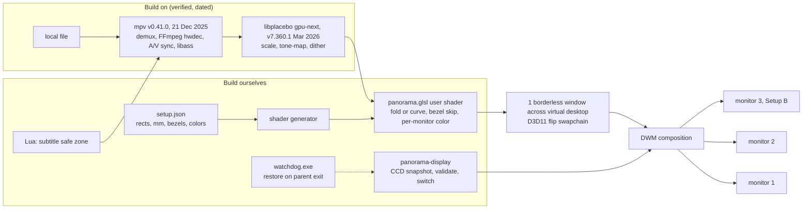

# Research Report: Windows rendering architecture and smooth multi-monitor playback

Timestamp: 2026-10-10, Asia/Bangkok (pass started 18:46). Web budget: 5/5 calls used, 0 left.

## Contents
1. Executive Summary
2. Research Methodology (+ evidence legend)
3. Key Findings: 1 Technology Overview | 2 Current State & Trends | 3 Best Practices | 4 Security | 5 Performance
4. Comparative Analysis
5. Implementation Recommendations (Quick Start, Code Examples, Common Pitfalls)
6. Recommendation for the concept demo
7. Resources & References
8. Appendix: Glossary
9. Unresolved questions

Answer map: Q1 -> KF1 | Q2 -> KF2.1-2.4, KF3.1 | Q3 -> KF2.5, KF3.2-3.3 | Q4 -> KF3.4-3.6 | Q5 -> section 6.

Evidence tags (used on every non-trivial claim):
- **[V]** verified this pass from a page I fetched.
- **[S]** community / search-snippet only, not opened or opinion-grade.
- **[K]** prior knowledge, NOT re-verified (5-call cap). Hypothesis until the spike list in section 6 closes it.
- **[D]** our derivation (arithmetic/reasoning), not sourced.

---

## Executive Summary

**Stack.** mpv v0.41.0 (tag 21 Dec 2025, year inferred; rolling dev builds stamped 2026-10-09) made the libplacebo-based `gpu-next` the default VO [V]. libplacebo v7.360.1 (13 Mar 2026, year inferred) is current with live D3D11/Vulkan/HDR fixes [V]. That pair is the SOTA open stack on Windows; madVR is closed and believed stalled, MPC-VR is DirectShow-bound, VLC 4 believed unreleased (all three NOT verified, search returned nothing) [K]. **libmpv is not a vehicle for per-monitor D3D11 passes**: its render API is OpenGL + software only, last API change 2.5 (mpv 0.40.0), no gpu-next/libplacebo mention [V]; so it likely still runs the legacy GL renderer [D].

**Presentation.** A window spanning outputs goes through DWM and one pacing clock. Mixed-refresh behaviour is documented only by community: older Windows 10 = slowest monitor wins, Windows 10 2004+ = fastest wins, Windows 11 24H2 = one user still sees cross-monitor coupling, Microsoft previewed per-display independent refresh (GA unconfirmed) [S]. Official Microsoft docs on spanning behaviour: not found. Therefore: demo = unify refresh rates (ADR 0005) + one spanning window; product = one flip-model window per monitor, per-monitor vblank-aware frame pick, render on the adapter that owns the output. Refresh switching: dynamic (non-persisted) change + out-of-process watchdog + dirty snapshot on disk; use CCD (SetDisplayConfig) for exact rational rates because legacy `DEVMODE` is integer Hz [K].

**Demo call.** Stock mpv v0.41.0 + generated user shader (fold/curve + bezel skip + per-monitor color) + our display manager/watchdog + subtitle safe-zone script. Product (provisional, needs 1 spike): in-tree `vo_panorama` on libplacebo (mpv fork) > own libplacebo+FFmpeg shell > libmpv-GL host (reject). Most Windows API/DXGI claims are [K] because the cap was spent on version/currency checks; section 6 lists the cheap measurements that close them.

---

## Research Methodology

Calls (all five used):
1. WebFetch `github.com/mpv-player/mpv/releases` -> versions, dates, 0.41.0 notes.
2. WebFetch `github.com/haasn/libplacebo/releases` -> versions, dates, D3D11/Vulkan/HDR notes.
3. WebSearch (extended): DWM spanning window / mixed refresh / independent flip / hybrid cross-adapter / VRR windowed. Returned community posts only; no Microsoft doc; flip-model and hybrid parts unanswered.
4. WebSearch (extended): anime upscaling + madVR + MPC-VR + VLC 4 + libmpv. Did NOT fan out: only anime results (low-grade SEO + community builds).
5. WebFetch raw `mpv/DOCS/client-api-changes.rst` -> libmpv render API history.

Date range: releases 2024-2026; search results undated. GitHub list pages print day+month only; years inferred from ordering against today (2026-10-10).
Key terms: mpv gpu-next 0.41, libplacebo release, libmpv render API, DWM mixed refresh rate, independent flip, hybrid iGPU/dGPU, VRR windowed, ArtCNN, Anime4K, AnimeJaNai, madVR, MPC Video Renderer, VLC 4.
Not covered (budget): Microsoft Learn pages (DXGI flip model, CCD, ChangeDisplaySettingsEx), PresentMon docs, libplacebo shader docs, FFmpeg/libass releases, madVR/MPC-VR/VLC status, anime upscaler repos, any hands-on measurement. Single-source warning: nearly every [V] item rests on one primary page; cross-check was impossible within the cap.

---

## Key Findings

### 1. Technology Overview (Q1)

**1.1 Verdict.** mpv + libplacebo is the stack. Nothing else I know combines open source + maintained + SOTA scalers/HDR/dither + user-shader hooks + libass + D3D11/Vulkan + hwdec. Everything else is closed (madVR), DirectShow-bound (MPC-VR), unreleased (VLC 4), or OpenGL-only when embedded (libmpv).

**1.2 Component register** (build-on candidates)

| Component | Version / date | Source | Status flag | License |
|---|---|---|---|---|
| mpv | v0.41.0, 21 Dec 2025 (year inferred). Earlier: v0.40.0 25 Mar 2025, v0.39.0 23 Sep 2024. Rolling `git-release` pre-release, page stamp 2026-10-09, Windows full + Clang builds | [V] GitHub releases | MAINTAINED (no tag for ~9.5 months but dev builds current) | GPL default; LGPL via `-Dgpl=false`; page says Windows libmpv GPL builds = GPLv3, LGPL builds = LGPLv3 [V] |
| libplacebo | v7.360.1, 13 Mar 2026 (inferred). v7.360.0 11 Feb 2026, v7.351.0 21 May 2025, v7.349.0 02 Jul 2024 | [V] GitHub releases | MAINTAINED, sparse tags (4 tags in ~20 months); mpv tracks git; pin by commit. mpv 0.41 needs >= 6.338.2 [V] | LGPL-2.1+ [K] |
| libmpv render API | client API 2.5 (mpv 0.40.0) last change; OpenGL + SW only | [V] client-api-changes.rst | STABLE but GL-only; legacy-renderer risk [D] | follows mpv build |
| FFmpeg / libass (bundled in mpv builds) | versions not verified | n/a | [K] | LGPL/GPL mix / ISC [K] |
| Windows DXGI flip model, CCD API, ChangeDisplaySettingsEx | OS-provided (dev PC: Win11 26200) | [K] | OS-maintained; ChangeDisplaySettingsEx = legacy but supported [K] | n/a |
| Anime4K / ArtCNN / AnimeJaNai | versions/dates not verified | [S] | unknown; Anime4K believed stalled [K] | check each before bundling |

**1.3 What changed recently [V]**
- mpv 0.41.0: "libplacebo based `gpu-next` is now the default, instead of `gpu`"; "vo: prefer vo_gpu_next over vo_gpu by default"; vo_gpu remains fallback. Min libplacebo 6.338.2. "Vulkan hardware decoding is preferred over other APIs"; non-copy hwdec before -copy; `--hwdec-threads`. d3d11 composition mode support; `--wid` runtime change handling; helpers to register mpv as a media app on Windows. HDR: `--hdr-reference-white`, subtitle-peak option for HDR output, ICC profile colorspace now respected over metadata, `--target-colorspace-hint` default `auto`. Subs: libass caching options (glyph-limit, bitmap-max-size), `--sub-fix-timing`, `blend-subtitles=video` in gpu-next. Manual redraws capped near display fps.
- libplacebo: 7.360.1 = Vulkan deferred-alloc off on Nvidia + MoltenVK timeline-semaphore workaround, GL sync leak fix. 7.360.0 = D3D11 swapchain `{alpha,color}_bits`, fix SDR output in HDR mode on Windows, `VK_KHR_swapchain_maintenance1`, overlays use source colorspace, BWDIF deinterlace, extended HLG gamma, YCgCo. 7.351.0 = `pl_d3d11_params.no_compute`, libav Vulkan interop needs lavu >= 58.11.100 and Vulkan >= 1.2.175, `pl_cache_{set,get}_file()`, sinc preset radius 3 -> 2. Release notes are diffs: custom-shader hooks, ICC/3DLUT, tone/gamut mapping, film grain, scalers "not mentioned" (not absent; see [K] below).
- libmpv: render types = OpenGL (`render_gl.h`) + SW (added API 1.109, mpv 0.33.0). Pacing hooks exist: `MPV_RENDER_PARAM_ADVANCED_CONTROL`, `NEXT_FRAME_INFO`, `BLOCK_FOR_TARGET_TIME`, `SKIP_RENDERING` (API 1.101). Nothing on D3D11/DXGI/Vulkan/Metal/gpu-next/libplacebo. 0.41.0 notes mention no render-API change.
- [K] libplacebo capabilities relied on below: LGPL; D3D11 + Vulkan + GL backends; EWA scalers; tone/gamut mapping; ICC -> 3DLUT via lcms2; dither/deband/film grain; mpv-format custom shaders incl. `//!HOOK` stages up to OUTPUT, `//!PARAM`, `//!TEXTURE`.

**1.4 Windows hardware decode**

| Path | State | Tag |
|---|---|---|
| D3D11VA | Windows-native, vendor-neutral, zero-copy with D3D11 context; the safe default | [K] |
| Vulkan Video | mpv 0.41 prefers Vulkan hwdec [V]; needs Vulkan context, driver support, FFmpeg Vulkan hwaccel; per-GPU codec coverage on Windows not verified | [V] pref / [K] rest |
| NVDEC (CUDA) | NVIDIA-only, interop to GL/Vulkan/D3D11 | [K] |
| D3D12VA | not mentioned in 0.41 notes [V]; FFmpeg hwaccel exists [K]; mpv support unverified | [K] |

Rule [D]: decode must run on the adapter that renders; on hybrid laptops pick adapter explicitly (`--d3d11-adapter` / Vulkan device option, names unverified).

**1.5 Subtitles.** libass inside mpv; 0.41 adds caching knobs and `blend-subtitles=video` [V]. Default `blend-subtitles=no` renders subs at output resolution after scaling (crisp, positioned in window space) [K]; keep it that way for panorama so text is never warped or resampled.

**1.6 Anime upscaling (weak evidence).** Anime4K = non-DL GLSL shader set, lightest, best on old low-res [S]. ArtCNN (Ani4Kv2, AniSD models) shipped in community mpv builds [S]. 2x_AnimeJaNai = real-time via mpv + TensorRT, NVIDIA-centric, heavy [S]. Vendor VSR (RTX VSR via `d3d11vpp`) [K, unverified]. No head-to-head benchmark found [S]; "best" is unproven, so treat as A/B by eye. Cost note [D]: NN shader upscalers run at SOURCE resolution (cost ~ source pixels, not canvas pixels); running them once per monitor view would multiply cost by N, so run once into an intermediate.

### 2. Current State & Trends

**2.1 One spanning window vs one window per display**

| Aspect | One borderless window spanning displays | One flip-model window per display |
|---|---|---|
| Present path | DWM composes; spanning behaviour not documented by Microsoft (not found) [S/K] | Each can be Independent Flip / MPO if it exactly covers its monitor with nothing above it [K]; confirm with PresentMon |
| Pacing clock | One. Other outputs sample the latest buffer at their own vblank | One per monitor (waitable swapchain) [K] |
| Mixed refresh | Coupled; cadence differs per monitor | Each monitor free to run its own multiple of content fps |
| VRR | Windowed VRR is a Win11 option, coupling reported [S] | Possible per monitor [K] |
| Hybrid GPU | DWM cross-adapter copy [K] | Render on owning adapter |
| Resampling | Canvas then per-monitor: double resample when PPI differs | Source -> each monitor's native grid: one resample |
| Effort | Zero extra with mpv | Custom renderer/presenter |
| Verdict | DEMO | PRODUCT |

DXGI facts relied on [K]: flip-model swapchains only (`FLIP_DISCARD/SEQUENTIAL`), never blt; 2-3 buffers; waitable object for pacing; `DXGI_PRESENT_ALLOW_TEARING` for VRR; borderless window exactly covering ONE monitor is the Independent Flip candidate; any overlay/topmost window above it can force composed mode. PresentMon labels to look for: "Hardware: Independent Flip", "Hardware Composed: Independent Flip" (MPO), "Composed: Flip".

**2.2 DWM and mixed refresh rates: evidence is community-grade and conflicting [S]**
- Older Windows 10: DWM composes monitors together; faster monitor dragged down to slower; micro-stutter (Tom's Hardware thread, Joltfly, Microsoft Q&A).
- Windows 10 2004: reported change so DWM syncs to the FASTEST monitor (Notebookcheck headline "Windows 10 2004 finally gets multi-monitor refresh rates right").
- Windows 11 24H2: a Blur Busters user still sees fps on a side monitor affected by a VRR game on the main monitor (one anecdote).
- Microsoft previewed independent per-display refresh in Insider builds (TechRadar); GA/build unknown.
- Independent flip bypasses DWM for presentation (forum claim); no official statement on multi-monitor found.
Conflict resolved how: assume the worst (coupling), unify rates for the demo, measure on Setup A/B.

**2.3 VRR.** Win11 "Optimizations for windowed games" + VRR setting make windowed flip-model apps VRR-eligible [K]. For video it is the cleanest cure for 23.976/24/25/30 fps on a VRR-capable panel (present at PTS) but: panel VRR ranges/LFC differ per monitor, laptop panel may lack VRR, VA/OLED brightness flicker at low rates [K]; independent VRR monitors still run unsynchronized [D]. Hypothesis to A/B, not a plan.

**2.4 Hybrid laptops (Setup A)** [K unless noted]
- Typical wiring: internal panel on iGPU (unless MUX/Advanced Optimus puts it on dGPU); HDMI/DP ports on dGPU or iGPU depending on model; USB-C varies. Read it per machine with DXGI `EnumAdapters1` + `EnumOutputs`.
- Windows lets a window span adapters; DWM copies across. Per-app GPU preference (Settings > Graphics) chooses the RENDER adapter, not the DISPLAY adapter.
- Options: (a) accept the copy (demo); (b) per-adapter renderers, each decoding for its own outputs (2x decode power) or sharing frames via cross-adapter textures (D3D11 sharing is limited); (c) MUX switch to dGPU-only if the laptop has it (user-side).
- Copy cost [D]: a 2560x1600 4-byte slice = 16.4 MB/frame = ~1.0 GB/s at 60 Hz. Bandwidth is not the issue; jitter and lost flip/VRR are.

**2.5 Refresh-rate switching APIs (Q3)** [K, MS Learn pages not fetched]

| API | Scope | Persistence | Precision | Notes |
|---|---|---|---|---|
| `ChangeDisplaySettingsEx(W)` | per device | `CDS_UPDATEREGISTRY` persists; flags 0 / `CDS_FULLSCREEN` = dynamic; `(dev, NULL, NULL, 0, NULL)` returns to registry mode | integer Hz (`dmDisplayFrequency`): 59.94 vs 60 and 23.976 vs 24 ambiguous | simple, proven by players; one modeset per monitor; `CDS_NORESET` batching only works with `CDS_UPDATEREGISTRY`, i.e. persists |
| CCD `QueryDisplayConfig` / `SetDisplayConfig` | all active paths in ONE call | `SDC_SAVE_TO_DATABASE` persists; omit for temporary (verify) | rational num/den | recommended; `SDC_VALIDATE` dry run; fewer black flashes |
| DXGI exclusive fullscreen mode switch | per swapchain | OS reverts when app dies (reported) | integer-ish | legacy; fights borderless/flip, bad for N monitors |
| Vendor APIs / CRU custom timings | vendor | n/a | n/a | avoid in app; CRU is a user-side tool for 23.976 modes |

**2.6 Trends [V unless noted]:** gpu-next default (old vo=gpu now fallback); Vulkan hwdec preferred; HDR plumbing active (D3D11 SDR-in-HDR fix, `target-colorspace-hint=auto`); libplacebo keeps MoltenVK fixes, which is the macOS portability signal; Microsoft working on per-display refresh [S]; libmpv render API frozen at OpenGL/SW.

### 3. Best Practices

**3.1 Frame pacing and sync across displays (Q2)**

Cadence arithmetic [D] ("=" integer repeat, "~" uneven/judder):

| Content fps | 60 Hz | 120 | 144 | 165 | 240 | 50 | 100 |
|---|---|---|---|---|---|---|---|
| 23.976 / 24 | 2.5 ~ | 5 = | 6 = | 6.875 ~ | 10 = | 2.08 ~ | 4.17 ~ |
| 25 | 2.4 ~ | 4.8 ~ | 5.76 ~ | 6.6 ~ | 9.6 ~ | 2 = | 4 = |
| 29.97 / 30 | 2 = | 4 = | 4.8 ~ | 5.5 ~ | 8 = | 1.67 ~ | 3.33 ~ |
| 59.94 / 60 | 1 = | 2 = | 2.4 ~ | 2.75 ~ | 4 = | n/a | 1.67 ~ |

- 23.976 vs 24: a 24.000-clocked mode shows 23.976 content with a repeated frame every ~41.7 s (0.1% drift) unless audio-speed resampling (mpv `display-resample`, [K]) absorbs it. That mechanism follows ONE reference display; other monitors drift against it [D].
- Inter-display skew with no genlock [D]: the same frame appears on each monitor at its next vblank, so skew <= one refresh interval: 16.7 ms @60, 8.3 @120, 6.9 @144, 4.2 @240. Vendor genlock/frame-lock is a pro-card feature; consumer path: none [K].
- Rules [D]: (1) one master clock (audio) and one PTS timeline for all views; (2) per monitor, pick the frame whose PTS covers THAT monitor's vblank (not "latest decoded"); (3) track each output's vblank phase continuously (clock drift moves it) and, for equal-rate pairs, choose vblanks that put skew <= T/2; (4) calibrate per-monitor display latency (panel lag differences of tens of ms between a gaming monitor and a TV-like/laptop panel can exceed vblank skew); (5) optional temporal blend at each monitor's vblank (mpv-style interpolation) trades judder for blur. All are hypotheses to A/B on a bezel-crossing pan.

**3.2 Picking a rate across mismatched monitors (Q3)** [D]
1. Inputs: content fps f; per active output i the mode list at its current resolution (do not change resolution).
2. Spanning-window architecture: candidates = intersection of all lists. Per-monitor architecture: each monitor picks its own rate; the ONLY requirement is R_i ~ integer x f (e.g. 120 and 144 are both perfect for 24p).
3. Score = distance of R/f from an integer (0 = perfect; <= ~0.1% drift is absorbable by audio-speed resample on the reference display), then prefer HIGHER R (smaller skew), then avoid modes the GPU/link cannot sustain at the canvas size.
4. Use exact rationals (CCD) to tell 59.94 from 60 and 119.88 from 120 [K].
5. No acceptable candidate (e.g. 60 Hz-only office monitor + 24p) -> leave rates alone, enable interpolation/VRR, tell the user. Never switch resolution.
6. Laptop panels with Windows 11 Dynamic Refresh Rate may retime themselves mid-playback; pin a fixed rate [K].

**3.3 Safe restore after crash (ADR 0005)** [D design on [K] API semantics]
1. Before any change: `QueryDisplayConfig(ACTIVE_PATHS)` + persisted registry mode per device -> write `%LOCALAPPDATA%\panorama\display-snapshot.json` with `dirty:true`, display identity (adapter LUID + target id, fallback EDID hash), position, size, rate.
2. Validate (`SDC_VALIDATE` / `CDS_TEST`), then apply NON-persistently (no `CDS_UPDATEREGISTRY`, no `SDC_SAVE_TO_DATABASE`). Registry/database keep the user's original mode, so logoff/reboot self-heals.
3. Spawn a separate watchdog process (not a thread; not in a kill-on-close job) that waits on the player PID and restores the snapshot if `dirty`.
4. Clean exit: restore, `dirty:false`, stop watchdog.
5. Every start: if a dirty snapshot exists, restore first (covers watchdog killed, power loss).
6. On `WM_DISPLAYCHANGE` from someone else (hot-plug, Win+P), do not blindly replay a stale snapshot: restore only displays whose identity still exists and whose current mode equals what we applied.
7. User-visible panic path (tray/hotkey) + auto-revert if playback did not start within N seconds, mirroring Windows' own confirm dialog.
Unverified and must be tested on Win11 26200: does a hard kill leave the dynamic mode in place (expected yes), and does anything auto-revert?

**3.4 Where warps and per-monitor color go (Q4)**

| Option | Verdict | Why |
|---|---|---|
| mpv/libplacebo user shader on one canvas (`//!HOOK OUTPUT`, or MAIN with `//!WIDTH/HEIGHT`) | DEMO | zero custom code; region-dependent matrix/LUT inside the shader; generate GLSL from setup.json (no runtime params needed) |
| libplacebo direct: one `pl_render_image` per monitor with its own crop, target, color params, hooks | PRODUCT | one scaling pass source -> each monitor's native pixels (the monitors partition the canvas, so total pixels = one canvas pass [D]); per-monitor `pl_frame` color/HDR; ICC -> 3DLUT [K] |
| libmpv render API into GL FBO, then per-monitor passes | REJECT | OpenGL/SW only [V]; GL<->D3D11 flip presentation needs interop (WGL_NV_DX_interop2 or ANGLE) [K]; probably legacy renderer [D] |
| render-to-texture then per-monitor passes (generic) | OK only when upstream is oversampled | double resample when PPI ratios are far from 1 [D] |
| N mpv instances + IPC sync | REJECT | frame-exact sync across processes not achievable; breaks the illusion [D] |

Rules [D]: scale ONCE, from source to each monitor's native pixel grid, geometry in the same pass; fold = per-monitor crop+scale (affine), curve = per-pixel UV map; color correction last, in linear light, then dither (check that mpv/libplacebo dithers AFTER the OUTPUT hook, otherwise 8-bit banding in dark scenes); run source-resolution NN shaders once into an intermediate. mpv's `icc-profile-auto` follows one display, so a spanning window needs our own per-region correction [K]. Hardware-side matching via DDC/CI (Monitor Configuration API: brightness, contrast, RGB gain) avoids bit-depth loss; laptop panels usually lack it [K].

**3.5 Mixed DPI and HDR/SDR per display**
- Per-Monitor V2 awareness; work in physical pixels from the virtual desktop; ignore `WM_DPICHANGED` suggested rects for the video window; size swapchains in raw pixels. EDID physical size can be wrong: allow manual mm override [K/D]. For the demo, set 100% scaling on all monitors to remove the variable [D].
- HDR is per display in Windows and per swapchain in DXGI [K]. A spanning swapchain with mixed HDR/SDR monitors: behaviour unverified. Demo in SDR with HDR off on all monitors; set `target-colorspace-hint=no` (verify accepted values) so the auto default [V] cannot flip colorspace mid-run [D]. HDR comes with per-monitor swapchains later; libplacebo D3D11 HDR path is under active fixing [V].

**3.6 Subtitles never split by a bezel** [D on [K] options]
- Anchor dialogue wholly inside ONE monitor's usable pixels with margin; width <= monitor width minus bezel-adjacent margin; let libass wrap. With 2 monitors the canvas centre is the seam, so shift the anchor to the centre of one monitor (A/B which).
- Stock mpv levers: `--sub-pos`, `--sub-margin-x/y`, `--sub-scale`, `--sub-use-margins`, `--sub-ass-force-margins` (units are scaled pixels; verify). Keep `blend-subtitles=no` so subs stay crisp and outside the warp; confirm with a test file whether OUTPUT-hook warping touches OSD/subs (order not verified).
- Typeset signs and karaoke follow the picture and can cross a bezel; only dialogue is controllable. PGS/bitmap subs can be moved and scaled, not re-wrapped.
- Own renderer: libass at each monitor's pixel grid, drawn as a post-warp overlay (libplacebo overlay in target space).

### 4. Security Considerations
- Threat model: local files only (ADR 0004) but untrusted media (downloaded anime). Attack surface: FFmpeg demux/decode, hardware decoders (driver bugs), libass + embedded MKV fonts (FreeType). Keep bundled libs current; prefer official mpv builds (the official release page lists Windows builds [V]) over unknown third-party packs; verify hashes.
- Display changes can leave the user with an unusable screen: validate first, non-persistent apply, watchdog, dirty snapshot, auto-revert. No admin rights needed for mode changes [K]; do not request them.
- Snapshot/IPC: schema-validate the snapshot, never execute anything from it; mpv's JSON IPC pipe (`--input-ipc-server`) accepts commands including `run`, so keep the pipe user-only [K].
- Shaders: only load shipped, reviewed GLSL; a bad shader can hang the GPU (TDR) [K]. Do not auto-download shaders or models.
- Licensing is also a compliance risk, see section 6.

### 5. Performance Insights
- Pixel budgets [D]: 3x1080p = 6.2 Mpx; 3x1440p = 11.1 Mpx; 3x4K = 24.9 Mpx per frame. At 4 B/px: 24.9 / 44.2 / 99.5 MB per frame; at 24 fps = 0.6 / 1.1 / 2.4 GB/s, at 60 Hz = 1.5 / 2.7 / 6.0 GB/s. Trivial for dGPU VRAM, heavy for an iGPU running EWA scalers at 24.9 Mpx.
- Per-monitor `pl_render_image` costs the same total scaling pixels as one canvas pass [D]; only source-resolution stages (deband, chroma upsample, NN upscale) duplicate N times unless factored out.
- Spanning window cost: DWM composition plus possible cross-adapter copy; irrelevant for latency (A/V offset is calibrated) but relevant for jitter [D]. Measure, do not guess.
- Skew bound by refresh listed in KF3.1; panel latency spread is the larger unknown.
- Measure with: mpv stats page (drops, vsync jitter), PresentMon present mode per window, slow-motion phone video of a moving test pattern crossing the bezel [K/D].

---

## Comparative Analysis

**A. Architectures** (effort = relative judgment, no durations)

| Option | SOTA quality | Per-monitor scale/warp | Present/pacing control | Hybrid GPU | Effort demo / product | License | macOS path | Risk | Verdict |
|---|---|---|---|---|---|---|---|---|---|
| A. stock mpv 0.41 + user shader, spanning window | yes [V] | one canvas, double resample if PPI differs | none (DWM) | DWM copy | Low / n.a. | process boundary keeps our code free; GPL mpv | mpv runs on macOS (`macvk` [K]) | low | **DEMO** |
| C. in-tree `vo_panorama` (mpv fork, owns N windows, built from vo_gpu_next ideas) | yes | best | full | per-adapter feasible | n.a. / Med-High | GPL-2+ or LGPL build [V partial] | yes, port window layer | medium: rebase cost; mpv VO internals NOT read this pass | **PRODUCT #1 (provisional)** |
| B. own shell: libplacebo + FFmpeg + libass + WASAPI | yes [V] | best | full | full | n.a. / High (hwdec interop, A/V sync, UI, seeking) | LGPL deps, own license | yes (MoltenVK fixes [V]) | medium-high: scope | **PRODUCT #2** |
| D. libmpv GL host + per-monitor passes | probably legacy renderer [D] | OK | partial: advanced-control API [V] | GL interop pain | Med / Med | libmpv LGPL possible [V partial] | yes | GL-only, legacy exposure | **REJECT** unless render API gains D3D11/Vulkan |
| E. N mpv instances + IPC sync | yes | good per instance | +-1 frame at best [D] | easy | Low / n.a. | n.a. | n.a. | breaks illusion | **REJECT** (last-resort demo hack) |

**B. Other players** (none verified this pass)

| Option | What I know [K] | Flag | Verdict |
|---|---|---|---|
| madVR | closed-source DirectShow renderer, historically best image quality, cannot be bundled; last public build I know is 0.92.17; no 2025-26 evidence found | CLOSED, believed STALLED | reject: no hooks for multi-monitor geometry, no redistribution |
| MPC Video Renderer / MPC-BE | open-source DirectShow renderer/player, actively developed as far as I know | likely MAINTAINED, status unverified | reject: DirectShow only, no libplacebo-class hooks |
| VLC 4 / libVLC | VLC 4.0 not released as stable at last knowledge; libVLC has embedding callbacks but 4.x unstable | NOT READY, unverified | reject for now |

---

## Implementation Recommendations

### Quick Start (demo)
1. Pin mpv v0.41.0 or the official Windows `git-release` build (stamp 2026-10-09 [V]); portable config dir; note its bundled FFmpeg/libass/libplacebo versions (`mpv --version`).
2. Pre-flight both setups by hand: same refresh on all monitors (highest common rate that is an integer multiple of the test clip's fps: 120/144/240 for 24p), 100% scaling, HDR off, Night Light off, auto-brightness and content-adaptive brightness off (laptop panel), same color preset, record each monitor's mode list.
3. Write `setup.json` (rects in virtual-desktop px, mm pitch, bezels, per-monitor color) -> generate `panorama.glsl` + `mpv.conf`.
4. Run; capture PresentMon + mpv stats; slow-mo video the bezel-crossing pan.
5. Run the A/B list in section 6; run the spike list to close the [K] items.

### Code Examples (skeletons; verify option names with `mpv --list-options`)

`mpv.conf`
```
vo=gpu-next                  # default since 0.41 [V]
gpu-api=d3d11                # A/B vulkan
hwdec=auto-safe              # A/B d3d11va, vulkan, nvdec
border=no
geometry=5760x1080+0+0       # virtual-desktop bounding box, physical px
glsl-shaders=~~/panorama.glsl
video-sync=display-resample
blend-subtitles=no
target-colorspace-hint=no    # demo is SDR
```

Shader skeleton (generated)
```glsl
//!HOOK OUTPUT
//!BIND HOOKED
//!DESC panorama map
vec4 hook() {
    vec2 px = HOOKED_pos * HOOKED_size;     // canvas px
    vec2 uv = map_to_source(px);            // generated: fold or curve, bezel skip
    return color_correct(HOOKED_tex(uv), monitor_index(px));
}
```

Display change (pseudo-code; flag combos from memory, check docs)
```
snap = QueryDisplayConfig(ACTIVE_PATHS); write snapshot.json {dirty:true}
pick R per 3.2; set path[i].target.refreshRate = {num,den}
SetDisplayConfig(.., VALIDATE | USE_SUPPLIED_CONFIG | ALLOW_CHANGES)   // dry run
SetDisplayConfig(.., APPLY    | USE_SUPPLIED_CONFIG | ALLOW_CHANGES)   // no SAVE_TO_DATABASE
spawn watchdog(pid, snapshot.json)
... playback ...
restore(snap); dirty:=false; stop watchdog
```

### Common Pitfalls
- Legacy `DEVMODE` Hz is an integer: 59.94 and 60, 23.976 and 24 collide [K]. Use CCD rationals.
- `CDS_UPDATEREGISTRY` / `SDC_SAVE_TO_DATABASE` make a crash permanent. Never use them for playback changes.
- Mode switches move windows and icons, retrigger `WM_DISPLAYCHANGE`, and can toggle HDR state: re-apply window geometry after the change settles [D].
- Windows 11 Dynamic Refresh Rate and laptop "change brightness based on content" / vendor power-saving (CABC) silently change the laptop panel; that is a brightness-mismatch source (illusion breaker #2) [K].
- `--fs` on mpv fullscreens ONE monitor; use a borderless geometry window [K]. `video-sync=display-resample` follows one display only [K].
- Per-app GPU preference decides render adapter, not display adapter. Check which adapter owns each output before blaming the renderer [K].
- Overlays (Game Bar, notifications, topmost windows, taskbar) can knock an exact-fit window out of Independent Flip [K].
- Third-party mpv builds are community packs; pin hash [D]. libplacebo tags are sparse: pin a commit [V cadence].
- EDID physical sizes are often rounded or wrong [K]; make mm overridable.
- Panel latency and clock differences are real and per-monitor; vblank sync alone will not align a pan [D].
- Anime upscaler shaders at source res cost the same however many monitors you have; per-monitor duplication triples it [D].

---

## Recommendation for the concept demo (Q5)

### Diagram: demo



### Diagram: product target (provisional)
```
file -> FFmpeg demux/decode (hwaccel on the adapter that owns the output) -> frame queue
        (PTS timeline, audio master clock)
             |                      |                      |
         view[0] mon 1          view[1] mon 2          view[N] mon N
   libplacebo pl_render_image: crop/warp (fold|curve) + color 3DLUT + libass overlay
   -> own flip-model window + swapchain; per-monitor vblank-aware frame pick
Cross-cutting: display manager (CCD switch + watchdog) | geometry model (fold/curve/bezels)
               | calibration store (per-monitor LUT) | latency table (per-monitor panel lag)
```

### (a) Build on (named, dated, verified)
- **mpv v0.41.0**, tag 21 Dec 2025 (year inferred); rolling official Windows `git-release` build, stamp 2026-10-09; MAINTAINED. Source: GitHub releases [V].
- **libplacebo v7.360.1**, 13 Mar 2026 (year inferred) via mpv's bundled copy; MAINTAINED with sparse tags. Source: GitHub releases [V].
- **Windows DXGI flip model, CCD API, PresentMon** as measurement/OS layer: [K], unfetched.
- Not building on: libmpv render API (OpenGL/SW only [V]), madVR, MPC-VR, VLC 4 (reasons in Comparative Analysis).

### (b) Build ourselves (demo)
1. `panorama-shader-gen`: setup.json -> GLSL (fold, curve, bezel skip, per-monitor 3x3+gamma or LUT) + mpv.conf. This IS the novelty; nothing existing does bezel-aware panoramic mapping.
2. `panorama-display`: enumeration (rects, mm, mode lists with rationals), rate chooser (KF3.2), validated non-persistent switch, snapshot, out-of-process watchdog (KF3.3). ADR 0005 demands it.
3. Subtitle safe-zone Lua script (KF3.6). Black-bar crop smoothing belongs to another researcher's topic.
4. Measurement harness: PresentMon capture + mpv stats + bezel-crossing test clips (face crossing bezel, slow pan, dark scene).

### (c) A/B by eye (ranked by illusion priority)
1. Fold vs smooth curve (already planned).
2. OUTPUT-hook warp (post-scale) vs MAIN-hook warp with in-shader Lanczos/Catmull-Rom: look at a face crossing a bezel and fine line art.
3. Unified high refresh (120/144/240) vs each monitor native/mixed: 24p slow pan across the seam (illusion #3).
4. `gpu-api=d3d11` vs `vulkan`, `hwdec=d3d11va` vs `vulkan`/`nvdec`: dropped frames, jitter, power on the hybrid laptop.
5. 24p at 60 Hz with interpolation vs 24p at 120 Hz native cadence.
6. Color: per-monitor 3x3+gamma vs 3D LUT vs DDC/CI hardware match; check dark gradients for banding (illusion #2).
7. Subtitle anchor: centre monitor vs seam-avoiding offset.
8. Anime upscale: none vs Anime4K vs ArtCNN (vs RTX VSR) on 480p/720p/1080p sources at panorama scale.
Deferred (needs custom renderer): spanning window vs per-monitor windows.

### (d) Spike list that closes the [K] gaps (each cheap)
- S1 PresentMon on the spanning mpv window, Setup A and B: present mode per output; does any output reach Independent Flip/MPO?
- S2 Mixed vs unified refresh: same clip, mpv stats + slow-mo camera.
- S3 `ChangeDisplaySettingsEx` (dynamic) and CCD (no SAVE flag): kill -9 the player on Win11 26200, see whether the mode persists; test `(NULL,NULL,NULL,0,NULL)` restore.
- S4 CCD dump of exact rationals for each monitor: do 59.94/119.88/23.976 appear, and as what?
- S5 Hybrid: adapter-to-output map on Setup A; GPU preference variants; cross-adapter jitter.
- S6 Hook order: does OUTPUT run before or after dither and subtitle overlay in gpu-next?
- S7 Read mpv `video/out/vo_libmpv.c` + `gpu/libmpv_gpu.c` (and the VO driver interface) to settle "legacy renderer" and to size the `vo_panorama` fork.
- S8 Read the mpv 0.41 "d3d11 composition mode" change: can a host obtain the swapchain/visual?
- S9 Per-monitor panel latency with a high-speed camera and a flashing pattern.

### (e) Post-demo ranking, license, macOS
- Rank [provisional, decide after S7]: 1) in-tree `vo_panorama` on libplacebo (reuses mpv's demux/audio/sync/hwdec/subs; avoids rewriting hwdec interop and A/V sync); 2) own libplacebo + FFmpeg shell (cleaner, much more code); 3) libmpv-GL host (reject unless libmpv gains D3D11/Vulkan and gpu-next); never N-instance.
- License: mpv GPL by default, LGPL with `-Dgpl=false` [V partial; Windows LGPL builds are LGPLv3 per page]. Using mpv as a separate process (CLI + shader + IPC) leaves our own code's license free; linking GPL libmpv or forking mpv makes that part GPL. libplacebo LGPL-2.1+, libass ISC, lcms2 MIT [K]. madVR cannot be bundled. Third-party shaders/models: check each license before shipping [S]. Advice: decide license after the demo, but keep display manager, geometry, and calibration code in modules with no GPL code so both options stay open [D].
- macOS later: libplacebo is portable (MoltenVK workarounds in 7.360.x [V]); mpv has a Vulkan-on-Metal context [K]; libass/FFmpeg portable. Windows-only to replace behind a thin "display + present" interface [D]: CCD/ChangeDisplaySettings -> CoreGraphics display modes; DWM/flip/PresentMon -> CAMetalLayer + display link; PMv2 -> backing scale; D3D11VA -> VideoToolbox. Apple Silicon removes the cross-adapter problem.

---

## Resources & References

Fetched this pass (primary):
- [mpv-player/mpv releases](https://github.com/mpv-player/mpv/releases), fetched 2026-10-10. v0.41.0 listed 21 Dec (2025 inferred); v0.40.0 25 Mar; v0.39.0 23 Sep; rolling `git-release`, build stamp 2026-10-09.
- [haasn/libplacebo releases](https://github.com/haasn/libplacebo/releases), fetched 2026-10-10. v7.360.1 13 Mar (2026 inferred); v7.360.0 11 Feb; v7.351.0 21 May; v7.349.0 02 Jul.
- [mpv DOCS/client-api-changes.rst](https://github.com/mpv-player/mpv/blob/master/DOCS/client-api-changes.rst) (raw master copy fetched 2026-10-10). Newest entry API 2.5 = mpv 0.40.0.

Search-result links (undated, snippet-level only, not opened):
- [Blur Busters: dual monitor different Hz](https://forums.blurbusters.com/viewtopic.php?t=13675)
- [Microsoft Q&A: mismatched refresh rates](https://learn.microsoft.com/en-us/answers/questions/5775476/mismatched-refresh-rates-issue)
- [Flaeri: DWM and mixed refresh rate performance](https://blog.otterbro.com/dwm-mixed-refresh-rate-performance/)
- [Notebookcheck: Windows 10 2004 multi-monitor refresh rates](https://www.notebookcheck.net/Windows-10-2004-20H1-finally-gets-multi-monitor-refresh-rates-right.454143.0.html)
- [TechRadar: Windows 11 multi-monitor independent refresh preview](https://www.techradar.com/computing/windows/love-your-multi-monitor-setup-windows-11-could-soon-make-it-even-better)
- [Tom's Hardware: multi-monitor different refresh stuttering](https://forums.tomshardware.com/threads/multiple-monitors-different-refresh-rates-stuttering-issue.3682772/)
- [wgpu issue 7663](https://github.com/gfx-rs/wgpu/issues/7663) (relevance not confirmed)
- [mpv anime build (Anime4K + ArtCNN)](https://chinna95p.github.io/mpv-anime-build/), [mpv for anime guide](https://kohana.fi/article/mpv-for-anime), [Anime4K + MPV how-to](https://jothiprasath.com/blog/mpv-anime4k-upscaling/)

Not fetched; read during the spikes (URLs from memory, may have moved):
- [DXGI flip model (MS Learn)](https://learn.microsoft.com/en-us/windows/win32/direct3ddxgi/for-best-performance--use-dxgi-flip-model)
- [ChangeDisplaySettingsExA (MS Learn)](https://learn.microsoft.com/en-us/windows/win32/api/winuser/nf-winuser-changedisplaysettingsexa)
- [SetDisplayConfig (MS Learn)](https://learn.microsoft.com/en-us/windows/win32/api/winuser/nf-winuser-setdisplayconfig)
- [PresentMon](https://github.com/GameTechDev/PresentMon)
- [mpv manual](https://mpv.io/manual/master/), [libplacebo docs](https://libplacebo.org/)

---

## Appendix: Glossary
- **DWM**: Desktop Window Manager, the Windows compositor.
- **Flip model**: DXGI swapchain mode where buffers are flipped rather than copied; prerequisite for direct/independent flip, MPO, tearing/VRR.
- **Independent Flip**: app buffers scanned out directly, DWM bypassed for that output.
- **MPO**: Multiplane Overlay, hardware overlay planes DWM can use instead of copying.
- **CCD**: Connecting and Configuring Displays API (`QueryDisplayConfig`, `SetDisplayConfig`).
- **VRR / LFC**: variable refresh rate / low-framerate compensation.
- **PTS**: presentation timestamp of a video frame.
- **gpu-next**: mpv's libplacebo-based VO. **libmpv**: mpv as an embeddable library. **render API**: libmpv's way to draw into a host-owned surface.
- **hwdec**: hardware decode path. **D3D11VA / NVDEC / Vulkan Video**: D3D11, NVIDIA, Vulkan decode APIs.
- **PMv2**: Per-Monitor V2 DPI awareness.
- **EWA**: elliptical weighted average resampling (high-quality scalers).
- **3DLUT**: 3D color lookup table. **CABC**: content-adaptive brightness control.
- **TDR**: Windows GPU timeout detection and recovery.
- **OUTPUT hook**: last mpv/libplacebo user-shader stage, after scaling/color management.

---

## Unresolved questions
1. Does Windows 11 25H2 / 26H1 ship per-display independent DWM refresh, which build, and does it cover a window spanning displays? (TechRadar preview unconfirmed.)
2. Can any output reach Independent Flip / MPO when a window spans several? No Microsoft source found.
3. Does libmpv's render context use the legacy GL renderer or gpu-next, and is a D3D11/Vulkan render API planned? (only inferred from the change log's silence).
4. mpv 0.41 "d3d11 composition mode": can a host obtain the swapchain/visual (embedding, DirectComposition)?
5. Exact semantics and crash behaviour of non-persistent mode changes (`CDS_FULLSCREEN`/flags 0, `SetDisplayConfig` without SAVE) on Win11 26200: auto-revert or not?
6. Do the author's monitors expose 59.94/119.88/23.976 as separate rationals; what is each monitor's VRR range; does the laptop panel use Dynamic Refresh Rate?
7. Hybrid wiring of Setup A: which adapter drives eDP and each external port; MUX available; measured cross-adapter jitter.
8. OUTPUT hook order relative to dither and subtitle overlays in gpu-next; effect on banding after our color pass.
9. Status 2025-26 of madVR, MPC Video Renderer/MPC-BE, VLC 4 (search returned nothing).
10. Anime upscaler currency: versions/dates/licenses of ArtCNN, Anime4K, AnimeJaNai; any independent benchmark; RTX VSR availability through mpv.
11. FFmpeg/libass versions in the official mpv Windows build; Vulkan Video decode coverage per vendor driver on Windows.
12. Mixed HDR/SDR monitors under one swapchain: DWM behaviour unknown.
13. How invasive is a `vo_panorama` VO inside mpv (window ownership, hwdec interop reuse, rebase cost)? Needs S7.
